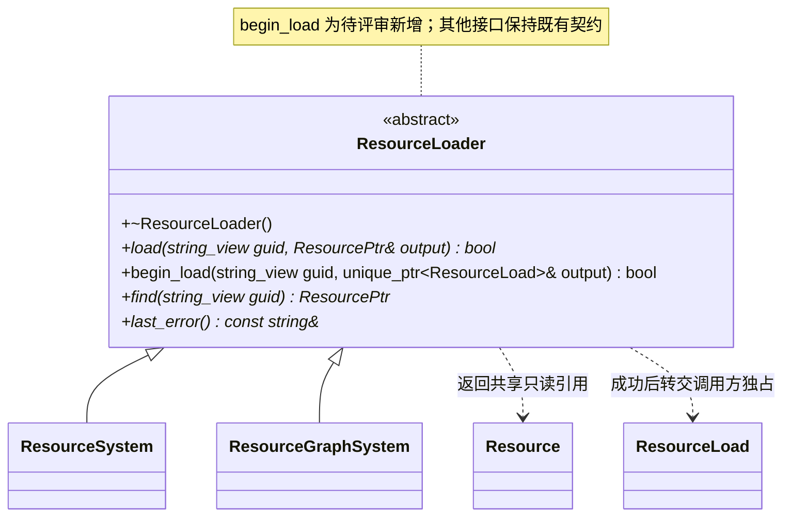
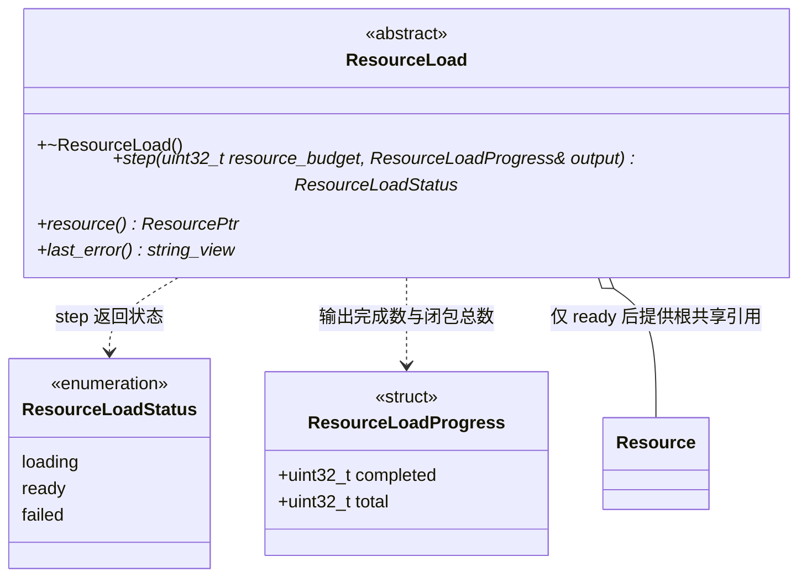

# 资源加载接口

[类图索引](../../class-diagrams/index.md) · [单项资源系统](resource-system.md) · [依赖图插件](../../plugins/runtime/class-diagrams/resource-graph.md)

- 接口归 `runtime/resource/`，不引用任何具体插件。虚析构为 noexcept；`find` 为 const noexcept，`last_error` 为 const noexcept；状态和查询标注 nodiscard。
- `load` 显式同步加载一个请求目标，失败清空输出；是否组合依赖由所选实现决定。
- `find` 只查询实现已缓存的当前代际对象，不触发文件读取。命中返回共享引用，未命中返回空；核心单项实现不缓存，始终返回空。
- `ResourcePtr` 是 `std::shared_ptr<const Resource>` 的别名。接口不引入异步队列、优先级、引用计数包装或编辑器身份。
- `last_error` 借用最近失败原因，随后操作可能改变其内容；返回状态仍是成功或失败的依据。

具体实现的公开契约分别维护在资源系统与资源依赖图插件图；此图只维护共同接口。

## 单线程分步操作（待评审）

本节及上图的 `begin_load` 是新增提案，尚未实现。既有 `load/find/last_error` 契约不变，`Scene.Load` 继续同步返回。新增能力只让调用方把一个目标资源的必要闭包分多帧推进；不创建后台线程、线程池、调度器、消息队列或通用资源预加载框架。

- `ResourceLoad`、`ResourceLoadStatus`、`ResourceLoadProgress` 归核心 `engine` 命名空间，只声明操作、状态与普通计数结构。具体依赖遍历和缓存策略仍归所选加载器；核心不引用 `resource_graph` 插件。
- `begin_load(guid, output)` 先清空输出，成功才转交一个尚未推进的操作，由调用方用 `unique_ptr` 独占。准备阶段只检查目标、目录代际并遍历本目标的目录元数据，不读取实体载荷。基础接口默认返回 false，表示该实现不提供分步能力；依赖图插件重写它。原有核心单项加载与 `Scene.Load` 不因此强制启用插件。
- 每个操作固定创建时的目录 generation 与目标 GUID，只覆盖当前目录明确声明的唯一必要资源闭包。loading 期间目录换代、源条目缺失或实体/依赖校验失败，将操作置为 `failed`，保留自身错误并释放候选引用，不能混读新旧代际。已经 ready 的操作保持完成状态和旧根引用，不再次发布缓存；场景提交方仍须核对 begin 时的 generation，拒绝向新代目录提交旧候选。
- `step(resource_budget, output)` 在调用线程执行。正预算限定本次最多完成多少个不同资源，命中同代缓存或完成读取、解码、依赖校验均计为一个完成项；同一 GUID 只计一次。预算 0 仅输出当前状态快照，不执行读取。返回时始终填写当前 `completed/total`；`total` 在创建成功后固定，`completed` 单调且不超过 `total`。
- 计数表示实际完成的资源项，不是耗时或字节百分比。同步读取/解码一个资源不可中途让出，预算不承诺毫秒上限；一次大资源仍可能占用较长一帧。调用方须主动每帧执行少量 step，并返回正常宿主循环，UI 才能刷新。
- `resource()` 为 `const noexcept`，返回标准 ResourcePtr 的共享副本；仅 `ready` 返回完整根资源，`loading/failed` 返回空。根引用保持完整必要依赖闭包，不能向调用方暴露半成品。
- `last_error()` 为 `const noexcept`，返回本操作保存的错误只读借用，不复用加载器可能被其他调用改变的错误缓冲。终态重复 step 保持原终态与计数；ready 时错误为空。
- 析构为公共虚析构且 `noexcept`：未完成时取消，释放本任务候选引用；ready 后正常释放其根引用，不强制卸载其他使用者仍持有的资源。操作不提供回调、自动推进或隐式提交。操作不可复制，全部方法及销毁由同一运行线程调用；借用的加载器与资源核心必须覆盖操作生命周期。状态和查询方法标注 `[[nodiscard]]`。

分步资源到达 ready 后，调用方保持该操作或复制的根 ResourcePtr，仍通过既有 `WorldSystem::load_scene(path)` 恢复并提交场景。WorldSystem 不增加公开方法。完整候选场景仍在一次同步调用中恢复，成功才替换活动场景；场景接管根引用后再释放本任务引用。

`Scene::restore_data` 和渲染器 GPU 准备是资源计数之外的独立同步阶段，不能伪装成按比例逐项完成。资源计数完成不等于画面就绪；整体 Ready 需由调用方在新场景首帧成功后确认。取消只在 step 调用之间及场景提交前生效，不能中断正在读取的单项资源或已开始的场景提交。

实现范围限于复用现有依赖图 DFS、标准 shared_ptr/weak_ptr 与单项读取接口，详见[插件提案](../../plugins/runtime/class-diagrams/resource-graph.md#单线程分步复用待评审)。不把编辑器 Taskflow 引入运行时；后续若接异步执行后端，再单独评审和复用成熟开源方案，本提案不预建该框架。
