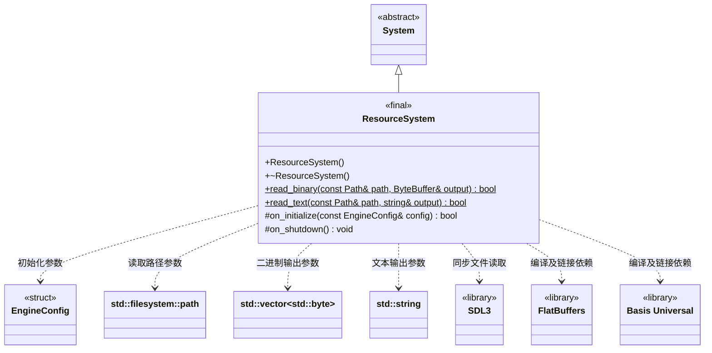

# 资源系统

[类图索引](../../class-diagrams/index.md) · [引擎与系统](engine-system.md) · [完整引用关系](../../class-diagrams/references.md)

状态：同步读取普通磁盘文件和 Android APK 内置资源；本图只定义 ResourceSystem，其他系统保持跨图引用。

- 由 Engine 拥有的根系统，先于世界和渲染初始化；保留 Basis Universal 转码表初始化和 FlatBuffers 解析入口的实际编译、链接验证。
- 两个静态读取方法不依赖系统、App 或引擎初始化，可由脚本、工具和 MCP 直接调用；Android APK 读取要求宿主已建立 SDL 的 Android Activity/JNI 环境。不新增通用文件包装类，不在静态读取中隐式创建 System 实例。
- 路径参数是 `std::filesystem::path`；传给 SDL 前转换为 UTF-8。图中 `ByteBuffer` 仅简写 `std::vector<std::byte>`，不是新增类型或包装。
- `read_binary()` 使用 SDL3 的路径检查与 `SDL_IOFromFile/GetIOSize/ReadIO/CloseIO` 同步读取普通文件；`read_text()` 复用相同读取路径，保留完整字节，不截断 NUL、不改换行、不删除 BOM，也不自动转码。
- 空文件成功并输出空内容。缺失、目录、设备等非普通文件、非法路径、过大文件、短读、读取期间长度变化或关闭失败均返回 `false`，输出保持为空；成功后输出由调用者拥有。
- 单次文件上限为 64 MiB，在分配内容缓冲区前检查；大资源的流式读取按后续实际需求增加。该限制不是对整套项目资源的限制。
- Android 接受 `apk:/assets/<相对文件路径>`，例如项目入口 `apk:/assets/project/scripts/game.js` 和 ICU 数据 `apk:/assets/v8/icudtl.dat`。先严格检查完整虚拟路径，再去掉 `apk:/assets/` 前缀，使用 SDL 文件流读取 APK；不对虚拟路径执行磁盘 stat，也不复制资源到可写目录。
- 虚拟文件路径拒绝空名、空分量、`.`、`..`、反斜杠、额外冒号及 NUL；不解码百分号、不规范化后再接受越界输入。非 Android 平台拒绝 `apk:` 路径，不把它当成本地同名文件。
- SDL 的 Android 文件入口会先尝试私有目录中的同名相对路径；资源系统核验流的 `SDL_PROP_IOSTREAM_ANDROID_AASSET_POINTER` 属性，只接受实际 APK 资源。若同名磁盘文件遮挡包资源则返回失败，不能把可写内容当成内置版本；正常同步版本使用独立的 `files/assets/versions/` 目录。
- 不重写 `on_tick()`，沿用基类默认空更新。静态读取与系统资源生命周期互不耦合。

返回状态的方法标注 `[[nodiscard]]`；构造、析构与关闭钩子保持 `noexcept`，覆盖方法标注 `override`。每个成功打开的 SDL 文件流均显式关闭，失败不遗留半成品输出。

Android 包验证需覆盖：包内项目入口和 ICU 可读、压缩及空资源可读、缺失和目录失败、非法虚拟路径失败且清空输出，以及人为建立同名私有文件后读取必须失败。脚本版本优先级和删除标记由 ScriptSystem 负责，资源读取不自行切换到持久版本。
