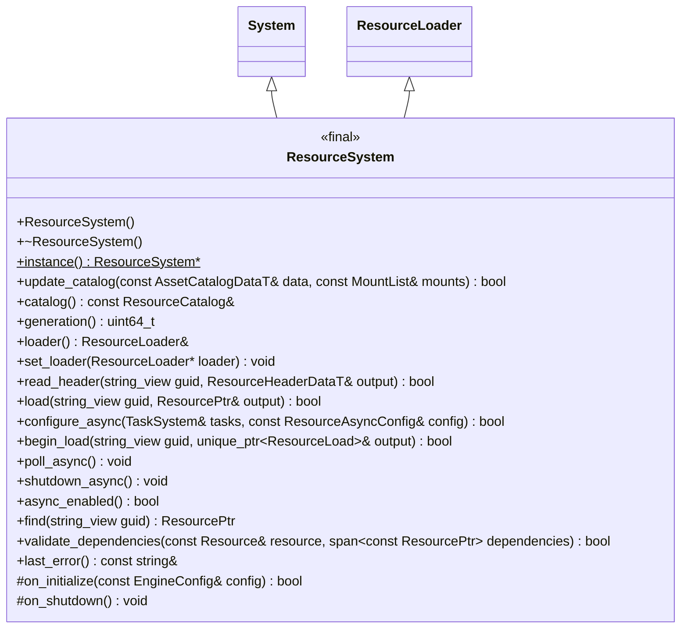
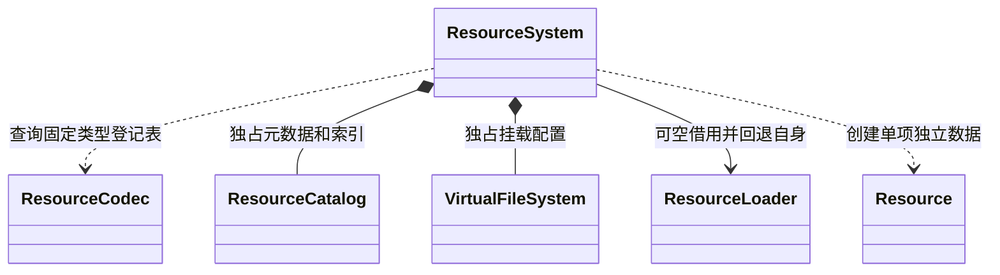
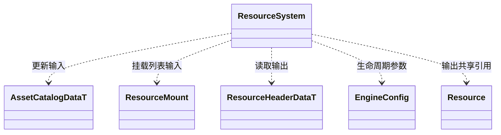
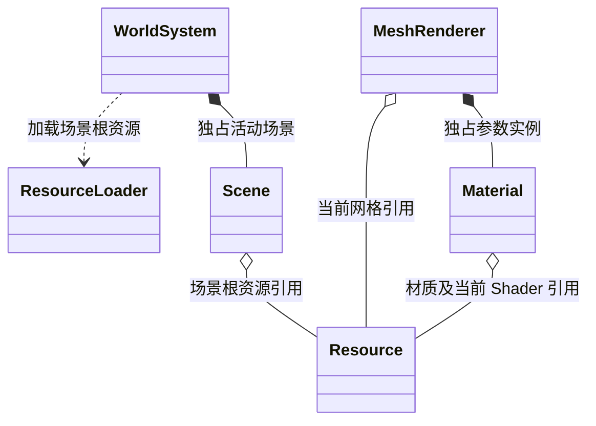
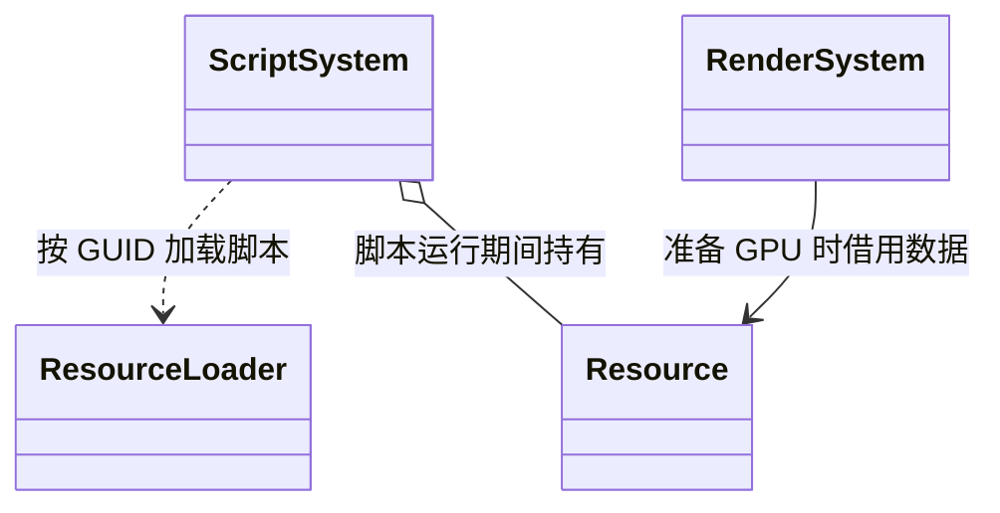
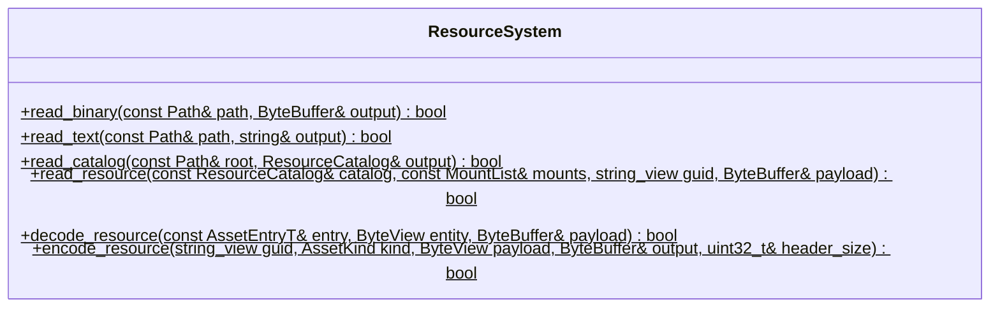
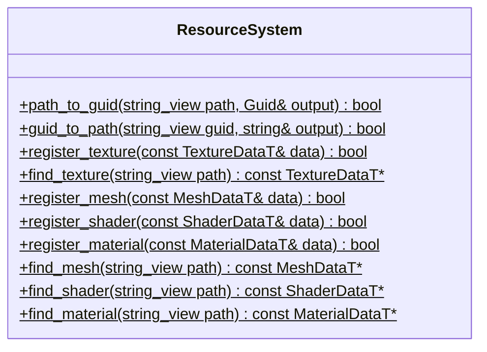
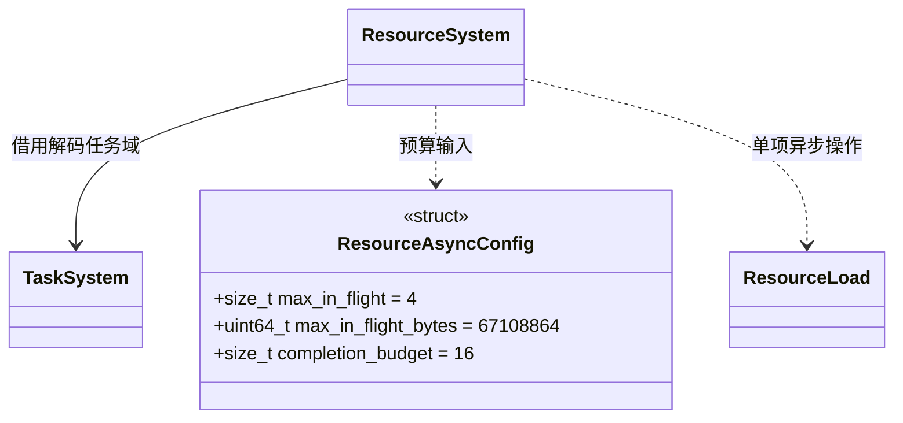

# 资源系统

[类图索引](../../class-diagrams/index.md) · [设计说明](../resource-loading.md) · [目录](resource-catalog.md) · [已加载资源](resource.md) · [文件访问](virtual-file-system.md)

资源核心提供元数据目录、单项同步或异步读取与加载接口选择；逐类型解码和契约校验由[资源解码器](resource-codecs.md)负责；依赖树和共享缓存由[运行时资源依赖图插件](../../plugins/runtime/class-diagrams/resource-graph.md)实现。使用方式见[资源加载](../resource-loading.md)。

## 核心接口

`ResourcePtr` 是 `std::shared_ptr<const Resource>` 别名，`MountList` 是 `std::vector<ResourceMount>`，不新增包装类。领域模块、编辑器与宿主借用同一资源根系统；不向 Engine 添加资源便利接口。

接口服从[调用方驱动核心](../../architecture.md#调用方驱动核心)的统一原则。目录更新不是编辑器专用机制；业务、编辑器和宿主可以在满足同一生命周期约束时调用，频率和流程均由调用方决定。

- `update_catalog()` 接收已解码的完整目录及部署挂载，校验唯一身份、运行平台、格式、位置和必要依赖，成功整体替换，失败保留旧索引。编辑器直接提交内存数据，真机宿主启动提交一次；核心无模式参数或自动更新策略。
- 合法 `update_catalog` 原子替换目录并递增代际，失败保留旧目录与代际。已有资源引用不阻止目录更新；旧对象拥有独立数据，依赖图插件继续保活其旧闭包。新加载只使用当前目录和挂载，不从旧代际回退。
- `catalog()` 返回只读借用。路径/GUID 转换继续使用目录内的 GuidMap，查询不触发 I/O 或增加引用。
- `read_header()` 按目录给出的头部长度读取实体头，校验身份、格式和边界；不读取载荷、不加载依赖。失败输出为空。建立目录无需逐个调用它。
- `load()` 只读取请求的单个资源，核心校验信封并按登记表交给对应 ResourceCodec 解码与类型校验；不递归加载依赖，不建立共享缓存，失败输出为空。`find()` 的核心实现返回空。
- `loader()` 返回宿主设置的加载器借用；未设置时返回本系统。`set_loader()` 接收可空借用，null 恢复单项实现；调用方负责实现对象有效期，核心不拥有或识别具体插件。
- `validate_dependencies()` 为 const 方法，统一检查提供的资源引用、当前代际与目录身份，再委派对应 ResourceCodec 校验跨实体契约，不读取文件、不存储依赖。依赖插件在完成候选加载后调用。
- `generation()` 为 const noexcept；成功加载的 Resource 记录其目录代际。旧引用保持有效，释放自己的 shared_ptr 即结束一次使用，不通过 GUID 强制销毁别人的对象。
- `last_error()` 是最近失败上下文的借用，下一次操作可能改变文本；状态以返回值为准。
- 目录更新、请求提交和结果发布在宿主协调线程执行。configure_async 借用已就绪 TaskSystem；请求固定目录快照和代际，文件传输由 SDL AsyncIO 执行，外置资源校验解码由任务域执行。poll_async 或系统 tick 只派发已完成文件事件，不等待。宿主先派发 TaskSystem 完成委托；shutdown_async 用于关闭边界，先使操作失效，再收尾 I/O 和任务后解除借用。借给运行宿主的资源系统必须在任务域关闭前调用它。目录换代或关闭使未完成操作失败，后台只持不可变输入和私有输出，不访问活动系统。
- ResourceAsyncConfig 的 max_in_flight、max_in_flight_bytes 限制读取及解码中的候选；completion_budget 限制每次文件结果派发。无物理位置的内置定义在协调线程复制，避免访问活动全局注册表的线程竞争。load 保持明确同步模式。

构造、析构与关闭钩子为 noexcept；钩子标注 override。状态和重要查询标注 nodiscard；catalog、generation、find、last_error 及依赖校验为 const，loader 返回可调用接口借用，为非 const noexcept。宿主先释放领域使用者再关闭资源系统；原 Basis Universal 初始化及依赖编译、链接职责保留。

## 所有权和参数依赖

## 领域使用者

领域模块按以下关系持有共享资源。公开方法在各自类图维护。

`o--` 表示持有共享所有权。候选场景失败时释放候选引用，保留旧场景。动态组件换资源先取得新引用再替换。GPU 创建和退役继续由 RenderSystem 管理，CPU 加载成功不等于 GPU 已就绪。

## 资源文件工具与内置初始化

文件工具不建立资源对象。`read_catalog` 只读元数据；`read_resource` 只校验并读取一个实体的载荷，供导入复用和候选脚本预检，不递归加载依赖。`encode_resource` 和 `decode_resource` 统一实体格式，避免编辑器、脚本或平台工具各自实现格式。失败输出为空。

`instance` 返回已初始化的单宿主根系统借用，未就绪时为空。身份转换只查询目录和固定内置映射。`register_*` 仅供引擎 bootstrap 初始化，允许引擎无项目启动。`load()` 对有物理位置的条目一律读取当前挂载并校验实体，包括 `builtin://`；损坏或缺失时返回失败，不回退编入定义。只有无物理位置的固定内置条目才使用 bootstrap 定义。

`register_*` 对完全相同的定义重复登记返回成功，已有路径的不同数据或跨类型冲突返回失败；注册校验仅使用 bootstrap 表，不查询活动目录或加载器。

`find_*` 对已外置条目只查询所选加载器的当前代际对象；未外置的内置定义查询 bootstrap 注册表。查询不执行 I/O、不增加常驻引用；从加载器借用的数据必须由调用方持有的 ResourcePtr 保活。普通逻辑路径不附加 `project/`，编辑器专属 `editor://` 不进入运行目录。

内置资源的固定身份、类型和依赖通过 `builtin_resource_catalog()` / `builtin_resource_info(guid)` 提供给核心与构建模块；它们不依赖渲染设备初始化，也不复制宿主平台的 Shader 字节码到其他平台。

贴图由 TextureDataT 保存 CPU 缓存；register_texture/find_texture 服从相同的 builtin 注册与项目借用规则。Shader 默认贴图、材质覆盖贴图必须存在于直接依赖集合，类型、路径和 GUID 一致。缓存先校验 FlatBuffers、Basis 文件校验和、尺寸与 mip 元数据；渲染模块负责设备格式及实际转码，资源系统不创建 GPU 对象。

`builtin_resource_payload(guid, output)` 是与 `builtin_resource_catalog()` 同级的自由函数：无需系统、窗口或 GPU 初始化，按固定 GUID 序列化引擎自带定义为对应 FlatBuffers 载荷；失败清空 `ByteBuffer`。它与启动备用定义共用构造，不读取活动项目的注册表。编辑器资源构建负责将 Shader 替换成目标平台字节码，再通过 `encode_resource()` 写出实体；该函数不承担平台选择、文件布局或打包策略。

