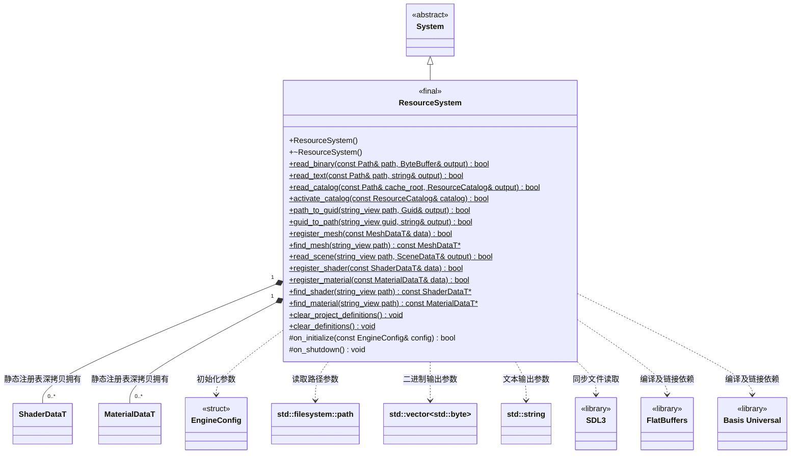
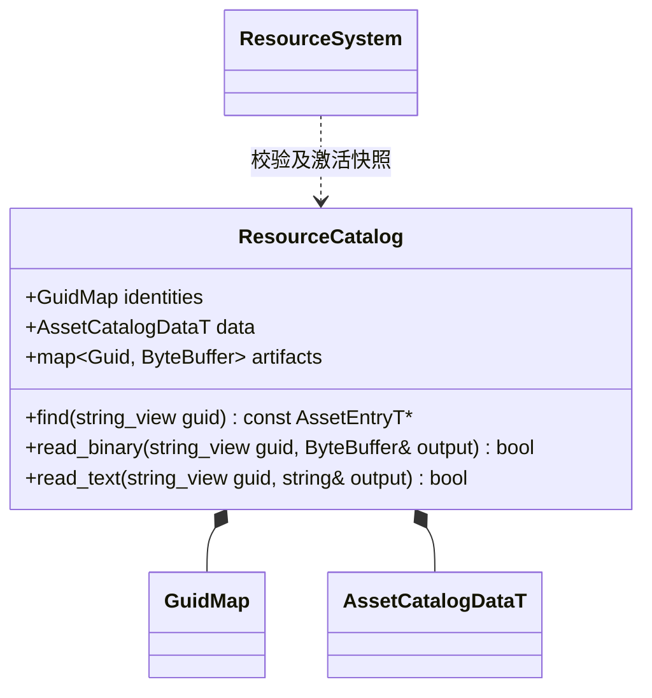

# 资源系统

[类图索引](../../class-diagrams/index.md) · [引擎与系统](engine-system.md) · [完整引用关系](../../class-diagrams/references.md)

同步文件读取、按唯一路径注册和查询 Shader / 材质生成数据。文件读取和定义注册互相独立，项目定义从 GUID 二进制缓存加载，内置定义由引擎注册。

- 由 Engine 拥有的根系统，先于世界和渲染初始化；保留 Basis Universal 转码表初始化和 FlatBuffers 解析入口的实际编译、链接验证。
- 两个静态读取方法不依赖系统、App 或引擎初始化，可由脚本、工具和 MCP 直接调用；Android APK 读取要求宿主已建立 SDL 的 Android Activity/JNI 环境。不新增通用文件包装类，不在静态读取中隐式创建 System 实例。
- 路径参数是 `std::filesystem::path`；传给 SDL 前转换为 UTF-8。图中 `ByteBuffer` 仅简写 `std::vector<std::byte>`，不是新增类型或包装。
- `read_binary()` 使用 SDL3 的路径检查与 `SDL_IOFromFile/GetIOSize/ReadIO/CloseIO` 同步读取普通文件；`read_text()` 复用相同读取路径，保留完整字节，不截断 NUL、不改换行、不删除 BOM，也不自动转码。
- 空文件成功并输出空内容。缺失、目录、设备等非普通文件、非法路径、过大文件、短读、读取期间长度变化或关闭失败均返回 `false`，输出保持为空；成功后输出由调用者拥有。
- 单次文件上限为 64 MiB，在分配内容缓冲区前检查；尚未提供流式读取接口。该限制不是对整套项目资源的限制。
- Android 接受 `apk:/assets/<相对文件路径>`，例如项目入口 `apk:/assets/project/scripts/game.js` 和 ICU 数据 `apk:/assets/v8/icudtl.dat`。先严格检查完整虚拟路径，再去掉 `apk:/assets/` 前缀，使用 SDL 文件流读取 APK；不对虚拟路径执行磁盘 stat，也不复制资源到可写目录。
- 虚拟文件路径拒绝空名、空分量、`.`、`..`、反斜杠、额外冒号及 NUL；不解码百分号、不规范化后再接受越界输入。非 Android 平台拒绝 `apk:` 路径，不把它当成本地同名文件。
- SDL 的 Android 文件入口会先尝试私有目录中的同名相对路径；资源系统核验流的 `SDL_PROP_IOSTREAM_ANDROID_AASSET_POINTER` 属性，只接受实际 APK 资源。若同名磁盘文件遮挡包资源则返回失败，不能把可写内容当成内置版本；正常同步版本使用独立的 `files/assets/versions/` 目录。
- 注册、查询与清理在引擎主线程执行。整个宿主仅允许一个已初始化 ResourceSystem 管理定义生命周期，第二实例初始化返回 false；静态文件读取仍可独立使用。
- 完整路径必须以 `builtin/` 或 `project/` 开头，分别表示引擎内置和项目资源；来源就是身份的一部分，不另存来源字段。同一相对名字可在两个空间独立存在。同一完整路径在 Shader 与材质之间唯一，重复注册一律拒绝，不替换已有对象。路径须规范，拒绝空值、缺少或未知来源前缀、绝对路径、反斜杠、冒号、NUL、空分量、`.` 和 `..`，名字区分大小写。
- `register_shader()` 深拷贝生成 Shader 数据，要求非空顶点与片段 GPU 字节码。参数必须有唯一名称、合法且非引擎保留的 uniform 名、完整数值类型、有限默认值与合法范围。
- 每个材质 uniform 使用 Vec4 槽；float/Vec2/Vec3/Vec4 分别占 1/2/3/4 个分量，`uniform_offset` 指定起点。同名 uniform 可共享不重叠区段，越界和重叠均拒绝；相机、光照、矩阵及 bgfx 预定义 uniform 名不可覆盖。
- `register_material()` 要求引用已注册 Shader；`builtin/` 材质仅能引用 `builtin/` Shader，`project/` 材质可引用两者。所有覆盖参数均在 Shader 中公开声明，名称、类型和范围匹配；未知、重复、隐藏或不匹配参数返回 false。成功后注册表与调用方对象完全独立。
- 查询返回只读借用，调用者不得修改或转移生成数据的嵌套字段。注册新路径不使既有借用失效；`clear_project_definitions()` 只使项目定义借用失效，`clear_definitions()` 或宿主关闭使全部失效。借用定义的 CPU 场景须先销毁，才能清理定义；GPU 已复制字节，不持有定义借用。
- `clear_project_definitions()` 依次删除项目材质和项目 Shader，保留全部内置定义及其借用，重复调用安全；项目运行结束后调用。
- 初始化建立 `builtin/` Shader 和材质定义；建立失败只撤销本次新增的定义。关闭清空宿主定义表。注册的生成数据字段见[共享数据模型](scene-data.md)，实例使用规则见[材质](material.md)。
- 不重写 `on_tick()`，沿用基类默认空更新。

返回状态的方法标注 `[[nodiscard]]`；构造、析构与关闭钩子保持 `noexcept`，覆盖方法标注 `override`。每个成功打开的 SDL 文件流均显式关闭，失败不遗留半成品输出。

Android 包验证需覆盖：包内项目入口和 ICU 可读、压缩及空资源可读、缺失和目录失败、非法虚拟路径失败且清空输出，以及人为建立同名私有文件后读取必须失败。脚本版本优先级和删除标记由 ScriptSystem 负责，资源读取不自行切换到持久版本。

## GUID 缓存加载

- `cache/catalog.bin` 是运行时索引；资源产物严格为 `cache/gen/<完整GUID>`，没有扩展名、资源类型前缀或版本子目录。SQLite 只由编辑器使用。
- 每个 Run 可独占一份 ResourceCatalog。读取校验完整清单、GUID、路径、依赖以及每项产物的长度与内容摘要后保存字节快照，后续磁盘覆盖不改变活动版本。失败输出为空。
- GuidMap 位于运行时核心模块；编辑器与真机复用同一双向路径/GUID规则。内置资源使用固定 GUID。
- 激活先解析全部 Shader、Material、Mesh 并验证互相引用，失败恢复旧定义；成功更换项目资源表。调用者先释放旧场景；GPU 以 bgfx::copy 拥有字节并且不保存 CPU 资源借用，可以在下次 prepare 按新场景 ID 退役。候选脚本预检不得激活全局资源。
- `read_scene` 只读当前已激活快照的 FlatBuffers 二进制，拒绝错误文件标识、版本或内容。

- read_catalog 允许五个受支持目标平台，供宿主校验跨平台产物；activate_catalog 严格匹配运行平台。目录最多 65536 项、驻留总计 512 MiB，单项上限 64 MiB；超过则返回 false。普通磁盘缓存拒绝 catalog/gen 路径上的符号链接，APK 由 SDL AAsset 读取。
