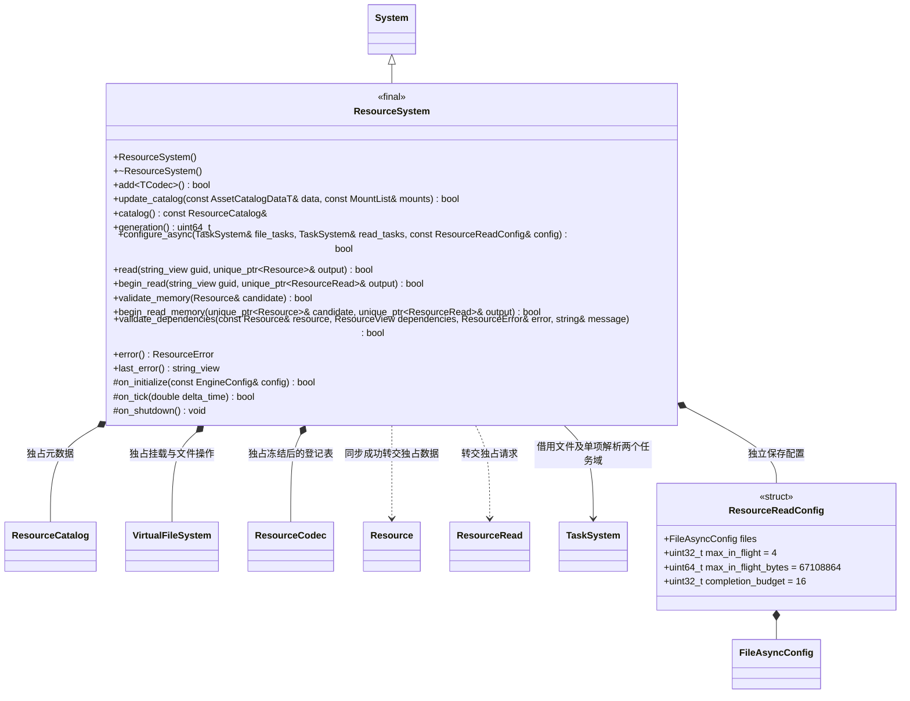
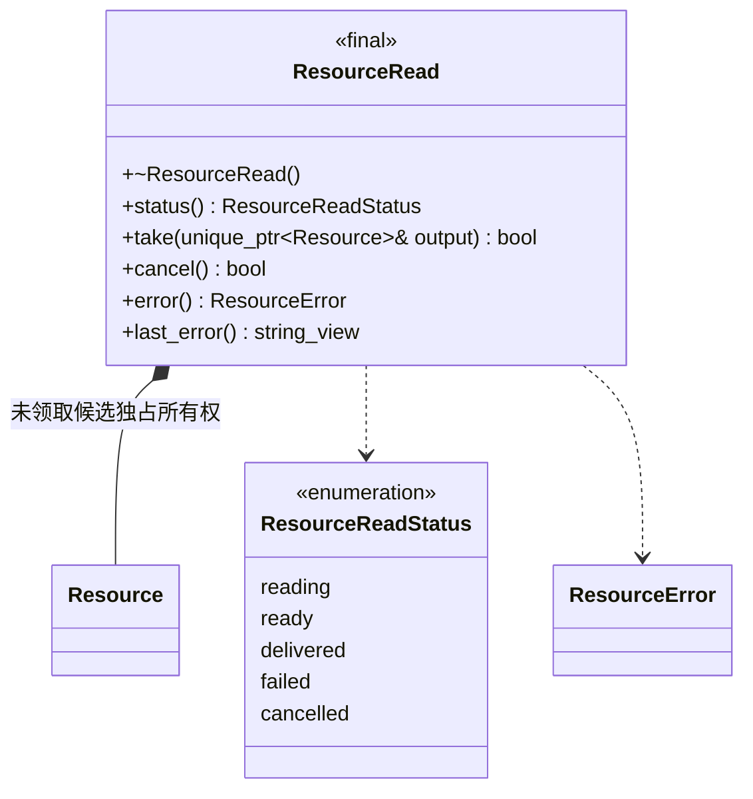
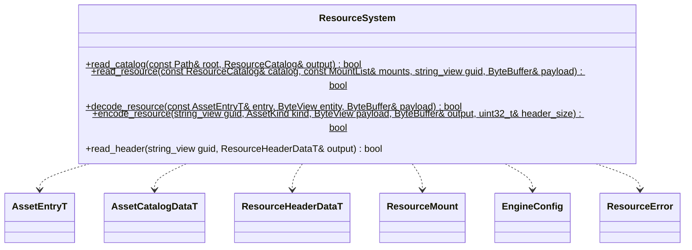

# 核心资源读取系统

[类图索引](../../class-diagrams/index.md) · [统一生命周期](resource-lifecycle.md) · [文件读取](virtual-file-system.md) · [类型处理器](resource-codecs.md) · [目录](resource-catalog.md) · [资源插件](../../plugins/runtime/class-diagrams/resource-graph.md)

**状态：统一资源契约及业务接入补充已按确认类图实现；验证范围见测试文档。** 核心的“资源读取类”沿用 ResourceSystem，负责目录与单项资源读取/解析。它不实现 ResourceLoader，不加载依赖树，不缓存共享资源，不维护业务引用计数。

## 单项读取能力

ResourceView 是 span<const Resource* const> 的标准别名，只包含本次调用借用，不另造依赖容器。

- 构造建立安全空状态，可能失败的初始化经返回值报告；析构/on_shutdown 为 noexcept，重复关闭安全，钩子 override。状态与重要查询标注 nodiscard。
- add<TCodec> 只在初始化前登记，检查规范类型映射及 Kind 唯一性；重复/冲突登记失败，不覆盖。处理器生命周期覆盖所有任务。宿主登记核心类型及选中的插件类型，核心不 include 具体插件。
- update_catalog 校验完整目录与挂载后原子替换，成功递增目录代际，失败保持原状态。旧目录快照由正在收尾的操作独立保活；目录查询借用不跨更新保存。
- read 仅读取 GUID 对应的一项实体：定位、读取、校验信封/哈希/类型、解码、校验本项数据。成功转交 unique_ptr；不读取依赖，也不返回业务 ResourceHandle。重复调用可以重复读取，去重是插件职责。
- validate_dependencies 只检查传入依赖数据与本项声明/跨实体约束；不读文件、不保留借用、不增计数。校验基于资源独立元数据与其同代际依赖，不能拿当前目录替换旧资源的依赖。该方法为 const，失败输出明确 error/message。
- read/begin_read 请求输入是规范 GUID；路径解析属于 ResourceCatalog。catalog/generation/error/last_error 为 const noexcept 查询。命令失败清空输出；最近错误文本由下一次命令覆盖，异步错误归独立操作。
- configure_async 借用两个已就绪且不同的 TaskSystem 域；已有活动请求时不可重配。未配置时同步 read 可用，begin_read 返回 unavailable；不能用同步工作冒充异步受理。
- on_tick 先处理文件结果，再提交/接收解码任务，最后在协调线程发布单项结果；不等待 I/O。宿主统一派发 TaskSystem 完成委托，核心只处理自身队列。后台只访问冻结输入、类型处理器和私有候选。
- 目录换代时未完成单项操作以 generation_changed 失败；晚到结果丢弃。已取出的旧数据是独立值，仍由所有者管理。shutdown 取消请求、等待文件/任务收尾后才销毁处理器。
- ResourceReadConfig 分别限制单项数、候选输入字节和每 tick 完成数；超过单项允许上限返回 budget_exceeded，不能永久排队。容量暂满返回 busy，由插件有界排队重试。字节预算不冒充总驻留内存上限。

## 单项异步读取

ResourceSystem 创建操作，调用方不能直接构造；不可复制/移动对象本身。status/error/last_error 为 const noexcept 纯查询，析构 noexcept，状态返回 nodiscard。输出 unique_ptr 必须为空；非空时拒绝且保留原值。ready 只表示单项已校验，不表示依赖闭包就绪；插件取得全部依赖并校验后才能交付业务句柄。

take 仅 ready 时成功一次，转交独占候选并变为 delivered；其他状态失败输出空，不改变终态错误。cancel 对 reading/ready 撤销并返回 true，重复取消 true，delivered/failed 返回 false。销毁未领取操作取消并回收结果，不阻塞；独立操作状态可以晚于系统销毁，但此后不能回调系统。

begin_read_memory 与文件读取共用操作，只跳过 I/O；受理时取得候选所有权，未受理保留。validate_memory 为同步入口，校验候选元数据/规范类型/本项数据并设置当前代际，失败不消费对象；依赖仍由插件提供并另行校验。两者禁止用内存候选替换当前目录的物理条目。

## 保留的实体工具与移除的旁路

Path 为 filesystem::path。实体工具服务编辑器构建/导入复用，只处理目录或单项信封，不是业务加载入口；失败输出安全空值。read_header 不加载载荷和依赖。所有文件实际读取复用 VFS。

目标移除 ResourceSystem 的 ResourceLoader 继承、loader/set_loader、find、register_texture/mesh/shader/material、find_* 以及通过全局 instance 取得加载器的旁路。路径/GUID 通过 ResourceCatalog 查询；原始 read_binary/read_text 调用移到 VFS 的文件读取能力及调用方文本解码。

已有 builtin_resource_catalog/info/payload 等离线定义函数仍用于构建；运行时内置资源在宿主提交基线目录后通过加载器的内存入口接纳，或按当前外置条目正常加载。默认引用由宿主显式保留，不在核心另存一套有不同生命期的静态对象表。
