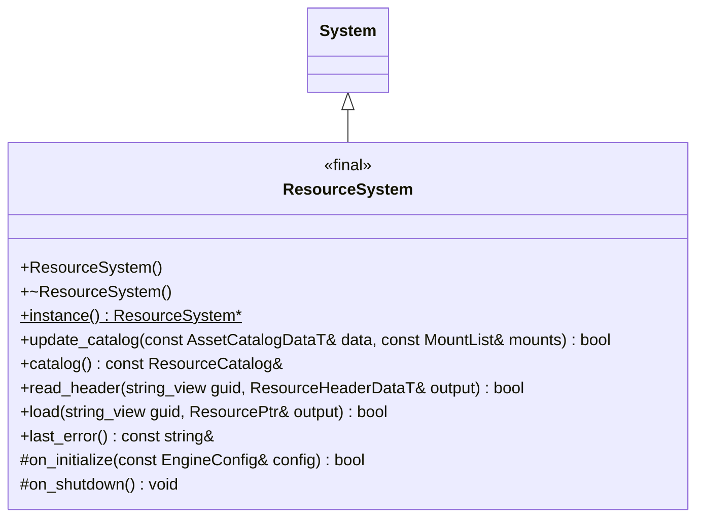
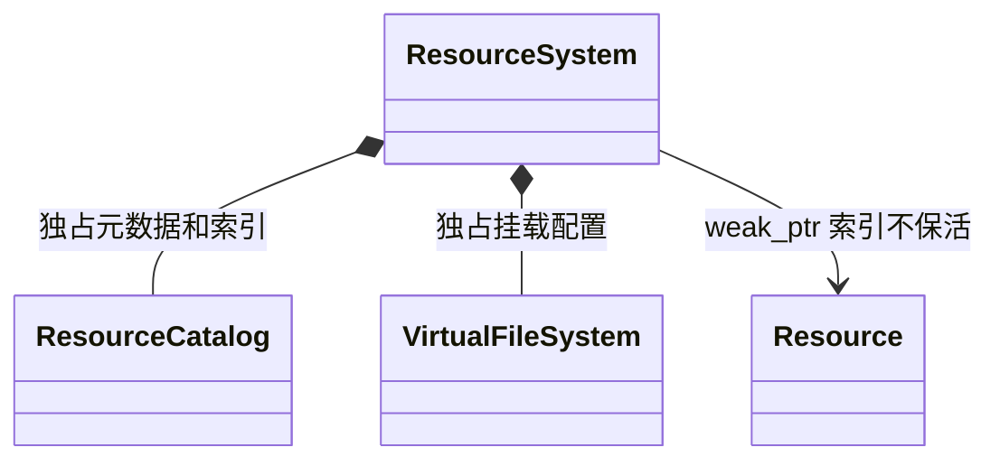
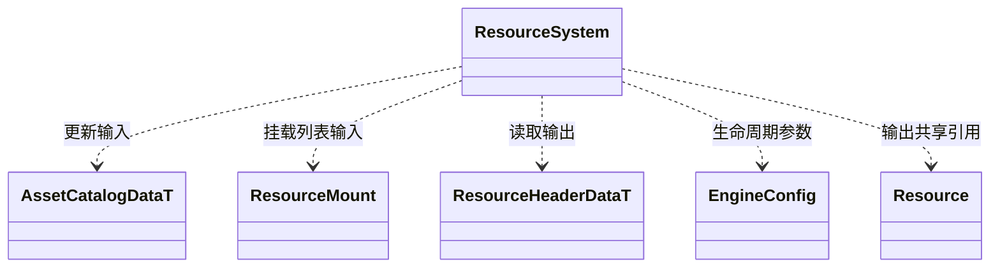
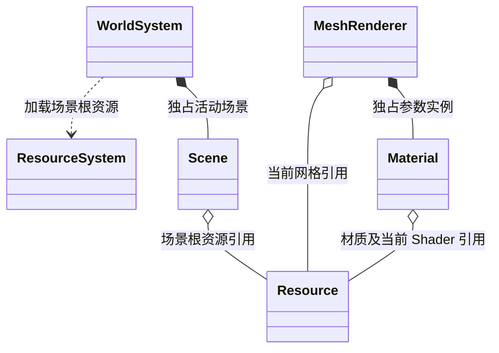
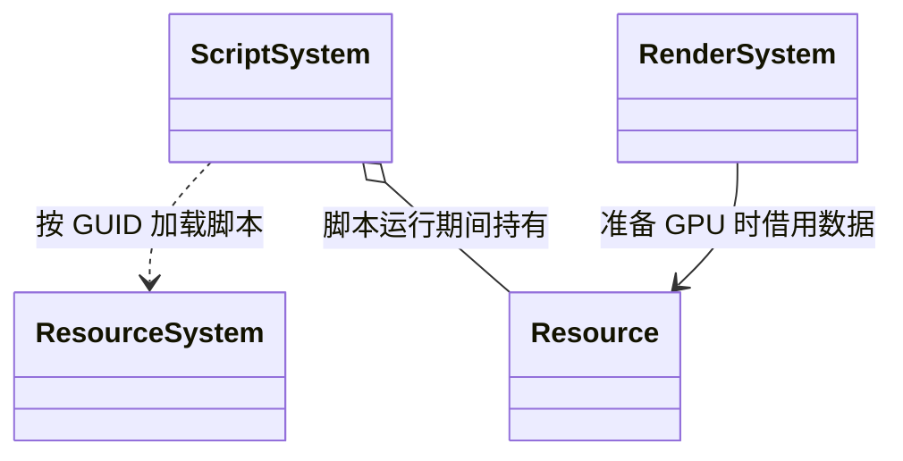
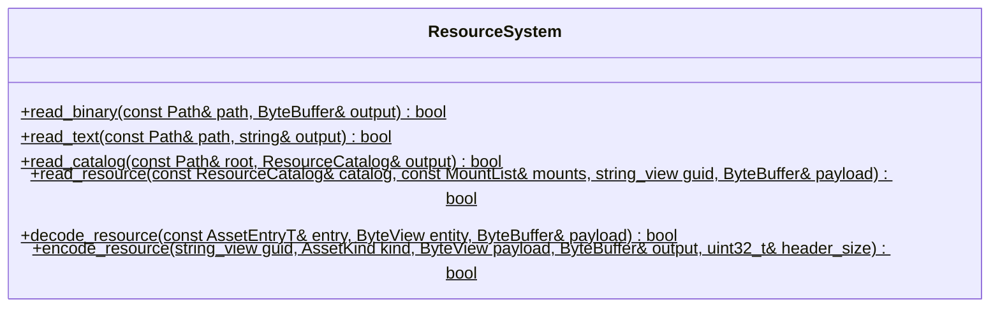
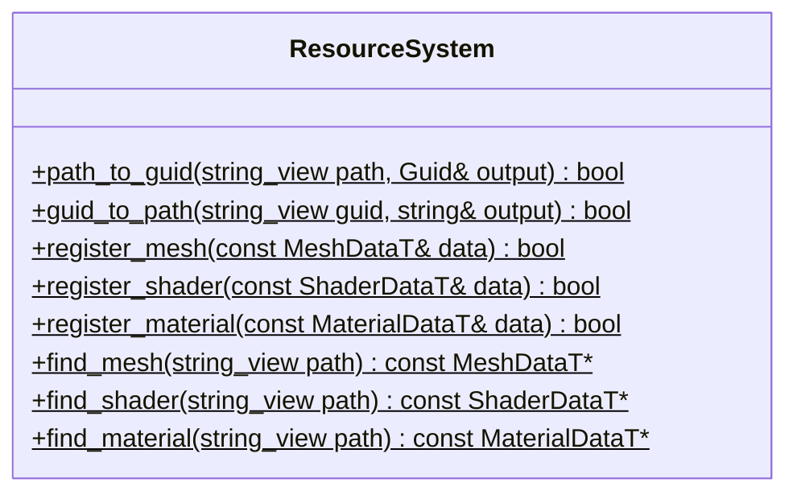

# 资源系统

[类图索引](../../class-diagrams/index.md) · [设计说明](../resource-loading.md) · [目录](resource-catalog.md) · [已加载资源](resource.md) · [文件访问](virtual-file-system.md)

资源系统提供元数据目录、同步按需加载和共享资源生命周期。使用方式见根 [README](../../../README.md)。

## 核心接口

`ResourcePtr` 是 `std::shared_ptr<const Resource>` 别名，`MountList` 是 `std::vector<ResourceMount>`，不新增包装类。领域模块、编辑器与宿主借用同一资源根系统；不向 Engine 添加资源便利接口。

接口服从[调用方驱动核心](../../architecture.md#调用方驱动核心)的统一原则。目录更新不是编辑器专用机制；业务、编辑器和宿主可以在满足同一生命周期约束时调用，频率和流程均由调用方决定。

- `update_catalog()` 接收已解码的完整目录及部署挂载，校验唯一身份、运行平台、格式、位置和必要依赖，成功整体替换，失败保留旧索引。编辑器直接提交内存数据，真机宿主启动提交一次；核心无模式参数或自动更新策略。
- 仍有使用者的条目及其依赖，不允许改变或删除其内容、类型、大小、路径、位置、依赖集合和相关挂载。调用者必须在覆盖实际文件前释放受影响使用者；未被使用条目的变化不必重启核心。
- `catalog()` 返回只读借用。路径/GUID 转换继续使用目录内的 GuidMap，查询不触发 I/O 或增加引用。
- `read_header()` 按目录给出的头部长度读取实体头，校验身份、格式和边界；不读取载荷、不加载依赖。失败输出为空。建立目录无需逐个调用它。
- `load()` 同步加载必要依赖并校验、解析当前资源。已加载对象直接共享；失败清空输出并回收本次无使用者的对象，不影响已有使用者。
- 对象索引只持 weak_ptr，不替业务保活。卸载使用 `ResourcePtr::reset()` 或作用域结束，不提供按 GUID 强制销毁共享对象的入口。
- `last_error()` 是最近失败上下文的借用，下一次操作可能改变文本；状态以返回值为准。
- 目录更新、加载与引用释放在宿主协调线程执行。无异步、优先级、文件监测、打包或版本发现业务。

构造、析构与关闭钩子为 noexcept；钩子标注 override。状态和重要查询标注 nodiscard，查询为 const。宿主先释放领域使用者再关闭资源系统；原 Basis Universal 初始化及依赖编译、链接职责保留。

## 所有权和参数依赖

## 领域使用者

领域模块按以下关系持有共享资源。公开方法在各自类图维护。

`o--` 表示持有共享所有权。候选场景失败时释放候选引用，保留旧场景。动态组件换资源先取得新引用再替换。GPU 创建和退役继续由 RenderSystem 管理，CPU 加载成功不等于 GPU 已就绪。

## 资源文件工具与内置初始化

文件工具不建立资源对象。`read_catalog` 只读元数据；`read_resource` 只校验并读取一个实体的载荷，供导入复用和候选脚本预检，不递归加载依赖。`encode_resource` 和 `decode_resource` 统一实体格式，避免编辑器、脚本或平台工具各自实现格式。失败输出为空。

`instance` 返回已初始化的单宿主根系统借用，未就绪时为空。身份转换只查询目录和固定内置映射。`register_*` 仅供内置资源初始化；项目资源统一走目录和 `load`。`find_*` 只查询内置定义或仍有使用者的已加载对象，不执行 I/O、不增加常驻引用；项目数据借用必须由调用方持有的 ResourcePtr 保活。

内置资源的固定身份、类型和依赖通过 `builtin_resource_catalog()` / `builtin_resource_info(guid)` 提供给核心与构建模块；它们不依赖渲染设备初始化，也不复制宿主平台的 Shader 字节码到其他平台。
