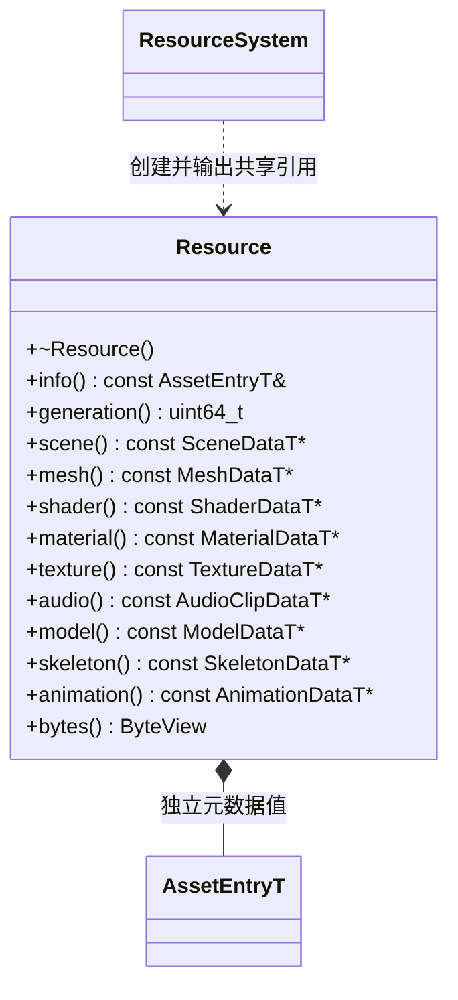
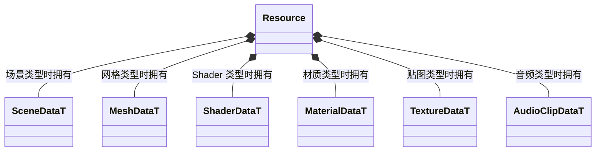

# 已加载资源

[类图索引](../../class-diagrams/index.md) · [资源系统](resource-system.md) · [目录](resource-catalog.md)

Resource 表示已解析、可共享的 CPU 资源，不是节点、GPU 对象或新的序列化模型。

- `ResourcePtr = std::shared_ptr<const Resource>` 只是标准类型别名，不另建句柄或引用计数。ResourceSystem 创建对象，构造权限仅向该系统开放；对象禁止复制和移动。
- 对象只拥有与其类型对应的生成数据；脚本或原始二进制持有自己的字节缓冲。ByteView 是 `std::span<const std::byte>`，不新增类。不手写重复的持久字段。
- 查询为 const noexcept 并标注 nodiscard。类型不匹配返回空指针，非字节型资源的 bytes 返回空视图。借用仅在调用者仍持有 ResourcePtr 时有效。
- info 指向独立拥有的元数据，不借用可替换目录。资源数据只读；材质可修改参数和场景节点实例仍归行为对象。
- Resource 只拥有本项元数据、目录代际和载荷，不拥有依赖或共享缓存。析构为 noexcept，不调用脚本或 GPU API。
- 完整依赖闭包由运行时资源依赖图插件的私有 Bundle 保活；输出仍使用 ResourcePtr 标准别名，最后一个使用者释放时由插件按正确顺序释放资源和依赖。
- `generation()` 标识创建时目录代际，const noexcept；目录更新不改变旧对象。当前代际查询与缓存隔离由加载器处理，不通过 GUID 强制删除其他使用者的对象。

Model、Skeleton、Animation 同样只拥有对应 FlatBuffers 生成载荷，结构与依赖见[模型资源](model-resources.md)。模型资源实例化在 Scene；骨架采样在 AnimationSystem；源文件转换在编辑器格式插件，均不进入 Resource 的只读实体职责。
