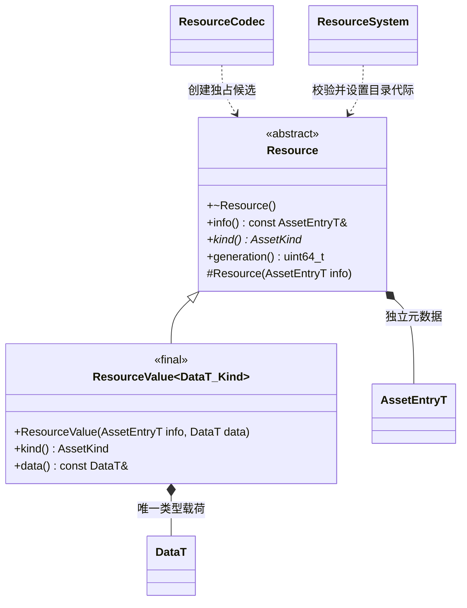
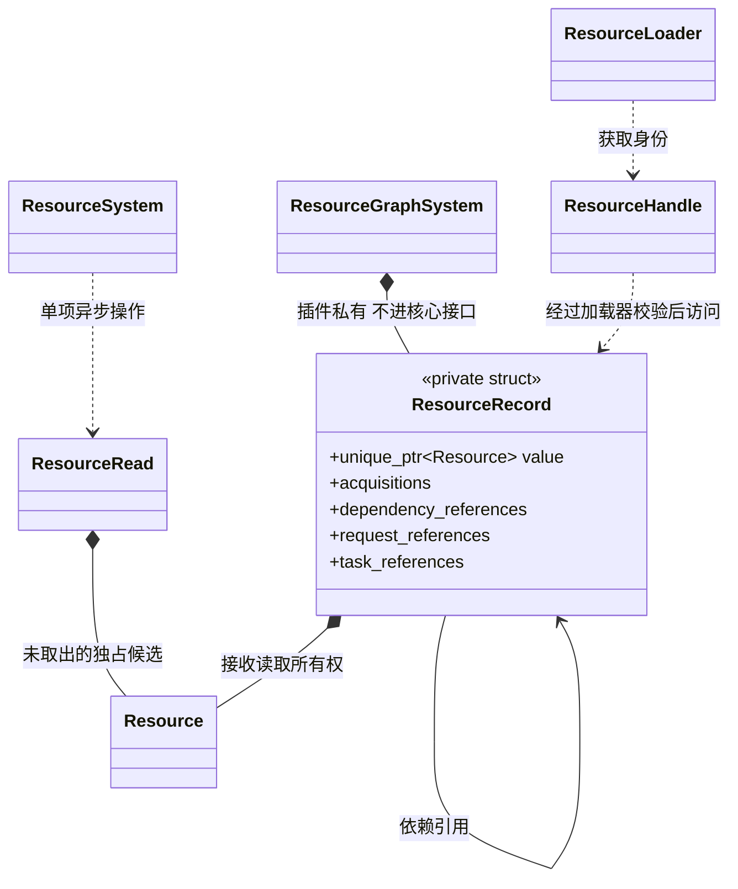

# 资源对象与类型承载

[类图索引](../../class-diagrams/index.md) · [统一生命周期](resource-lifecycle.md) · [核心读取](resource-system.md) · [类型处理器](resource-codecs.md)

**状态：统一资源契约及业务接入补充已按确认类图实现；验证范围见测试文档。** Resource 使用统一类型承载，业务通过获取句柄管理生命周期；持久数据仍以现有 schema 为唯一来源。

## 公共类型

- Resource 为类型擦除的只读资源抽象基类，公共虚析构为 noexcept，kind 为纯虚查询；ResourceValue 以 override 返回模板规定的 Kind。构造仅建立安全数据状态。禁止复制/移动资源对象本身，所有权通过 unique_ptr 转移。
- ResourceValue<DataT, Kind> 是一个简单 final 模板，保存一种载荷。MeshResource 等名字只是该模板的特化别名，不另外定义一份 MeshDataT，不给 Resource 追加 mesh()/movie()/terrain()。
- 每个 AssetKind 规定唯一规范载荷类型；登记时用编译期映射约束，不能给同一 Kind 注册另一种 DataT。插件类型也遵守该映射。新增类型只增自身载荷声明、处理器和登记，不改基类或集中 store 重载。
- DataT 使用 schema 生成的 native DataT；source/script/json 使用 ByteBuffer。ByteBuffer、ByteView 分别为标准 vector/span 别名；即使都是字节，Kind 仍不同，不得相互强转。
- kind/info/generation/data 为 const noexcept 查询并标注 nodiscard。info 拥有独立元数据，不借用可替换的目录。generation 在核心成功读取/接纳时设置，候选发布后不可变。
- ResourceSystem 以 friend 权限设置私有代际并校验元数据；处理器只创建规范候选，不得访问私有缓存或计数。
- ResourceLoader::get<TResource> 先检验句柄，再按规范 Kind 映射返回只读借用，不使用 RTTI；不支持任意自定义派生类冒充同 Kind 的另一布局。

## 所有权与借用

ResourceRecord 只是插件私有实现结构示意，不新增公共 Manager。核心读取层只转交 unique_ptr；业务不能取得该所有权，也不持有公共 shared_ptr。

业务 get 返回的指针/数据视图仅在对应获取有效且加载器存活时有效。模块跨调用或跨帧使用，先 retain 得到自己的句柄。后台任务由所属模块保留独立获取至完成，只借用它保活的不可变数据；不能捕获活动系统或 ECS 列。释放某个获取后，即使另一获取仍保活同一对象，该获取导出的借用也必须停止使用。

Resource 析构只释放本项 CPU 数据，不调用 GPU、音频设备或 VM。插件在任务不再访问后销毁本项，再释放其依赖引用；正在运行的模块由自身获取保活。

| 不可变资源数据 | 另属模块的运行状态 |
| --- | --- |
| SceneDataT / PrefabDataT / ModelDataT | ECS 实体、场景发布与实例映射 |
| MeshDataT / ShaderDataT / TextureDataT / MaterialDataT | GPU 对象、设备上传、材质实例参数 |
| AudioClipDataT / MovieDataT | 声部、解码器、播放位置与帧队列 |
| SkeletonDataT / AnimationDataT / AnimationRetargetProfileDataT | 骨骼实例、采样任务与播放状态 |
| FontDataT / UiDocumentDataT | 字形绘制缓存、UI 文档与控件身份 |
| EffectAssetDataT / TerrainAssetDataT / DestructionAssetDataT | 插件运行实例和生成任务 |
| LightProbeDataT | 场景绑定及 GPU 表示 |
| script / json / source 的 ByteBuffer | VM 模块、业务解析结果或调用方处理流程 |

完整 21 种类型及处理器归属见[类型处理器](resource-codecs.md)。
