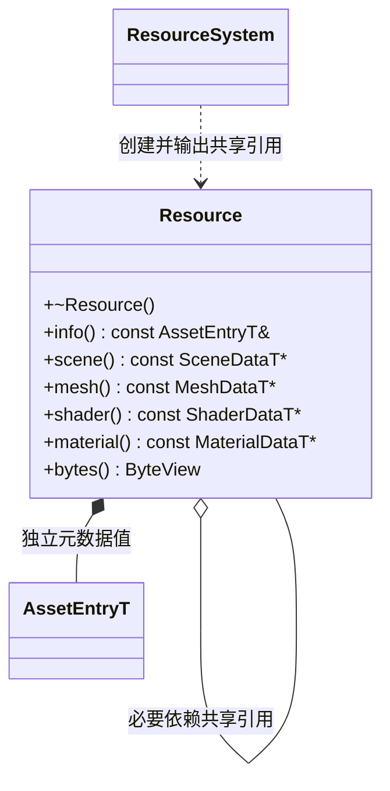
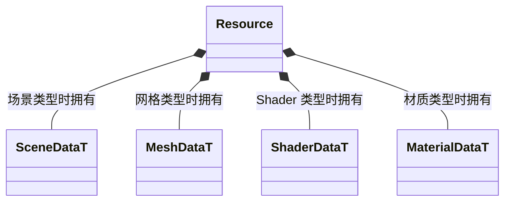

# 已加载资源

[类图索引](../../class-diagrams/index.md) · [资源系统](resource-system.md) · [目录](resource-catalog.md)

Resource 表示已解析、可共享的 CPU 资源，不是节点、GPU 对象或新的序列化模型。

- `ResourcePtr = std::shared_ptr<const Resource>` 只是标准类型别名，不另建句柄或引用计数。ResourceSystem 创建对象，构造权限仅向该系统开放；对象禁止复制和移动。
- 对象只拥有与其类型对应的生成数据；脚本或原始二进制持有自己的字节缓冲。ByteView 是 `std::span<const std::byte>`，不新增类。不手写重复的持久字段。
- 查询为 const noexcept 并标注 nodiscard。类型不匹配返回空指针，非字节型资源的 bytes 返回空视图。借用仅在调用者仍持有 ResourcePtr 时有效。
- info 指向独立拥有的元数据，不借用可替换目录。资源数据只读；材质可修改参数和场景节点实例仍归行为对象。
- 直接必要依赖由 shared_ptr 持有，加载前验证无环。最后一个使用者释放时先销毁当前数据，再释放依赖引用。析构为 noexcept，不调用脚本或 GPU API。
- 索引只保存 weak_ptr，目录成功更新时移除过期项，同一 GUID 再次加载时替换过期索引，不形成隐含常驻缓存。业务释放自己的 shared_ptr，不通过 GUID 强制删除别人的共享对象。
