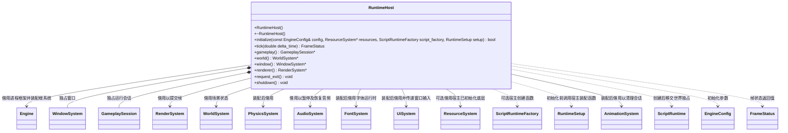

# 运行宿主

[类图索引](../../class-diagrams/index.md) · [完整引用关系](../../class-diagrams/references.md)

- RuntimeHost 位于运行时 app 模块，是桌面、编辑器和 Android 共用的运行组合入口。类型为 final，禁止复制和移动；构造、析构、查询、退出请求和关闭为 noexcept；initialize、tick 和 gameplay 的返回值标注 nodiscard。
- 初始化先独立创建 WindowSystem；resources 为空时向 Engine 注册并拥有 ResourceSystem，非空时借用宿主已经初始化的资源底层，再装配 WorldSystem、RenderSystem。世界独占物理、音频、导航、动画、字体、界面和可选脚本子系统。引擎已被其他宿主使用时拒绝初始化，不清理他人的资源。
- `resources`、`script_factory` 和 `setup` 默认空。`ScriptRuntimeFactory` 是 `std::unique_ptr<ScriptRuntime> (*)(WorldSystem&, RenderSystem&, UiSystem&)` 函数指针别名，由可执行宿主选择插件并提供。先构造世界和渲染器，再调用工厂创建尚未初始化的抽象脚本子系统，交给世界统一初始化、更新和关闭；初始化仍按世界、渲染器的次序。非空工厂返回空或无法附属时，整个初始化失败并清理已取得的资源。渲染器借用仅用于玩法回调；关闭时先由 GameplaySession 停止回调，再释放渲染器和世界。
- RuntimeHost 和 GameplaySession 只依赖 [ScriptRuntime](script-runtime.md) 契约，不包含或链接具体脚本插件，不依据虚拟机或插件编译宏改变核心实现。无工厂时仍能初始化窗口、场景和渲染；启动脚本玩法明确返回不可用。
- 每帧先处理窗口事件，退出返回 exit_requested；窗口不可绘制时暂停音频输出，返回 paused 并继续接收恢复事件；恢复后继续音频与物理步进。随后由 Engine 更新根系统，由 GameplaySession 处理显式部署控制和资源切换，最后提交渲染帧。
- 项目场景渲染失败时停止 GameplaySession 并尝试空白渲染；恢复成功继续运行，错误保留在会话中。系统更新或空白渲染失败保持 failed，直到关闭后重新初始化。渲染过程中收到平台暂停时返回 paused。
- `gameplay()` 返回可空借用，仅在本宿主初始化成功至关闭前有效。宿主调用者必须先关闭借用会话的 EditorSystem，再销毁 RuntimeHost。
- `world()` 返回同生命周期的可空世界借用，供宿主连接独立编辑器业务；运行时不认识命令服务或 MCP。
- `window()` 返回同生命周期的可空窗口借用，供调用方独立组织事件处理和渲染帧；核心不判断调用方模式。
- `renderer()` 返回同生命周期的可空渲染器借用，宿主据此装配编辑器渲染命令；截图和渲染设置接口由 RenderSystem 提供。
- 关闭先销毁玩法会话，再关闭 Engine 拥有的渲染、世界及可选资源根系统，最后销毁窗口。借用的外部 ResourceSystem 由调用宿主继续管理，本对象不关闭它。部分初始化和重复关闭均安全。
- RuntimeHost 不解析项目目录、不读取编辑器配置，也不实现脚本热重载；这些职责分别属于编辑器、平台路径和脚本模块。

可执行宿主负责按构建清单装配 ResourceGraphSystem 并向资源底层注入 ResourceLoader；RuntimeHost 库不 include 或链接具体资源插件。外部资源有效期覆盖本宿主及全部领域使用者，关闭消费者后先解除加载器借用，再关闭插件与资源底层。

`RuntimeSetup = bool (*)(WorldSystem&, WindowSystem&, PhysicsSystem&)` 是宿主回调别名。基础子系统与可选脚本已附属世界、世界尚未初始化时调用；窗口已就绪。宿主可登记可选组件并追加子系统，返回 false 则由现有生命周期反序清理。核心不解析插件名，也不在此回调定义业务策略；回调中的函数地址与借用对象须覆盖世界生命期。
