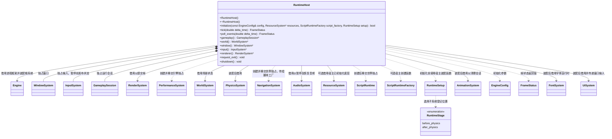
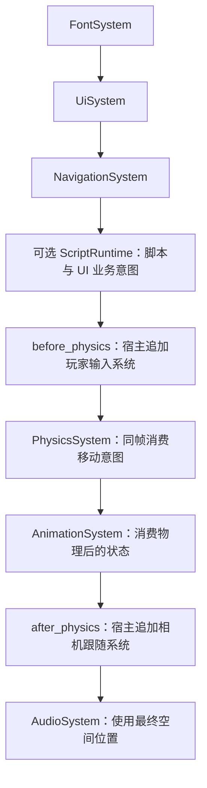

# 运行宿主

[类图索引](../../class-diagrams/index.md) · [完整引用关系](../../class-diagrams/references.md)

- RuntimeHost 位于运行时 app 模块，是桌面、编辑器和 Android 共用的运行组合入口。类型为 final，禁止复制和移动；构造、析构、查询、退出请求和关闭为 noexcept；initialize、tick 和 gameplay 的返回值标注 nodiscard。
- 初始化先独立创建 WindowSystem 和 InputSystem；resources 为空时向 Engine 注册并拥有 ResourceSystem，非空时借用宿主已经初始化的资源底层，再装配 PerformanceSystem、WorldSystem、RenderSystem。性能系统是独立根系统，当前仅接入可选 Tracy 客户端；世界独占物理、音频、导航、动画、字体、界面和可选脚本子系统。引擎已被其他宿主使用时拒绝初始化，不清理他人的资源。
- `resources`、`script_factory` 和 `setup` 默认空。`ScriptRuntimeFactory` 是 `std::unique_ptr<ScriptRuntime> (*)(WorldSystem&, RenderSystem&, UiSystem&, PhysicsSystem&, NavigationSystem&, InputSystem&)` 函数指针别名，由可执行宿主选择插件并提供。先构造世界和渲染器，再调用工厂创建尚未初始化的抽象脚本子系统，交给世界统一初始化、更新和关闭；初始化仍按世界、渲染器的次序。非空工厂返回空或无法附属时，整个初始化失败并清理已取得的资源。渲染器与输入借用仅用于玩法回调；关闭时先由 GameplaySession 停止回调，再释放渲染器和世界。
- RuntimeHost 和 GameplaySession 只依赖 [ScriptRuntime](script-runtime.md) 契约，不包含或链接具体脚本插件，不依据虚拟机或插件编译宏改变核心实现。无工厂时仍能初始化窗口、场景和渲染；启动脚本玩法明确返回不可用。
- 每帧先处理窗口事件，退出返回 exit_requested；窗口不可绘制时暂停音频输出，返回 paused 并继续接收恢复事件；恢复后继续音频与物理步进。随后由 Engine 更新根系统，由 GameplaySession 处理显式部署控制和资源切换，最后提交渲染帧。
- 项目场景渲染失败时停止 GameplaySession 并尝试空白渲染；恢复成功继续运行，错误保留在会话中。系统更新或空白渲染失败保持 failed，直到关闭后重新初始化。渲染过程中收到平台暂停时返回 paused。
- `gameplay()` 返回可空借用，仅在本宿主初始化成功至关闭前有效。宿主调用者必须先关闭借用会话的 EditorSystem，再销毁 RuntimeHost。
- `world()` 返回同生命周期的可空世界借用，供宿主连接独立编辑器业务；运行时不认识命令服务或 MCP。
- `window()` 返回同生命周期的可空窗口借用，供调用方独立组织事件处理和渲染帧；核心不判断调用方模式。
- `renderer()` 返回同生命周期的可空渲染器借用，宿主据此装配编辑器渲染命令；截图和渲染设置接口由 RenderSystem 提供。
- 关闭先销毁玩法会话，再关闭 Engine 拥有的渲染、世界及可选资源根系统，随后关闭输入、最后销毁窗口。借用的外部 ResourceSystem 由调用宿主继续管理，本对象不关闭它。部分初始化和重复关闭均安全。
- RuntimeHost 不解析项目目录、不读取编辑器配置，也不实现脚本热重载；这些职责分别属于编辑器、平台路径和脚本模块。

可执行宿主负责按构建清单装配 ResourceGraphSystem 并向资源底层注入 ResourceLoader；RuntimeHost 库不 include 或链接具体资源插件。外部资源有效期覆盖本宿主及全部领域使用者，关闭消费者后先解除加载器借用，再关闭插件与资源底层。

`RuntimeSetup = bool (*)(RuntimeStage, WorldSystem&, WindowSystem&, PhysicsSystem&, RenderSystem&)` 是宿主回调别名。

渲染器在装配回调前已经构造，尚未初始化；宿主可登记 [RenderExtension](render-extension.md)，将具体插件所有权移交世界。核心不识别插件类型，扩展 GPU 准备在渲染器初始化成功后的绘制阶段执行。
对象先构造，世界尚未初始化时分别以 `before_physics` 和 `after_physics` 调用一次；窗口已就绪，
物理实例已存在，但初始化前不得使用其运行能力。回调只追加对应位置的可选子系统，不在每帧调用。
可选组件由附属系统的 `on_initialize()` 登记，避免被世界初始化时的基础组件表替换。
返回 false 则按现有生命周期清理；核心不解析插件名，也不执行插件策略。

世界子系统的登记、初始化和更新顺序统一如下，关闭时反序执行：

字体与 UI 先初始化，脚本和插件均借用已构造的对象；整个世界初始化成功后才允许玩法与逐帧调用。
具体玩家控制器和相机插件只由可执行宿主装配，RuntimeHost 不包含插件头文件。
阶段枚举仅决定一次性的子系统登记位置，不增加 System 的逐帧阶段、事件总线或额外调度器。

步骤 3：脚本工厂追加借用已构造的物理系统，用于读取上一物理帧撞击快照；工厂不调用尚未初始化的物理能力，玩法结束后才释放该借用。

步骤 4：脚本工厂继续追加已构造的 NavigationSystem 引用，世界独占该子系统，宿主和脚本仅借用；世界关闭前结束玩法与查询。

## 输入装配

按[输入设计](../input.md)，RuntimeHost 在 WindowSystem 后独占初始化 InputSystem，每帧先开输入帧、单次泵窗口事件、按 UI / 原生触摸占用路由，再更新输入并检查暂停。输入不进入 World 或现有世界子系统链，后台仍处理断开与清理。

脚本工厂参数包括 InputSystem&，BindingContext 取得可空借用；宿主在所有 Run 与世界 / UI 消费者关闭后才关闭输入，最后关闭窗口。输入不增加项目配置或默认绑定参数；TS 自行加载、合并和提交最终配置。原生对象与参数关系见[输入类图](input-system.md)。

`poll_events(delta_time)` 在窗口可绘制时先同步 UI 文档，随后执行输入开帧、持续 UI 占用提交、唯一窗口事件泵和输入发布，并返回运行 / 暂停 / 退出 / 失败状态；不推进世界或渲染。`tick` 复用该方法，编辑器预览也调用同一入口，每宿主帧二者只选一个。`input()` 返回与 window() 相同生命周期的可空借用，供调用方创建和查询自己的通道，不新增编辑器模式。
