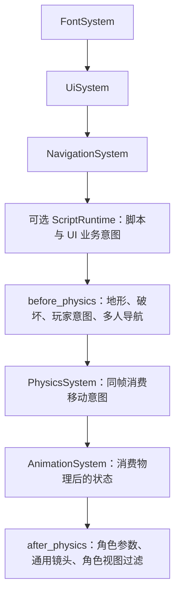

# 运行宿主

[场景加载](scene-loading.md)由 GameplaySession 组织各领域准备，RuntimeHost 不增加资源缓存或第二套加载接口。准备期间每帧继续提交当前已发布场景，候选资源按预算推进；候选发布后等待包含该内容的实际场景帧，再启动模拟。影片只影响呈现和进入时机，不阻止查询原生状态。

**资源接入：可执行入口选择资源插件，给 RuntimeHost/各模块注入可空的 ResourceLoader，并分离文件、解析、资源图、影片及渲染任务域。** 公开参数按[已确认的业务接入](resource-consumers.md)同步；没有加载器时基础宿主仍可启动，资源操作返回失败。

[类图索引](../../class-diagrams/index.md) · [完整引用关系](../../class-diagrams/references.md)

影片启动与正常玩法共用同一套呈现服务；分阶段契约见[影片启动](movie-startup.md)。
本页统一维护宿主公开方法，所有权以本页及启动关系图为准。

```mermaid
classDiagram
    direction TB
    class RuntimeHost {
        +RuntimeHost()
        +~RuntimeHost()
        +initialize(const EngineConfig& config, ResourceSystem#42; resources, ResourceLoader#42; loader, ScriptRuntimeFactory script_factory, RuntimeSetup setup, ThreadSystem#42; threads, const RuntimeParallelConfig& parallel, AnimationRetargeterFactory retargeter_factory = nullptr) bool
        +initialize_presentation(const EngineConfig& config, ResourceSystem#42; resources, ResourceLoader#42; loader, ThreadSystem#42; threads, const RuntimeParallelConfig& parallel) bool
        +begin_gameplay(ScriptRuntimeFactory script_factory, RuntimeSetup setup, AnimationRetargeterFactory retargeter_factory, shared_ptr~const ResourceCatalog~ catalog, shared_ptr~const MountList~ mounts, string_view entry, string_view scene) bool
        +step_gameplay(double max_seconds) RuntimeStartupStatus
        +activate_gameplay() bool
        +movie_player() MoviePlayer#42;
        +tick(double delta_time) FrameStatus
        +poll_events(double delta_time) FrameStatus
        +gameplay() GameplaySession#42;
        +tasks() TaskSystem#42;
        +world() WorldSystem#42;
        +window() WindowSystem#42;
        +input() InputSystem#42;
        +renderer() RenderSystem#42;
        +ui() UiSystem#42;
        +set_event_observer(WindowEventHandler observer, void* context) void
        +status(RuntimeHostStatus& output) bool
        +request_exit() void
        +shutdown() void
    }
    class Engine
    class ThreadSystem
    class TaskSystem
    class RuntimeParallelConfig {
        +ThreadConfig threads
        +TaskConfig runtime
        +TaskConfig background
        +TaskConfig file
        +TaskConfig resource_read
        +TaskConfig resource_graph
        +TaskConfig movie
        +TaskConfig render
        +TaskConfig physics
        +TaskConfig animation
        +TaskConfig navigation
        +ResourceReadConfig resources
        +AnimationConfig animation_sampling
        +SceneRestoreConfig scene_restore
        +RenderConfig rendering
        +size_t navigation_tile_threshold
        +size_t completions_per_frame
        +double completion_budget_seconds
    }
    class ThreadConfig
    class TaskConfig
    class ResourceReadConfig
    class AnimationConfig
    class SceneRestoreConfig
    class RenderConfig
    class WindowSystem
    class InputSystem
    class GameplaySession
    class RenderSystem
    class WorldSystem
    class PhysicsSystem
    class NavigationSystem
    class AudioSystem
    class ResourceSystem
    class ResourceLoader
    class ExecutableHost
    class ScriptRuntime
    class ScriptRuntimeFactory
    class RuntimeSetup
    class RuntimeStage {
        <<enumeration>>
        before_physics
        after_physics
        initialized
    }
    class AnimationSystem
    class EngineConfig
    class FrameStatus
    class MoviePlayer
    class ResourceCatalog
    class MountList
    class RuntimeStartupStatus {
        <<enumeration>>
        preparing
        ready
        failed
    }
    class RuntimeHostStatus {
        <<struct>>
        +uint64_t tick_id
        +uint64_t sampled_at_ns
        +bool initialized
        +bool window_drawable
        +bool exit_requested
        +FrameStatus frame_status
    }
    RuntimeHost ..> RuntimeHostStatus : 原生只读快照
    RuntimeHostStatus ..> FrameStatus
    RuntimeHost *-- MoviePlayer : 独占播放器
    RuntimeHost o-- ResourceCatalog : 锁存同一目录快照
    RuntimeHost o-- MountList : 锁存同一挂载快照
    RuntimeHost ..> RuntimeStartupStatus : 分阶段返回值
    RuntimeHost *-- TaskSystem : 独占运行 部署 影片 渲染 物理 动画 导航域
    ExecutableHost *-- TaskSystem : 独占文件 单项解析 资源组织域
    RuntimeHost *-- RuntimeParallelConfig : 运行预算快照
    RuntimeParallelConfig *-- ThreadConfig
    RuntimeParallelConfig *-- TaskConfig
    RuntimeParallelConfig *-- ResourceReadConfig
    RuntimeParallelConfig *-- AnimationConfig
    RuntimeParallelConfig *-- SceneRestoreConfig
    RuntimeParallelConfig *-- RenderConfig
    RuntimeHost *-- ThreadSystem : 独立宿主拥有预算
    RuntimeHost --> ThreadSystem : 编辑器提供时借用预算
    RuntimeHost --> Engine : 借用进程框架并装配根系统
    RuntimeHost *-- WindowSystem : 独占窗口
    RuntimeHost *-- InputSystem : 独占输入，暂停前发布状态
    RuntimeHost *-- GameplaySession : 独占运行会话
    RuntimeHost *-- RenderSystem : 呈现阶段独占至关闭
    RuntimeHost --> WorldSystem : 借用场景状态
    RuntimeHost --> PhysicsSystem : 装配后借用
    RuntimeHost ..> NavigationSystem : 创建并移交世界独占，传给脚本工厂
    RuntimeHost *-- AudioSystem : 独占共享音频服务
    RuntimeHost --> FontSystem : 装配后借用字体运行时
    RuntimeHost --> UiSystem : 装配后借用并传递窗口输入
    RuntimeHost --> ResourceSystem : 可选借用宿主已初始化底层
    RuntimeHost --> ResourceLoader : 可空借用高层契约 传给使用模块
    RuntimeHost ..> ScriptRuntimeFactory : 可选宿主创建函数
    RuntimeHost ..> RuntimeSetup : 初始化前调用宿主装配函数
    RuntimeSetup ..> RuntimeStage : 选择子系统登记位置
    RuntimeSetup ..> NavigationSystem : 借用已构造导航供宿主装配
    RuntimeSetup ..> TaskSystem : 借用已初始化运行域供插件装配
    RuntimeHost --> AnimationSystem : 装配后借用以清理会话
    RuntimeHost ..> ScriptRuntime : 创建后移交世界独占
    RuntimeHost ..> EngineConfig : 初始化参数
    RuntimeHost ..> FrameStatus : 帧状态返回值
```

- RuntimeHost 位于运行时 app 模块，是桌面、编辑器和 Android 共用的运行组合入口。类型为 final，禁止复制和移动；构造、析构、查询、退出请求和关闭为 noexcept；initialize、tick 和 gameplay 的返回值标注 nodiscard。
- 初始化先独立创建 WindowSystem 和 InputSystem；resources 为空时直接独占 ResourceSystem，非空时借用调用方已经初始化的资源底层。先独占并初始化 RenderSystem、AudioSystem 和 MoviePlayer，再按请求将 WorldSystem 移交 Engine。宿主初始化可选 Tracy 主线程名称，各模块独立提交采样；覆盖范围见[性能文档](../performance.md)；世界独占物理、导航、动画、字体、界面和可选脚本子系统。引擎已被其他宿主使用时拒绝初始化，不清理他人的资源。
- 调用方必须显式提供 `config`、`resources`、`loader`、`script_factory`、`setup`、`threads` 和完整的 `parallel` 预算；可空资源、工厂及装配函数由调用方显式传入 `nullptr`，不使用隐式预算。`ScriptRuntimeFactory` 是 `std::unique_ptr<ScriptRuntime> (*)(WorldSystem&, RenderSystem&, UiSystem&, PhysicsSystem&, NavigationSystem&, InputSystem&, WindowSystem&, AnimationSystem&, MoviePlayer*)` 函数指针别名，由可执行宿主选择插件并提供。先构造世界和渲染器，再调用工厂创建尚未初始化的抽象脚本子系统，交给世界统一初始化、更新和关闭；渲染器和音频在呈现阶段先初始化，随后绑定世界。非空工厂返回空或无法附属时，整个初始化失败并清理已取得的资源。渲染器与输入借用仅用于玩法回调；关闭时先由 GameplaySession 停止回调，再解除世界借用、释放世界和呈现服务。

工厂借用宿主已有窗口与可空 `MoviePlayer*`，供逐类绑定使用；不传 RuntimeHost，
不让脚本插件持有或关闭宿主。窗口和播放器有效期覆盖全部 Run，
先停止玩法及清理鼠标请求，再关闭输入和窗口。核心不链接具体 WindowBinding。
- RuntimeHost 和 GameplaySession 只依赖 [ScriptRuntime](script-runtime.md) 契约，不包含或链接具体脚本插件，不依据虚拟机或插件编译宏改变核心实现。无工厂时仍能初始化窗口、场景和渲染；启动脚本玩法明确返回不可用。
- 每帧先处理窗口事件，退出返回 exit_requested；窗口不可绘制时暂停音频输出，返回 paused 并继续接收恢复事件；恢复后继续音频与物理步进。随后由 Engine 更新根系统，由 GameplaySession 处理显式部署控制和资源切换，最后提交渲染帧。
- 项目场景渲染失败时停止 GameplaySession 并尝试空白渲染；恢复成功继续运行，错误保留在会话中。系统更新或空白渲染失败保持 failed，直到关闭后重新初始化。渲染过程中收到平台暂停时返回 paused。
- `gameplay()` 返回可空借用，仅在本宿主初始化成功至关闭前有效。宿主调用者必须先关闭借用会话的 EditorSystem，再销毁 RuntimeHost。
- `world()` 返回同生命周期的可空世界借用，供宿主连接独立编辑器业务；运行时不认识命令服务或 MCP。
- `window()` 返回同生命周期的可空窗口借用，供调用方独立组织事件处理和渲染帧；核心不判断调用方模式。
- `renderer()` 返回同生命周期的可空渲染器借用，宿主据此装配编辑器渲染命令；截图和渲染设置接口由 RenderSystem 提供。
- `status()` 在主线程复制当前宿主状态，`initialized` 明确报告初始化情况；不推进帧、任务或加载。`tick_id` 与单调时钟采样时间供业务和测试区分窗口不可绘制、帧暂停与加载仍在推进。
- 关闭顺序统一见下方[并行配置](#并行配置)。借用的外部 ResourceSystem 仍由调用宿主管理，RuntimeHost 仅解除借用，不驱动或关闭外部资源服务。部分初始化和重复关闭均安全。
- RuntimeHost 不解析项目目录、不读取编辑器配置，也不实现脚本热重载；这些职责分别属于编辑器、平台路径和脚本模块。

## 并行配置

`RuntimeParallelConfig` 是运行宿主装配参数，预算值完整保存在项目配置中。编辑器读取项目源 TOML 后直接传递类型配置；打包链导出聚合 `settings/runtime.json`，原生宿主读取 RuntimeSettings 的 engine / parallel 后再传入本对象。RuntimeHost 不解析项目 TOML，EngineConfig 与完整并行设置均由调用者显式提供，不以 `parallel = {}` 补预算。线程上限、各域并发/优先级/积压额度、资源在途数量与字节、动画批量及完成委托每帧预算由配置确定；核心不按调用方身份选择策略。宿主中域并发为 0 表示采用实际进程 worker 预算，传入 TaskSystem 前解析为正整数。线程预算只在启动时确定，借用进程 ThreadSystem 时沿用其预算。

各任务域优先级由配置显式指定；各域共享 oneTBB workers，额度不是独占核心。物理和动画关键计算仍在当前帧 join，保持输入/事件/骨骼时序；文件范围读取由文件域负责，单项解码交给资源解析域，依赖组织由资源图域负责。每帧按数量和总时间预算派发完成委托，然后推进场景与绘制。完成派发按任务域轮转，每次每域至多取一项；保留跨帧游标，预算耗尽后下帧从下一域继续，防止持续繁忙的运行域饿死部署及其他任务域。预算为零不派发，所有域均无就绪项时立即结束，不等待队列。单个委托仍须自行控制耗时，时间预算不抢占正在执行的委托。

关闭依次销毁 GameplaySession，解除渲染及音频的世界借用并关闭 Engine 的世界，销毁 MoviePlayer，解除资源底层与加载器借用，关闭宿主拥有的音频、渲染及可选资源系统，再销毁 InputSystem 和 WindowSystem，随后收尾并关闭各 TaskSystem，最后释放自有 ThreadSystem。领域系统先完成其 Jolt barrier、资源操作和其他借用任务，才能销毁任务域；后台候选只拥有独立数据，不能借用已经销毁的输入或窗口。未派发委托不在关闭期间执行。

[世界暂停](../world-pause.md)不改变 Engine/System 的调度接口。宿主只在
`!window.can_render()` 时暂停整个设备；世界暂停由 AudioSystem 解绑场景声部，不暂停独立影片。
世界暂停时仍运行正常帧循环、UI 和渲染；
仅窗口不可绘制时沿既有 FrameStatus::paused 返回。

可执行宿主负责按构建清单装配 ResourceGraphSystem，向 RuntimeHost 及领域模块注入 ResourceLoader；RuntimeHost 库不 include 或链接具体资源插件。外部资源有效期覆盖本宿主及全部领域使用者，关闭消费者后先解除加载器借用，再关闭插件与资源底层。

`RuntimeSetup = bool (*)(RuntimeStage, WorldSystem&, WindowSystem&, PhysicsSystem&, NavigationSystem&, RenderSystem&, TaskSystem&)` 是宿主回调别名。NavigationSystem 借用在调用前已构造，生命周期覆盖插件子系统；TaskSystem 为已初始化的运行域，供宿主显式注入插件。宿主可据此装配多人导航及异步地形/破坏，无需按类型扫描子系统。

渲染器在装配回调前已经初始化；宿主可登记 [RenderExtension](render-extension.md)，将具体插件所有权移交世界。核心不识别插件类型，扩展 GPU 准备在后续绘制阶段执行。
对象先构造，世界尚未初始化时分别以 `before_physics` 和 `after_physics` 调用一次；窗口已就绪，
物理实例已存在，但初始化前不得使用其运行能力。回调只追加对应位置的可选子系统，不在每帧调用。
世界及其子系统全部初始化后，再调用 `initialized`，由宿主关联冻结类型表和登记组件。此时尚未绑定场景或启动 Gameplay；登记失败仍回滚整个宿主。既有自行登记的子系统继续在 on_initialize 完成其登记。
返回 false 则按现有生命周期清理；核心不解析插件名，也不执行插件策略。

世界子系统的登记、初始化和更新顺序统一如下，关闭时反序执行：

世界更新结束后，RuntimeHost 单独更新 AudioSystem，使场景声部读取最终空间位置。
字体与 UI 先初始化，脚本和插件均借用已构造的对象；整个世界初始化成功后才允许玩法与逐帧调用。
具体玩家控制器和相机插件只由可执行宿主装配，RuntimeHost 不包含插件头文件。
阶段枚举仅决定一次性的子系统装配与登记时机，不增加 System 的逐帧阶段、事件总线或额外调度器。

脚本工厂借用已构造的物理系统，用于读取上一物理帧撞击快照；工厂不调用尚未初始化的物理能力，玩法结束后才释放该借用。

脚本工厂借用已构造的 NavigationSystem 引用，世界独占该子系统，宿主和脚本仅借用；世界关闭前结束玩法与查询。

## 输入装配

按[输入设计](../input.md)，RuntimeHost 在 WindowSystem 后独占初始化 InputSystem，每帧先开输入帧、单次泵窗口事件、按 UI / 原生触摸占用路由，再更新输入并检查暂停。输入不进入 World 或现有世界子系统链，后台仍处理断开与清理。

脚本工厂参数包括 InputSystem&，BindingContext 取得可空借用；输入和窗口生命周期覆盖所有 Run 与世界 / UI 消费者，统一关闭顺序见[并行配置](#并行配置)。输入不增加项目配置或默认绑定参数；TS 自行加载、合并和提交最终配置。原生对象与参数关系见[输入类图](input-system.md)。

`poll_events(delta_time)` 在窗口可绘制时先同步 UI 文档，随后执行输入开帧、持续 UI 占用提交、唯一窗口事件泵和输入发布，并返回运行 / 暂停 / 退出 / 失败状态；不推进世界或渲染。`tick` 复用该方法，编辑器预览也调用同一入口，每宿主帧二者只选一个。`input()` 返回与 window() 相同生命周期的可空借用，供调用方创建和查询自己的通道，不新增编辑器模式。

线程装配见[线程与任务系统](task-system.md)。initialize 的 threads 参数由调用方显式传入：空时根据 parallel.threads 创建并初始化进程预算，非空须已初始化并在宿主之后关闭。宿主独占运行、后台、加载、物理、动画和导航任务域；tasks() 返回初始化期间运行域的可空借用。

遵守 TaskSystem 的生命周期契约：完成委托内需要退出时调用 `request_exit()`，由宿主循环在回调返回的安全点执行 `shutdown()`；委托内不得直接关闭或销毁当前任务域、RuntimeHost 等正在派发该委托的拥有者。

- `ui()` 和 `window()/input()/renderer()` 一样只在初始化成功至关闭之前返回借用，供宿主装配 UI 编辑器插件；不依赖子系统编号或 RTTI。`set_event_observer` 登记可空的 WindowEventHandler 与上下文，主线程在原生事件路由之前通知，回调不能消费或改写事件；关闭先清除此借用。

动画提供者的可空工厂装配、失败回滚及所有权见[重定向注入](animation-retargeting.md#可选插件装配与关闭)。

`tick(delta_time)` 接收宿主计时器的真实、未缩放秒数。影片使用完整时间推进；世界模拟沿用最多 0.1 秒的单步上限。窗口恢复后的首帧影片增量为零，不累计后台暂停时长。有音轨时以音频设备消费位置为主时钟。
