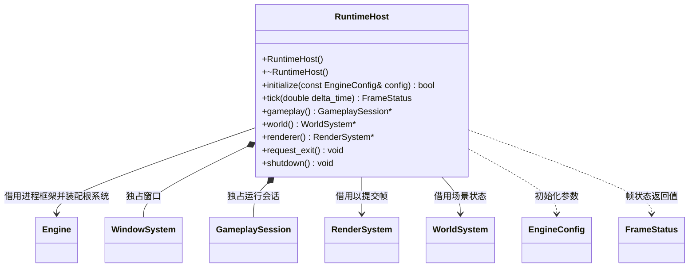

# 运行宿主

[类图索引](../../class-diagrams/index.md) · [完整引用关系](../../class-diagrams/references.md)

- RuntimeHost 位于运行时 app 模块，是桌面、编辑器和 Android 共用的运行组合入口。类型为 final，禁止复制和移动；构造、析构、查询、退出请求和关闭为 noexcept；initialize、tick 和 gameplay 的返回值标注 nodiscard。
- 初始化先独立创建 WindowSystem，再向空闲 Engine 装配 ResourceSystem、WorldSystem、RenderSystem。世界独占物理、导航、动画、界面和可选脚本子系统。引擎已被其他宿主使用时拒绝初始化，不清理他人的资源。
- 每帧先处理窗口事件，退出返回 exit_requested；窗口不可绘制返回 paused 并继续接收恢复事件。随后由 Engine 更新根系统，由 GameplaySession 处理显式部署控制和资源切换，最后提交渲染帧。
- 项目场景渲染失败时停止 GameplaySession 并尝试空白渲染；恢复成功继续运行，错误保留在会话中。系统更新或空白渲染失败保持 failed，直到关闭后重新初始化。渲染过程中收到平台暂停时返回 paused。
- `gameplay()` 返回可空借用，仅在本宿主初始化成功至关闭前有效。宿主调用者必须先关闭借用会话的 EditorSystem，再销毁 RuntimeHost。
- `world()` 返回同生命周期的可空世界借用，供宿主连接独立编辑器业务；运行时不认识命令服务或 MCP。
- `renderer()` 返回同生命周期的可空渲染器借用，宿主据此装配编辑器渲染命令；截图和渲染设置接口由 RenderSystem 提供。
- 关闭先销毁玩法会话，再关闭 Engine 的渲染、世界、资源根系统，最后销毁窗口。部分初始化和重复关闭均安全。
- RuntimeHost 不解析项目目录、不读取编辑器配置，也不实现脚本热重载；这些职责分别属于编辑器、平台路径和脚本模块。
