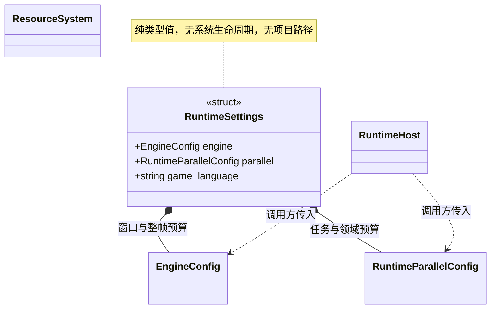

# 运行设置与项目配置边界

[类图索引](../../class-diagrams/index.md) · [运行宿主](runtime-host.md) · [并行预算](../parallelism.md)

> **影片配置规划 / 待实现：** 可选 `game.startup_movie` 逻辑资源路径及自动打包入口见
> [启动配置规划](movie-startup.md#启动配置规划)和[影片资源](movie-data.md)。该字段尚未加入以下
> RuntimeSettings 结构、现行配置验证或导出实现；无片头配置时保持原启动语义。

普通函数定义于 `runtime/app/runtime_settings.hpp`：

- `decode_runtime_settings(string_view text, RuntimeSettings& output, string& error) -> bool`：读取按 `game`、`engine`、`parallel` 模块组织的完整 JSON；三个模块及当前支持的各项配置均必填，缺项、未知字段或非法值失败，不改变输出。解析器不补默认值，没有版本、平台档位或配置层。
- `load_runtime_settings(const filesystem::path& path, RuntimeSettings& output, string& error) -> bool`：通过 ResourceSystem/VFS 读取并调用上述解析；只接受最多 64 KiB 的 JSON，支持普通文件与 Android APK。显式路径缺失返回失败。

`EngineConfig` 只定义窗口标题、宽高和目标帧率，独立系统预算放在 RuntimeParallelConfig。解析器不启动系统，不选择项目或平台，不依赖编辑器、TOML 或导入器。配置不是资源 GUID，不进入资源依赖图。

## 编辑器与导出

编辑器普通函数 `engine::editor::load_project_runtime_settings(project_root, platform, output, error)` 定义于 `editor/project/runtime_settings_io.hpp`，读取 `settings/runtime-*.toml`，合并公共配置与指定平台配置后复用运行时字段验证。平台明确使用 windows/macos/linux/android/ios；编辑器宿主传入当前平台。合并结果必须完整，缺少配置或内容无效时失败。

- `runtime-game.toml` 的 `[common].game_language` 是必填游戏语言字符串；汇总到 JSON 的 `game.game_language`，宿主传给 App，TS 通过只读 `App.gameLanguage` 获取。
- `runtime-engine.toml` 保存窗口等启动覆盖，`runtime-parallel.toml` 保存任务及领域预算覆盖。每个文件只拥有自己的模块。
- 各模块统一使用 `[common]`、`[platform.<平台>]`；平台字段覆盖同名公共字段。品质分组约定为 `[quality.<档位>]`，目前业务没有使用，本轮不添加品质选择或切换接口；非空品质配置明确报错，避免静默丢弃。
- 所有项目运行预算完整保存在 TOML 的公共配置与平台配置中；`RuntimeParallelConfig` 不再提供平台数值默认，Python 不复制 C++ 默认值。
- `scripts/runtime_settings.py` 独立完成打包收集，只输出当前平台完整的 `settings/runtime.json`。运行包不包含 TOML、编辑器设置或 TS 工程。
- 编辑器源配置和打包 JSON 均在 CLI 覆盖前应用；显式宽高与 worker 命令行参数最后覆盖。
