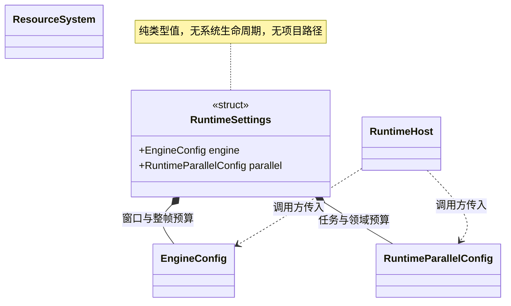

# 运行设置与项目配置边界

[类图索引](../../class-diagrams/index.md) · [运行宿主](runtime-host.md) · [并行预算](../parallelism.md)

普通函数定义于 `runtime/app/runtime_settings.hpp`：

- `decode_runtime_settings(string_view text, string_view profile, RuntimeSettings& output, string& error) -> bool`：解析统一 JSON。profile 必须由宿主明确选择 desktop/mobile；按调用方已有默认值 → defaults → 所选 profile → overrides 覆盖。失败不改变输出，未填写字段保留调用方默认。
- `load_runtime_settings(const filesystem::path& path, string_view profile, RuntimeSettings& output, string& error) -> bool`：通过 ResourceSystem/VFS 读取并调用上述解析；只接受最多 64 KiB 的 JSON，支持普通文件与 Android APK。显式路径缺失返回失败。

`EngineConfig` 只定义窗口标题、宽高和目标帧率，独立系统预算放在 RuntimeParallelConfig。解析器不启动系统，不选择项目或平台，不依赖编辑器、TOML 或导入器。配置不是资源 GUID，不进入资源依赖图。

## 编辑器与导出

编辑器普通函数 `engine::editor::load_project_runtime_settings(project_root, profile, output, error)` 定义于 `editor/project/runtime_settings_io.hpp`，读取可选 `settings/runtime.toml` 与 `settings/parallel.toml`，汇总为同一 JSON 模型后复用运行时字段验证；不新增配置 System。两个文件均缺少时保留传入默认值，存在但无效时失败。

- `runtime.toml` 使用统一 version/defaults/profiles/overrides，每层目前支持 engine。
- `parallel.toml` 保留并行配置的 version/defaults/profiles/overrides；转换时将各层放入统一模型的 parallel 字段。重复定义同一层 parallel 拒绝，避免两个源文件互相遮盖。
- `scripts/runtime_settings.py` 在打包阶段读取相同 TOML 并汇总，只输出 `settings/runtime.json`。运行包不包含 TOML、编辑器设置或购买清单。
- 编辑器源配置和打包 JSON 均在 CLI 覆盖前应用。未配置标题时，编辑器保留自己的 Engine Editor 默认标题；显式宽高与 worker 命令行参数最后覆盖。
