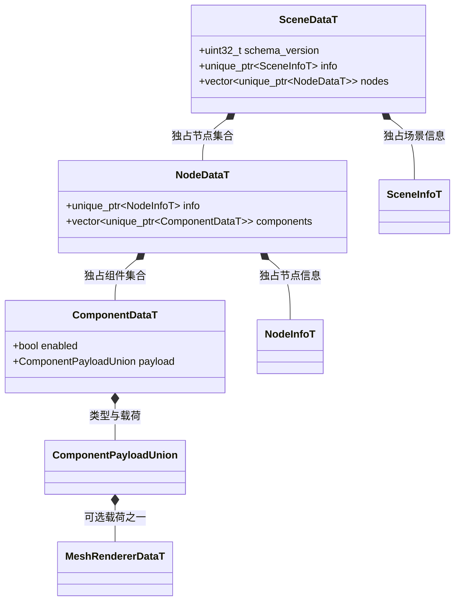
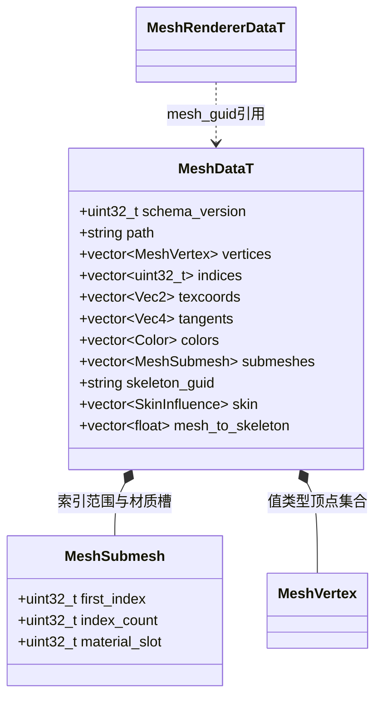
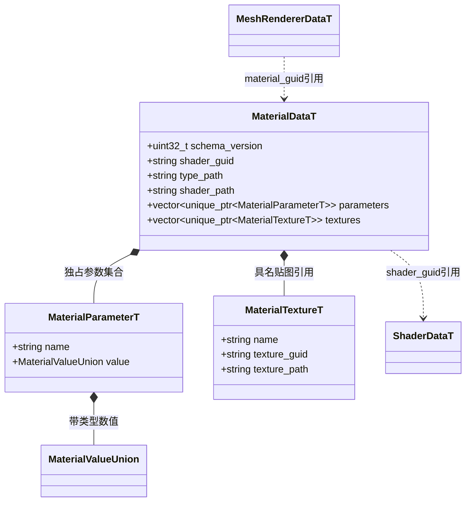
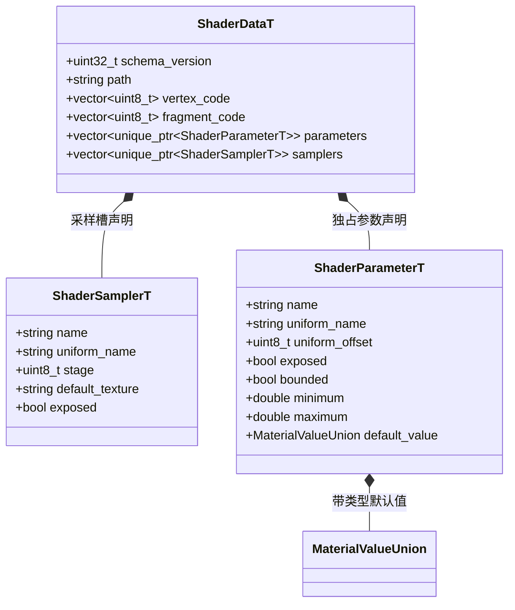
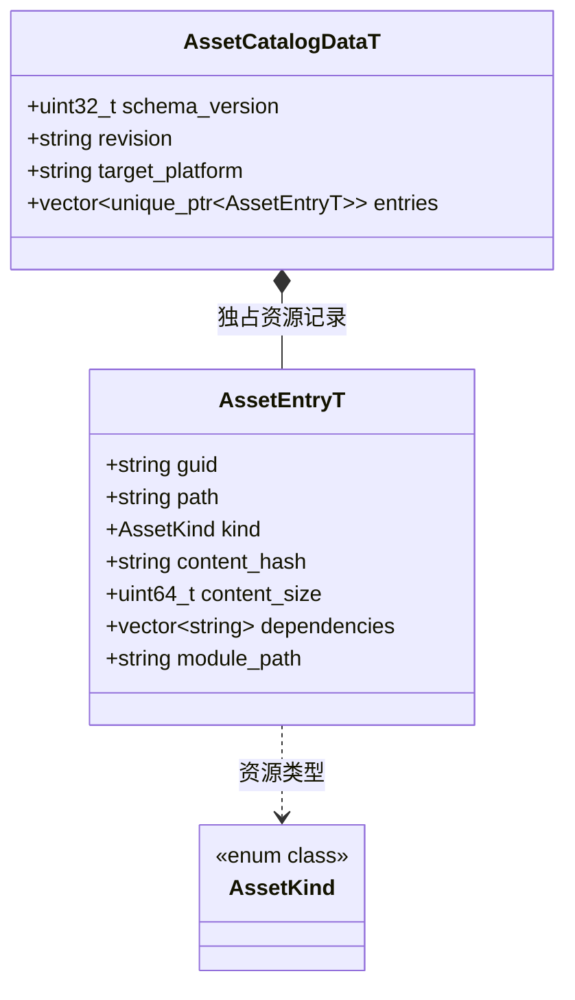
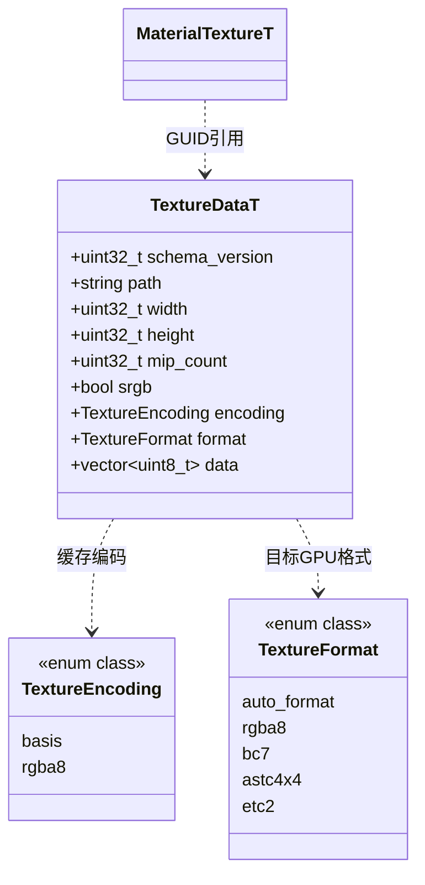
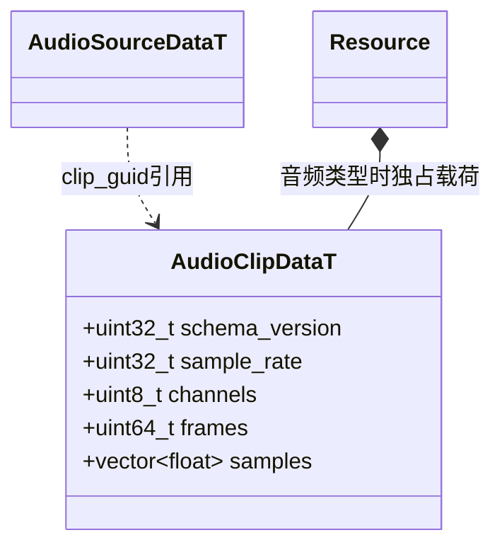

# FlatBuffers 共享数据模型

[类图索引](../../class-diagrams/index.md) · [资源系统](resource-system.md)

Schema 位于 `include/schemas/runtime/`，构建时生成 C++ 与 TypeScript。以下字段与 C++ 生成头一致，省略 `std::` 和 `engine::schema::` 命名空间；`unique_ptr`、容器元素类型和明确宽度整数保留原样。各资源根具有版本与文件标识，运行时验证后才解包。

## 场景与组件

`SceneInfoT`、`NodeInfoT` 与各组件载荷分别见[场景](scene.md)、[节点](node.md)、[渲染基础组件](component.md)、[物理组件](physics-components.md)和[音频组件](audio-components.md)。`scene.fbs` 只含场景、节点、组件及资源引用；数值类型来自 `common.fbs`。`MeshRendererDataT` 的 GUID 引用下方网格与材质定义，`AudioSourceDataT::clip_guid` 引用独立音频实体，不复制资源内容。组件 union 增加独立载荷，不在 Node 中保存具体类型字段。

场景节点 ID 为稳定局部 ID。加载时映射到运行实体 ID，恢复父子关系和活动相机；保存时反向映射，不将 flecs ID 落盘。TypeScript 节点 ID 使用 bigint。

## 网格

`MeshVertex` 是生成的值结构，包含位置和法线；顶点容器不使用 `unique_ptr`。资源路径与引用 GUID 的对应关系由资源目录维护。

## 材质

场景引用独立材质资源，不嵌入 Shader 字节码或整个材质定义。MeshRenderer 独占 Material 行为对象，Material 自己持有生成的 `MaterialDataT` 运行实例，支持命名参数修改。

## Shader

Shader 字节码使用 `vector<uint8_t>`，不是资源读取接口中的 `vector<std::byte>`。参数声明约束名称、Uniform 映射、可修改性、数值类型及范围；材质行为按这些声明校验。

## 资源目录

每个目录条目关联唯一 GUID、逻辑路径及完整性信息，依赖列表保存其他资源的 GUID；`module_path` 为脚本保留模块解析路径。运行时只消费目录和其引用的 GUID 二进制，不解析 TOML、不依赖 SQLite。

## 贴图

图片 `.meta` 声明格式、压缩模式、质量、颜色空间和 mipmap。编辑器调用 BasisU 生成缓存；运行时仅解析并按 GPU 能力转码。auto_format 由设备选择，明确指定但设备不支持的格式返回失败。内置默认贴图使用 RGBA8，避免运行时编码器参与生成。新增网格数组可省略，旧 MeshVertex 二进制布局不变；缺省 UV 为零、颜色为白色，切线按上游算法生成。

## 音频

`audio.fbs` 使用 `EAUD` 标识，采样为交错 F32 PCM。采样率、声道、帧数与样本数经过[运行时解码器](resource-codecs.md)校验。资源目录的 `audio` 类型、场景依赖与音源共享引用使用同一 GUID；播放游标、SDL 句柄与瞬态状态不进入模型。

## 模型、骨架与动画

`model.fbs`、`skeleton.fbs`、`animation.fbs` 各自定义独立资源根，标识分别为 EMDL、ESKL、EANI。对象包节点通过 GUID 引用 Mesh/Material，骨架保存关节及逆绑定，动画保存针对骨架索引的 TRS 轨道；详情见[模型资源](model-resources.md)。Mesh 的 SkinInfluence 保存四个 ushort 关节索引及四个 float 权重，mesh_to_skeleton 使用 16 项列主序 float。新数据同样由 flatc 生成 C++/TS，插件和运行时不维护重复持久字段。
