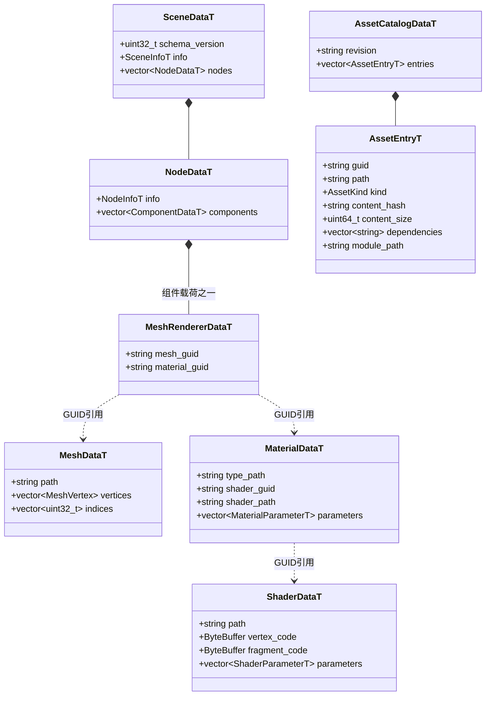

# FlatBuffers 共享数据模型

[类图索引](../../class-diagrams/index.md) · [资源系统](resource-system.md)

Schema 位于 `include/schemas/runtime/`，生成 C++ 与 TypeScript。源描述文件是 TOML；缓存是 FlatBuffers。每个独立资源有 schema_version=1 与文件标识，运行时验证后才解包。

- `scene.fbs` 只含场景、节点、组件和引用。数值值类型位于 common；Mesh、Shader、Material 与资源索引分别有独立 schema。
- 场景节点 ID 是场景内稳定局部 ID。加载时建立局部 ID 到运行时实体 ID 映射，恢复父子关系与活动相机；保存时反向映射，不将 flecs ID 落盘。
- 场景引用独立材质资源，不复制 Shader 字节码或整个材质定义。MeshRenderer 的运行时材质实例继续使用生成的 MaterialDataT 并支持命名参数修改。
- VecN 使用生成的数值结构。节点 ID 在 TypeScript 中为 bigint。运行时不解析 TOML、不依赖 SQLite。
