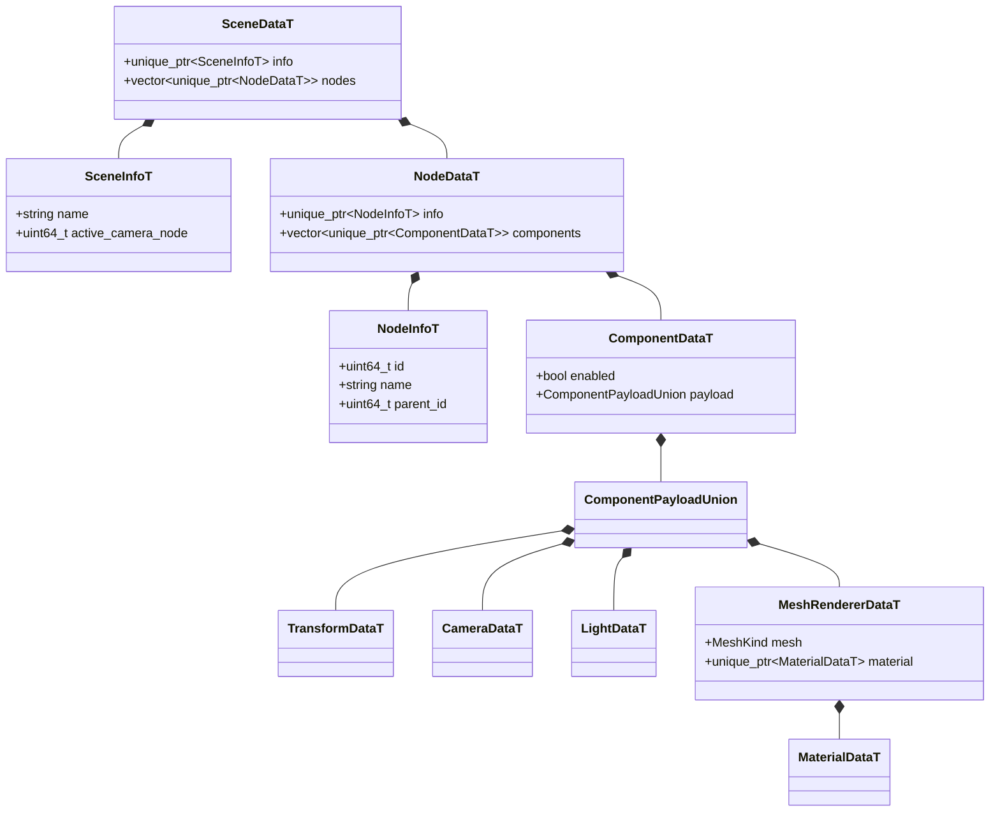
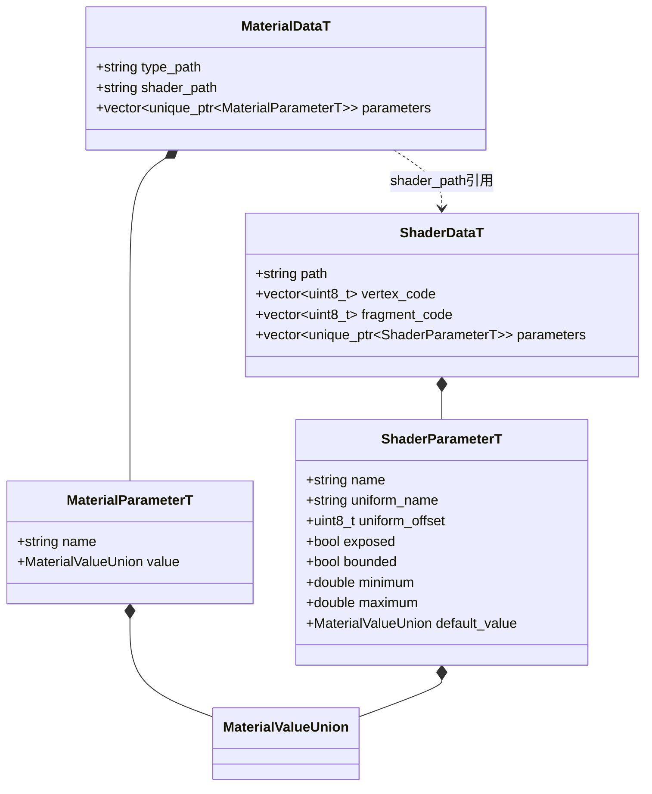
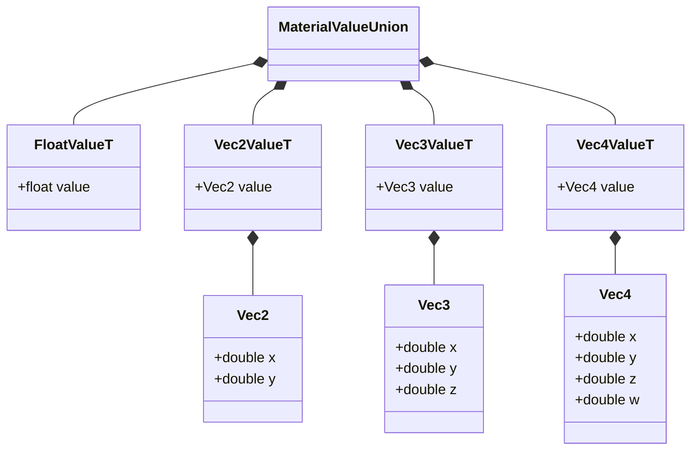

# FlatBuffers 共享数据模型

[类图索引](../../class-diagrams/index.md) · [场景](scene.md) · [资源系统](resource-system.md) · [材质](material.md)

所有下图类型均由 `schemas/runtime/scene.fbs` 生成。C++ 与 TypeScript 使用同一字段定义；本轮验证内存打包和双向读取，磁盘保存、读取留待下一阶段。`T` 后缀表示 C++ 原生对象接口，行为类不重复存储手写字段。

`MeshRendererDataT.material` 与下面的 `MaterialDataT` 是同一生成类型。资源表保存材质定义，组件中保存对应实例；定义覆盖值和实例合并后的值均使用相同的带类型参数格式。

两处 `MaterialValueUnion` 使用同一种生成联合类型：

- 生成 VecN 通过 `x()` / `mutate_x()` 等方法访问；图中展示逻辑数据字段，不额外声明第二套 C++ 结构。
- 场景与节点身份为 uint64，TypeScript 读取为 bigint，跨语言不能经 number 中转。
- 资源 `path` / `type_path` / `shader_path` 均使用 `builtin/...` 或 `project/...` 的完整规范路径，同时表达来源和身份，无需额外来源枚举。内置材质定义不得依赖项目 Shader；项目可复用内置。
- Shader 字节码为当前目标图形后端的真实二进制；参数的 union 是基础数据值类型，不是固定 Shader / 材质种类枚举。
- required 标记确保参数载荷、向量、元数据、材质与资源路径等必要字段存在；语义上的名字、范围及 uniform 槽冲突由 ResourceSystem 注册时验证。
- `Scene::build_data()` 只在需要快照时组合完整生成数据；日常运行由组件持有自己的生成载荷，不并行维护完整场景副本。
