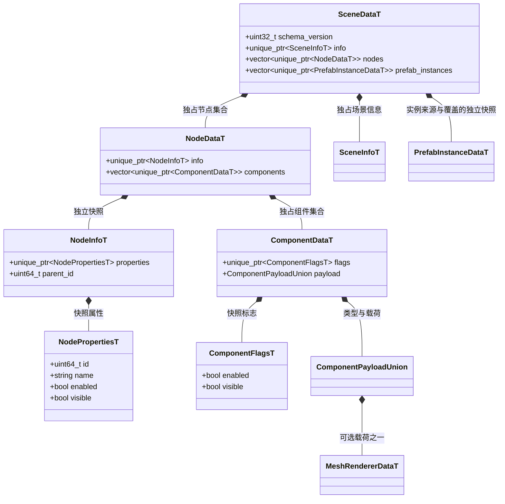
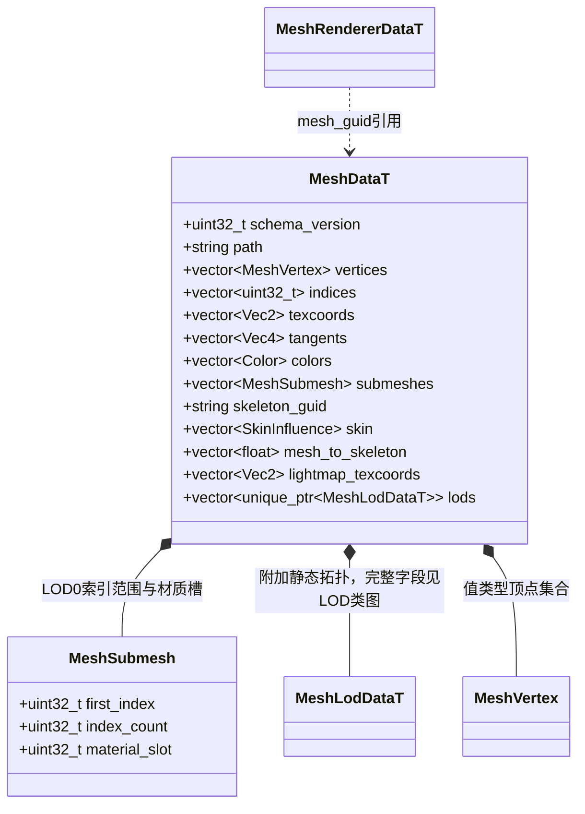
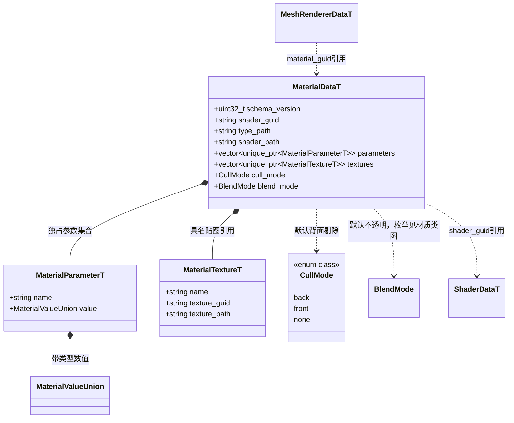
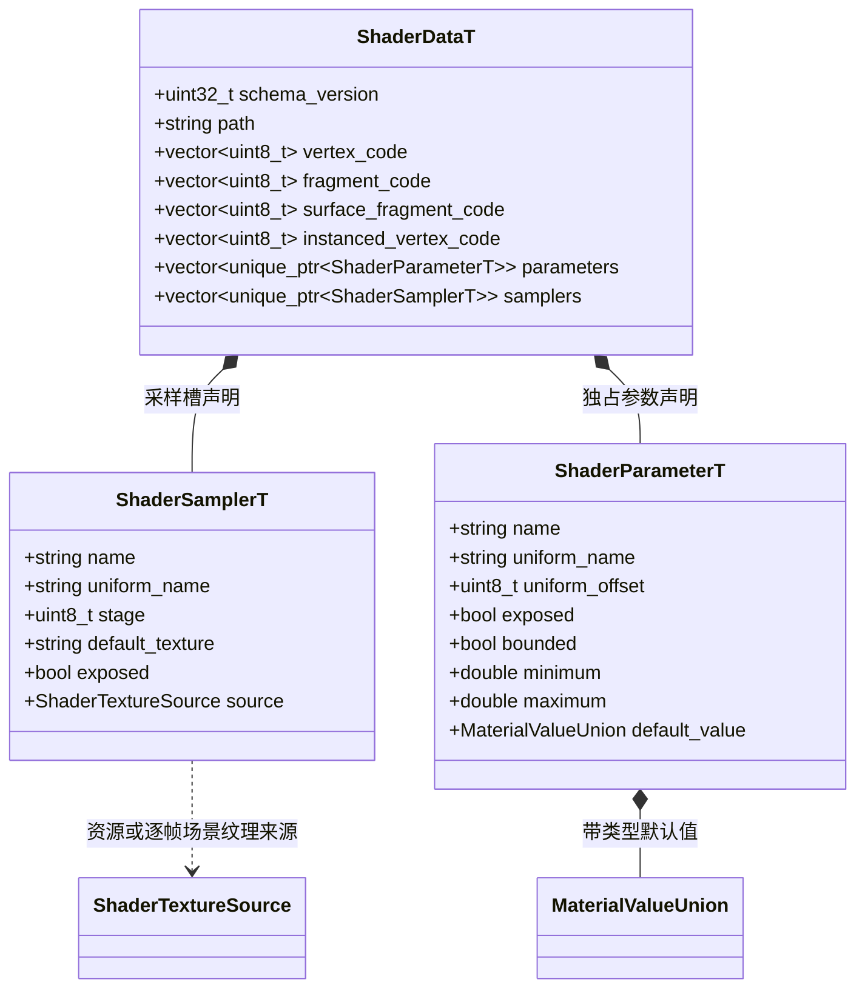
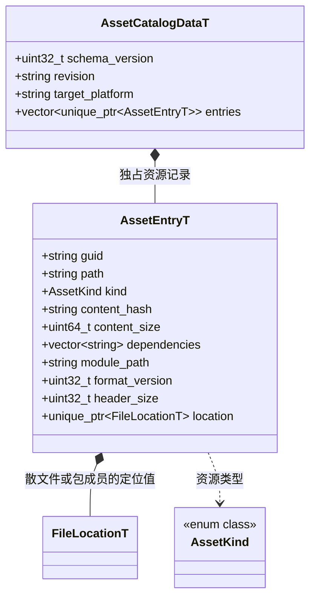
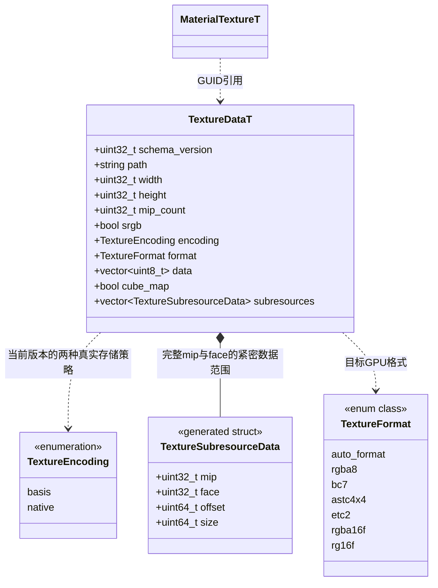
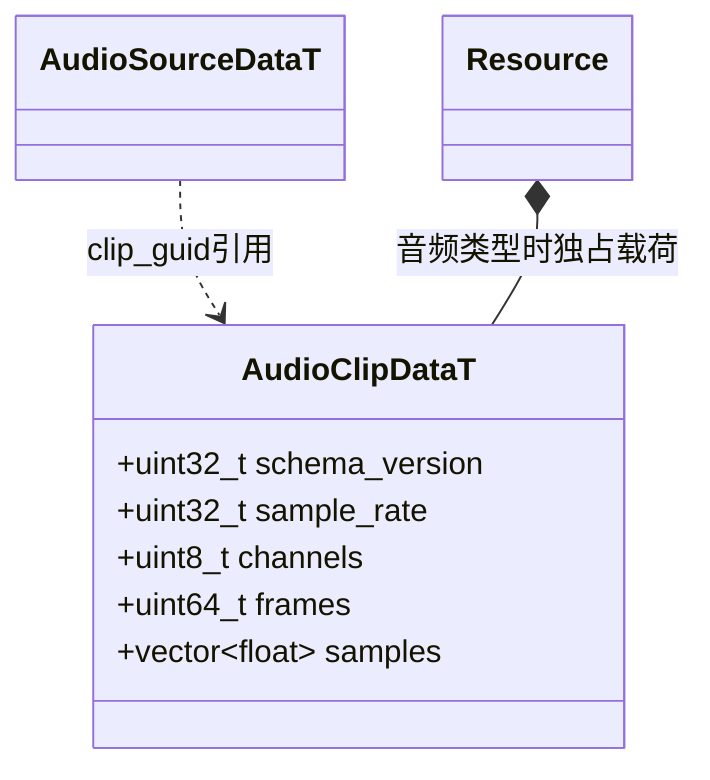

# FlatBuffers 共享数据模型

[类图索引](../../class-diagrams/index.md) · [资源系统](resource-system.md)

Schema 位于 `include/schemas/runtime/`，构建时生成 C++ 与 TypeScript。以下字段与 C++ 生成头一致，省略 `std::` 和 `engine::schema::` 命名空间；`unique_ptr`、容器元素类型和明确宽度整数保留原样。各资源根具有版本与文件标识，运行时验证后才解包。

## 场景与组件

`SceneInfoT`、`NodeInfoT` 与各组件载荷分别见[场景](scene.md)、[节点](node.md)、[渲染基础组件](component.md)、[物理组件](physics-components.md)和[音频组件](audio-components.md)。`scene.fbs` 组织场景、节点、组件及资源引用；相机和角色配置分别来自 `camera.fbs`、`character_controller.fbs`，数值类型来自 `common.fbs`。`MeshRendererDataT` 的 GUID 引用下方网格与材质定义，`AudioSourceDataT::clip_guid` 引用独立音频实体，不复制资源内容。组件 union 增加独立载荷，不在 Node 中保存具体类型字段。

上图 SceneDataT/NodeDataT/ComponentDataT 为保存、加载和撤销快照。运行时 NodePropertiesT、ComponentFlagsT 与各具体 Data 唯一存于 ECS；运行层级为 Flecs ChildOf，快照按需组装 parent_id，不维护两份权威层级。

场景节点 ID 为稳定局部 ID。加载时映射到运行实体 ID，恢复父子关系和活动相机；保存时反向映射，不将 flecs ID 落盘。TypeScript 节点 ID 使用 bigint。

`EnvironmentData` 与 `PostProcessData` 追加于组件 union 末尾，保留既有类型编号；环境、相机后处理和灯光投影参数随场景一起保存并热重载，定义见[环境与后处理组件](environment-components.md)。旧场景省略它们时使用默认画面参数，不借用上一场景的瞬态设置。

## 网格

`MeshVertex` 是生成的值结构，包含位置和法线；顶点容器不使用 `unique_ptr`。资源路径与引用 GUID 的对应关系由资源目录维护。

## 材质

场景引用独立材质资源，不嵌入 Shader 字节码或整个材质定义。MeshRendererRuntime 的 ECS 运行列独占 MaterialState 槽数据，Material 为带槽代次的值句柄；MaterialState 直接使用生成的 MaterialDataT，支持命名参数修改。

## Shader

Shader 字节码使用 `vector<uint8_t>`，不是资源读取接口中的 `vector<std::byte>`。参数声明约束名称、Uniform 映射、可修改性、数值类型及范围；材质行为按这些声明校验。

## 资源目录

每个目录条目关联唯一 GUID、逻辑路径及完整性信息，依赖列表保存其他资源的 GUID；`module_path` 为脚本保留模块解析路径。运行时只消费目录和其引用的 GUID 二进制，不解析 TOML、不依赖 SQLite。

## 贴图

**2026-11-07：以下格式 2 的大场景离线产物已实现。** 唯一字段定义在本页，导入和平台选择见[贴图导入](../../editor/class-diagrams/texture-importer.md#目标平台产物)。

图片 `.meta` 继续声明格式、压缩模式、质量、颜色空间和 mipmap，并用 storage 明确选择 basis 或 native。basis 保留压缩传输与运行时转码能力；native 在编辑器解析 auto，data 为明确 format 的 GPU 像素 / 块，运行时不转码。二者是同一当前版本的存储策略，不是旧格式兼容。native 禁止 auto_format；basis 的 auto_format 继续按既有设备能力选择转码目标。显式格式不支持时失败，不把 native 偷换成 basis 或另一种格式。

TextureData 格式 2，Schema 版本默认 0。native 的 subresources 按 mip、face 唯一定位连续紧密数据，偏移 / 大小完整覆盖 data 且不得重叠、留洞或越界；二维每 mip 一面，cube 每 mip 六面。按 block 尺寸校验末端取整、每面尺寸、数量与精确字节数；不得仅相信生产者的 size。basis 的 subresources 必须为空，由编码头验证其原有 mip 信息，不允许伪造 native 范围。现有尺寸 / 总量上限继续约束单项资源，不因分帧上传取消校验。

内置 / 程序化内存贴图也构造相同格式，像素候选使用 native 及明确的 RGBA8 / RGBA16F，不走编码器；显式提供的 basis 内存资源仍按相同 codec 校验。KTX 为编辑器源容器，导入后生成 native 范围；删除旧 rgba8 / ktx 编码枚举与旧格式分支，旧包拒绝并重建，GUID 保留。Mesh 的 UV / 颜色等语义不在本批调整。

## 音频

`audio.fbs` 使用 `EAUD` 标识，采样为交错 F32 PCM。采样率、声道、帧数与样本数经过[运行时解码器](resource-codecs.md)校验。资源目录的 `audio` 类型、场景依赖与音源共享引用使用同一 GUID；播放游标、SDL 句柄与瞬态状态不进入模型。

## 模型、骨架与动画

`model.fbs`、`skeleton.fbs`、`animation.fbs` 各自定义独立资源根，标识分别为 EMDL、ESKL、EANI。模型资源节点通过 GUID 引用 Mesh/Material，骨架保存关节及逆绑定，动画保存针对骨架索引的 TRS 轨道；详情见[模型资源](model-resources.md)。Mesh 的 SkinInfluence 保存四个 ushort 关节索引及四个 float 权重，mesh_to_skeleton 使用 16 项列主序 float。新数据同样由 flatc 生成 C++/TS，插件和运行时不维护重复持久字段。

### 方向光级联阴影

`LightData` 在既有阴影开关、分辨率及偏移后追加 `shadow_cascades:ubyte=4`、`shadow_distance:float=150`、`shadow_split_lambda:float=0.6`、`shadow_cascade_blend:float=0.1`。Schema 仍为唯一持久模型；TOML 编解码、组件校验、MCP 与脚本通过该模型使用相同值。数量仅接受整数 1/2/4，距离为 `(0,100000]` 有限值，混合划分比例在 `[0,1]`，交界混合比例在 `[0,0.3]`。

### 相机环境遮蔽

`PostProcessData` 追加 `ao_enabled:bool=false`、`ao_radius:float=1`、`ao_strength:float=1`、`ao_power:float=1.5`、`ao_fade_start:float=80`、`ao_fade_end:float=150`。旧场景未存储 AO 字段时使用这些默认值。所有浮点值有限，半径 `(0,100]`、强度 `[0,2]`、指数 `[0.1,8]`、淡出距离 `0 <= start < end <= 100000`；具体组件整体校验，失败不部分改变。AO 结果来自当帧 GPU 计算，只有参数进入场景模型。

`PostProcessData` 在末尾继续追加 `hdr_enabled:bool=false`、`bloom_enabled:bool=false`、`bloom_threshold:float=1`、`bloom_intensity:float=0.15`、`bloom_radius:float=1`。阈值范围 `[0,100]`、强度 `[0,10]`、半径 `[0.25,4]`，所有数值有限，且 `bloom_enabled` 为 true 时 `hdr_enabled` 必须为 true。旧数据按关闭的默认值读取；TOML、FlatBuffers、运行时组件和脚本使用同一模型，不自动改写请求中的另一开关。

当前 SceneData / PrefabData 二进制格式版本为 3；生成模型默认版本 0 无效。组件载荷包含参数化 CameraController 与角色能力配置，读取拒绝其他版本和未标记版本的数据；源描述通过当前导入器重新生成缓存和运行包，不保留旧布局读取分支。
