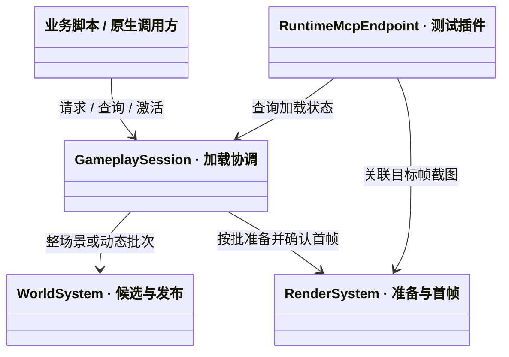
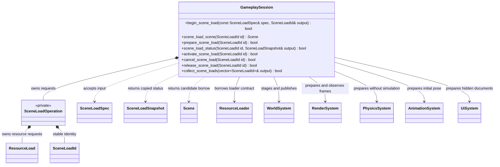
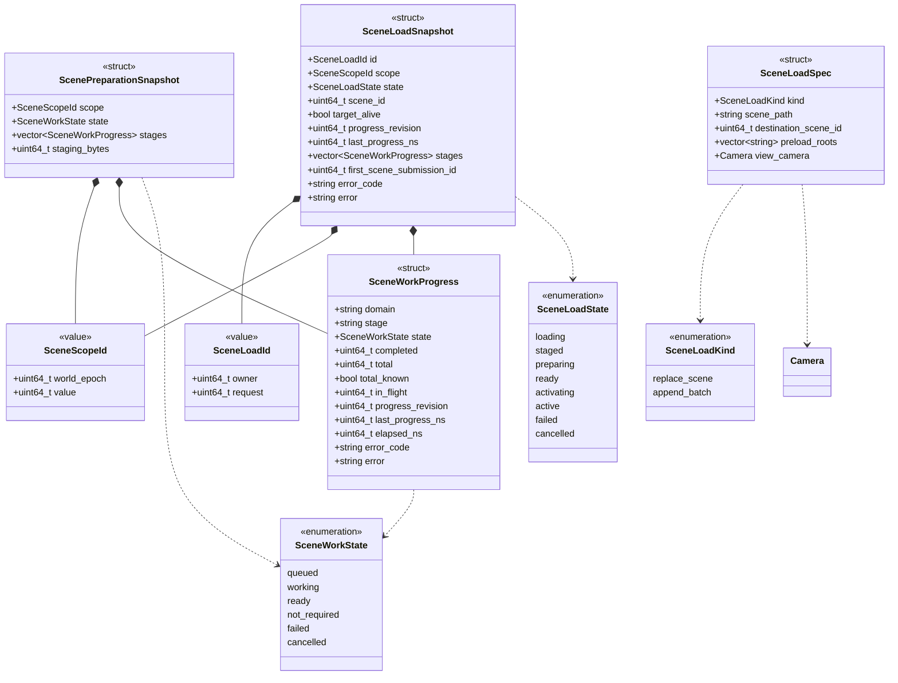
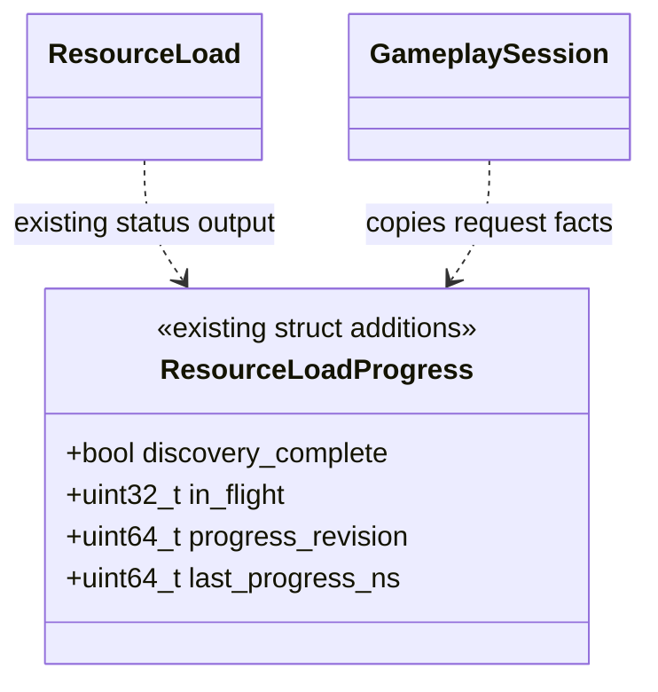
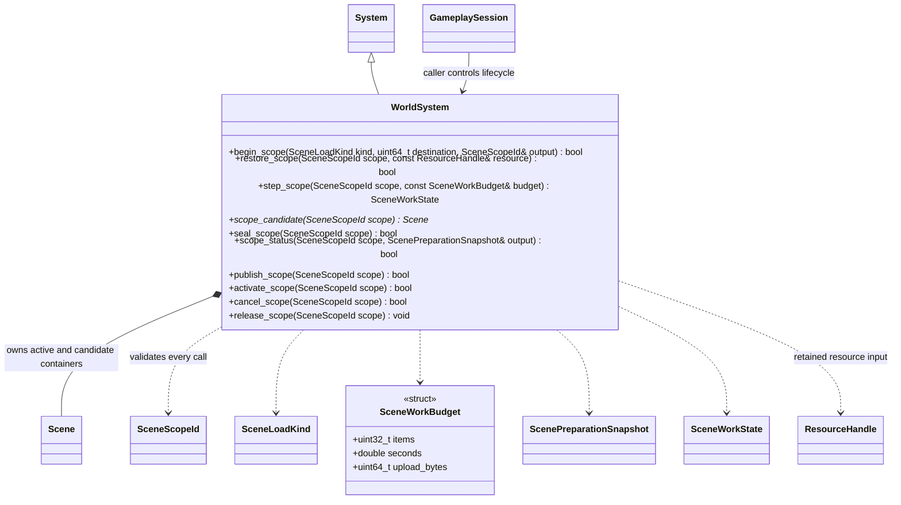
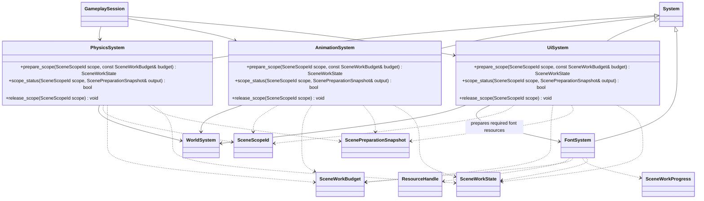
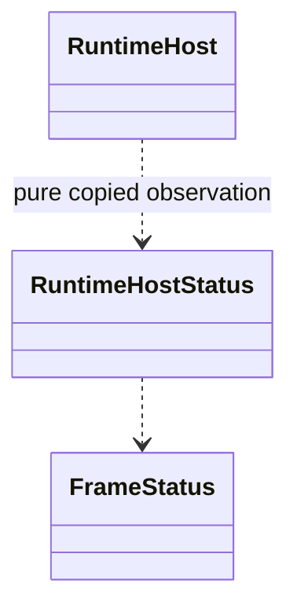

# 场景加载、动态批次与业务状态

[类图索引](../../class-diagrams/index.md) · [当前加载链路](large-scene-preparation.md) · [渲染就绪与截图](render-readiness.md) · [脚本业务接口](../../plugins/runtime/class-diagrams/scene-loading-script-api.md) · [测试 MCP](../../plugins/runtime/class-diagrams/mcp-runtime-test.md)

状态与方法按本页契约实现；平台验证与限制集中见[测试文档](../../testing.md)。

## 目标与职责

| 用户目标 | 对应设计 |
| --- | --- |
| 现有图形测试适配后可以截图 | 原生测试与 MCP 使用同一按请求标识的截图接口；可等待指定场景或批次的真实场景帧 |
| 进入场景时保持响应与连续呈现 | 资源后台读取，ECS 与领域准备按帧预算推进；候选未就绪时保留旧场景或调用方选定的加载画面 |
| 测试构建通过 MCP 查询加载状态 | MCP 组合普通模块的只读快照；协议、注入和测试编排仅进入显式测试构建 |
| 业务控制场景加载 | C++ 与 TS 可发起、查询、配置候选、请求准备、激活、取消和释放；不要求业务使用 MCP |

沿用 GameplaySession 作为调用方协调位置。它已经借用资源、世界、渲染、物理、动画及 UI 系统；新增操作记录放在其内部，不新增 LoadingSystem、LoadingManager、资源缓存或线程池。WorldSystem 管候选与发布，领域系统管各自的准备状态。核心模块不调用 MCP、不识别项目页面或测试脚本。

## 最小职责与复用边界

- 业务只操作一个加载请求：发起、查询状态、取得场景、完成配置后准备、激活、取消、释放。请求 ID 从状态快照取得；不另设 ID getter、重复的 Ready getter 或项目专用加载入口。请求枚举只返回 ID，详细数据复用单项状态查询。
- Prepare 与 Activate 保留为两个动作：前者封存业务构建并开始准备，后者允许完整内容切入。Cancel 保留可查询的取消终态，Release 放弃操作记录；合并这些语义会使失败归档或资源寿命含糊。
- 原生调用、业务脚本、编辑器预览及测试使用同一 GameplaySession、ResourceLoader、WorldSystem 和 RenderSystem 实现。候选仍在同一个 Flecs world 中隔离，任务仍由同一 TaskSystem 域执行；不增加测试世界、测试资源加载器或离线模拟渲染器。
- SceneLoadOperation 只拥有一次操作及必要引用，状态快照是复制出来的观察值，不反向成为另一份运行数据。各领域的范围方法属于实现同一加载事务的底层契约，不全部暴露为业务或 MCP 命令。
- 测试条件编译只增加协议适配和临时注入；场景准备、模拟激活、渲染提交、GPU 回读和 PNG 编码使用正式实现。测试辅助只等待和断言，不执行另一套加载算法。
- 从现有 GameplaySession.step_prepare 复用资源、ECS 与渲染准备实现；原启动流程继续负责部署和 VM，并驱动同一个场景请求。WorldSystem 和领域系统的范围化改动在各自现有实现中完成，不保留“启动用一套、切场景用一套、测试再一套”的并行算法。

## 加载协调接口

下图只定义 GameplaySession 的新增接口，既有启停、tick、部署接口见[玩法会话](gameplay-session.md)。SceneLoadOperation 是其私有记录，持有请求身份、资源获取、范围身份和阶段结果，不复制 ECS 或 GPU 数据。

- 构造借用关系沿用 GameplaySession；请求不能比会话活得更久。所有修改在宿主协调线程安全点执行，查询为 const、输出独立值快照，均标注 nodiscard。无后台任务保存 Scene、Node、ECS 列或 VM 对象的裸借用。
- `begin_scene_load` 返回 bool 表示受理，成功输出非零身份；拒绝时输出为空，原因沿用会话 last_error。受理后的失败、取消、进度归本请求，不能被其他命令覆盖。
- `replace_scene` 必须给出 scene_path；destination_scene_id 为 0。源场景闭包与 preload_roots 一起通过 ResourceLoader 预加载。只加载该请求明确需要的根和依赖。
- `append_batch` 必须指定当前仍有效的目标场景，scene_path 为空；preload_roots 声明待实例化的 Model、Prefab 等资源。空列表允许只用已有资源构建简单程序化节点。一批只有一个目标场景。
- view_camera 是可空的原生观察镜头值句柄，默认使用候选场景或追加目标的活动镜头；编辑器预览可传入其隐藏镜头，借用须覆盖准备与切入，不进入保存数据。场景环境与后处理仍读取目标场景组件，不能因为隐藏镜头而丢失效果。
- 资源就绪后按预算恢复候选，进入 staged。`scene_load_scene` 此时返回本请求独占的候选 Scene 借用；业务使用既有 Node/Component 和实例化方法配置候选，可分多帧完成。候选不参与模拟、可见对象查询或 UI 输入。active 时同一方法返回已发布的正式场景，追加批次返回其目标场景；其他状态或目标已卸载时返回空。候选借用不能跨发布持有，激活后通过同一方法重新取得正式借用。
- `prepare_scene_load` 封存本请求的成员、父子关系和资源引用，并开始领域准备。封存后经旧 Scene/Node 句柄写候选必须拒绝，不能一边准备一边无限增加依赖；需要重做则取消并创建新请求。对同一已封存请求重复调用幂等，不重开准备代次。
- `scene_load_status` 只读取已发布阶段记录，不执行 step、不刷新 ECS、不等待任务、不创建渲染资源。无效身份返回 false 并清空输出。collect 只复制当前保留的请求 ID，不扫描场景节点；详细信息继续调用同一状态接口。
- `activate_scene_load` 只接受 ready 请求，排队在下一安全点发布；true 表示已受理。对同一 activating/active 请求幂等，其他状态明确拒绝。真正完成由状态查询报告。
- `cancel_scene_load` 可取消尚未发布的请求；重复取消幂等。发布已开始或已 active 时拒绝，不能把取消误当撤销已发生的玩法操作。取消只撤销本请求持有的工作和引用，不中断其他请求共享的资源加载。
- `release_scene_load` 仅释放 active/failed/cancelled 的操作记录；活动场景和资源已交给实际消费者持有，释放请求不会卸载场景。仍在途的请求须先取消。终态持续可查到显式释放，结束会话统一清理；请求记录设有容量上限，不能静默淘汰仍被业务观察的请求。
- 一个会话最多一个 replace_scene 请求，可以有多个有界的 append_batch 请求。新的替换请求在旧替换仍在途时返回 busy；调用方明确取消后再发起。成功切走目标场景会取消该场景未发布的追加批次。
- 普通 Gameplay.Update 和加载 UI 在准备期间仍可执行。新场景的敌人、关卡计时及对象行为由业务在请求 active 后开始；核心不猜测哪些项目变量属于关卡计时。原生物理与动画的激活由范围状态约束。

## 身份、状态与进度

以下均为临时运行数据，不进入 Scene schema、资源、存档或 TOML。SceneLoadId 的 owner 是会话生命周期身份，request 是单调请求身份；SceneScopeId 是世界中的准备和发布范围，跨阶段不变化。两者不可回绕复用，0 仅表示空值。

| 加载状态 | 含义 |
| --- | --- |
| loading | 资源读取/解码或候选恢复正在推进，各阶段独立报告 |
| staged | CPU 资源与候选结构可用，等待业务配置候选并调用 Prepare |
| preparing | 候选已封存，渲染、物理、动画、UI 等必要准备正在推进 |
| ready | 本范围必要准备全部完成，可接受激活；尚未开始玩法 |
| activating | 已受理激活，正在安全点发布并等待属于该范围的场景帧 |
| active | 本次激活完成：至少一帧目标场景已提交，范围已可参与模拟 |
| failed / cancelled | 明确终态；有独立原因，不能继续自动推进 |

active 是本次请求的成功终态，不能单独证明目标当前仍存在；target_alive 单独报告范围是否仍有效。场景卸载、世界重建和设备换代都必须通过对应身份与帧快照校验，不能仅比较状态字符串。scene_id 表示发布后的目标玩法场景；追加批次始终属于其目标场景。

- domain 使用固定英文标识，例如 resource、world、render、physics、animation、ui；stage 由该领域定义英文标识，例如 reading、decoding、restoring、uploading、programs、targets。它们是可枚举诊断数据，不解析日志字符串得到状态。
- 多阶段可并行；stages 是这些阶段的事实快照，不用一个线性百分比覆盖并行状态。queued/working/ready/not_required/failed/cancelled 的语义统一，not_required 表示此范围确实无需该项；缺失必要能力必须失败。
- completed/total 使用各阶段明确定义的同种单位，例如去重资源项、节点或上传块。total_known=false 时不展示确定百分比；计数完成也不代替 state=ready。
- progress_revision 及 last_progress_ns 仅在实际阶段改变或工作完成时更新；查询、心跳、无进展的轮询不能更新它们。elapsed_ns 是本阶段经过时间，不把并行阶段耗时相加冒充总耗时。
- 资源阶段复用 ResourceLoad 的独立请求结果，扩展其进度以暴露依赖发现完成、在途项和实际进展序号；不增加第二份资源状态表。底层资源 ready 仍只表示 CPU 数据可用。
- 聚合快照在同一协调安全点采样；工作线程先发布结果，再由所属模块接收。快照不含内部地址、任务对象或可写引用。
- 64 位身份和纳秒时间跨 TS/JSON 使用十进制字符串；显示用毫秒可以另行换算，不能经 JS number 往返身份。
- 错误保存 domain、stage、稳定英文 error_code 和英文说明；加载失败、命令拒绝、截图失败分别记录。超时由调用方判断，不能因为一段时间没有进展就把引擎操作自动改成 failed。

ScenePreparationSnapshot 是单个领域的只读聚合：同一领域可以同时有多个 stages，例如贴图解码与 GPU 上传并行。scope_status 返回其 state 和各阶段快照；GameplaySession 将各领域结果组合为 SceneLoadSnapshot，不用一个“当前阶段”掩盖其他在途工作。staging_bytes 记录实际暂存字节，不代表总资源大小。

资源进度仅补充以下观测字段，已有 completed/total 和 ResourceLoad.status 方法仍在[资源加载契约](resource-loader.md)定义；资源模块不反向依赖场景快照类型。

资源 domain 的阶段名使用 loading，计数单位为去重依赖项；当前没有单项 I/O/解码细分状态时不伪造这些阶段。必要的进一步定位使用所属资源模块已有详细分析能力。

## WorldSystem 的候选和批次边界

范围接口统一组织场景恢复与发布。WorldSystem 不依赖 RenderSystem 或具体插件；它只执行调用方明确请求，GameplaySession 在调用 publish_scope 前检查全部参与领域的状态。

- begin_scope 为整场景或追加批次预留身份和独立候选容器；restore_scope 只接受已就绪的 Scene 资源，保持原有预加载契约。追加批次直接使用其候选 Scene 构建内容。
- step_scope 推进节点、父子、索引、追加目标映射和派生变换的准备。scope_status 是纯查询，取代使用 step(0) 作为查询入口的业务习惯。
- 普通 Node 查询、场景保存、模拟、拾取及 UI 输入只能访问已发布范围。领域准备只能通过本请求的 scope 在结构稳定阶段访问候选；不移除 Published 过滤后遍历整个世界。
- 追加批次使用候选容器隔离制作。目标局部 ID、父子和预制体映射在准备阶段预留并完成校验；发布保留完整实体 ID 和组件实例身份，候选 Scene 借用在发布后失效。业务持有的 Node 值句柄仍须按实际实体校验。
- 封存后生成不可变的准备范围。变换动画等正常帧更新不创建新的加载请求；活动对象的资源替换只使其所属的局部准备失效，不能把全部已就绪场景变回 preparing。
- 发布、可绘制和可模拟分开：publish_scope 使完整范围可被渲染，activate_scope 在确认首帧后启用其模拟。领域系统依据同一 ECS 范围状态，不各自维护互不一致的发布标记。
- 原子切换只改变已经准备好的范围状态、活动镜头和索引入口；节点恢复、批量索引构建、碰撞注册和 GPU 上传不放在此刻执行。实现可以用 ECS 范围元数据及关联表达统一开关，不能以一次主线程大循环重新给全部节点创建对象。
- 替换场景准备期间旧场景继续有效。提交前失败/取消保留旧场景；新场景首帧成功提交后，再退休旧的非持久内容。发布阶段发生设备失败时维持 activating 并报告渲染故障，由宿主恢复或终止，不声称新场景已经成功。
- 首帧尚未成功时保留旧场景的拥有关系；如果恢复已经不可能，宿主明确报告失败。回收旧场景的实体与 GPU 引用按预算退休，保留资源和提交序列要求的实际寿命。
- 新场景通常需要同时容纳旧场景和候选的内存。超过预算明确失败；如果业务选择先退出旧场景显示加载画面，应作为调用方显式流程，不能由加载器偷偷销毁旧内容。

## 领域准备与调度

渲染及渲染扩展的接口定义在[渲染就绪](render-readiness.md)。以下为其他直接影响首次进入的领域新增接口；沿用已有系统，不新增统一 Manager 或第三方包装类。

- prepare_scope 的第一次调用建立本领域私有准备状态，后续调用按预算推进。scope_status 为 const 纯查询；release_scope 撤销该范围未完成任务并回收本领域资源，幂等，活动范围的释放只在 WorldSystem 已退休它后进行。
- PhysicsSystem 准备碰撞形状、刚体与角色的初始状态；准备期间不求解、不发布接触事件，待范围 active 后加入活动模拟。AnimationSystem 准备骨架映射、初始姿态及必要蒙皮数据，不推进播放时间或发送事件。
- UiSystem 准备候选文档、布局与所需字体/图片，文档在发布前不可见且不参与输入。FontSystem 保持所属字体能力，由 UI 与渲染准备链显式使用；不把首次字体 GPU 创建藏在激活后的首帧。
- [FontSystem.prepare_font](font-system.md) 只消费已经加载的字体与 Shader 获取；按预算准备并共享 GPU 字体数据，返回本次阶段结果。它不读取文件、不推进场景和模拟，UiSystem/RenderSystem 将结果纳入自己的范围状态；相同字体和 Shader 不重复准备。
- 音频播放、导航作业及项目程序化生成仍使用所属显式接口；要求在进入前完成的项目工作在 staged 阶段完成后再 Prepare，或在 ready 后等待项目条件再 Activate。SceneLoad 的 ready 不冒充这些任意业务作业的完成。
- 场景包含的必需渲染扩展须参加准备；仅在 draw 中创建全部资源的插件不能被计为 ready。具体接入先更新所属插件契约，缺少必要准备能力返回 unsupported_preparation。
- 资源 I/O、解码及可并行 CPU 准备使用现有 TaskSystem 域，共享 ThreadSystem 预算。ECS 结构改变和 GPU API 提交仍在协调安全点，后台只处理不可变数据和自有结果。
- RuntimeHost 每帧持续处理窗口/输入、原有画面和 UI，再按统一剩余预算驱动 GameplaySession 的加载步骤。每个模块不能各用一整份帧预算；同一范围的就绪先决条件满足后，各领域可以交错推进。
- GameplaySession 的正常 tick、初始 step_prepare 与编辑器预览共用上述内部操作推进；同一帧只推进一次，不因为 MCP 查询而增加一轮工作。加载操作不要求存在脚本 VM。
- loading 帧禁止等待未完成 future、同步整场景读盘、循环等待 ready 或全 GPU idle。保留现有项数、时间、上传字节及暂存预算；排队等待和实际工作分别可观测。
- 预算是原子工作项之间的软上限。驱动程序创建管线、单次第三方调用仍可能形成长帧；实施必须把可拆工作切开、可离线工作移到导入阶段，并记录无法抢占的项。本类图定义保持响应的调度边界，不把尚未测量的“任何资源零卡顿”写成已保证的结果。

## 宿主状态与测试观察

RuntimeHost.status 为 const、纯查询，tick_id 在完成一轮宿主循环时递增；sampled_at_ns 表示这份快照的采样点。方法与字段统一维护在[运行宿主](runtime-host.md)。它只报告宿主自己的调度与窗口状态，不汇总场景节点或 GPU 数量。场景加载状态从 GameplaySession 取，帧和截图状态从 RenderSystem 取。

窗口不可绘制期间可以继续符合平台约束的 CPU 准备；不得伪造首帧完成或为了测试强制唤醒窗口。测试超时保存 window_drawable 和原始阶段状态，恢复后仍验证设备代次。

## 调用与验证边界

- 原生宿主、场景脚本与测试使用同一加载和状态契约；私有项目调用方的修改只留本机。
- 既有完整脚本启动与热重载的候选 Run 语义保留；场景操作属于创建它的调用方/Run，停止或换 Run 时取消未完成操作，不能清理另一个有效 Run 或编辑器预览的范围。
- 现有窗口渲染、GameplaySession、脚本及 MCP 用例按所属模块扩充，覆盖整体进入、追加批次、失败/取消、旧身份、未就绪首帧和连续呈现；图形用例按[截图契约](render-readiness.md#测试适配)归档。
- 先用一个已有代表场景和一个追加批次验证主循环可持续推进、准备预算与首帧顺序，再检查原有黑屏案例。不把本轮改成全引擎性能专项。
