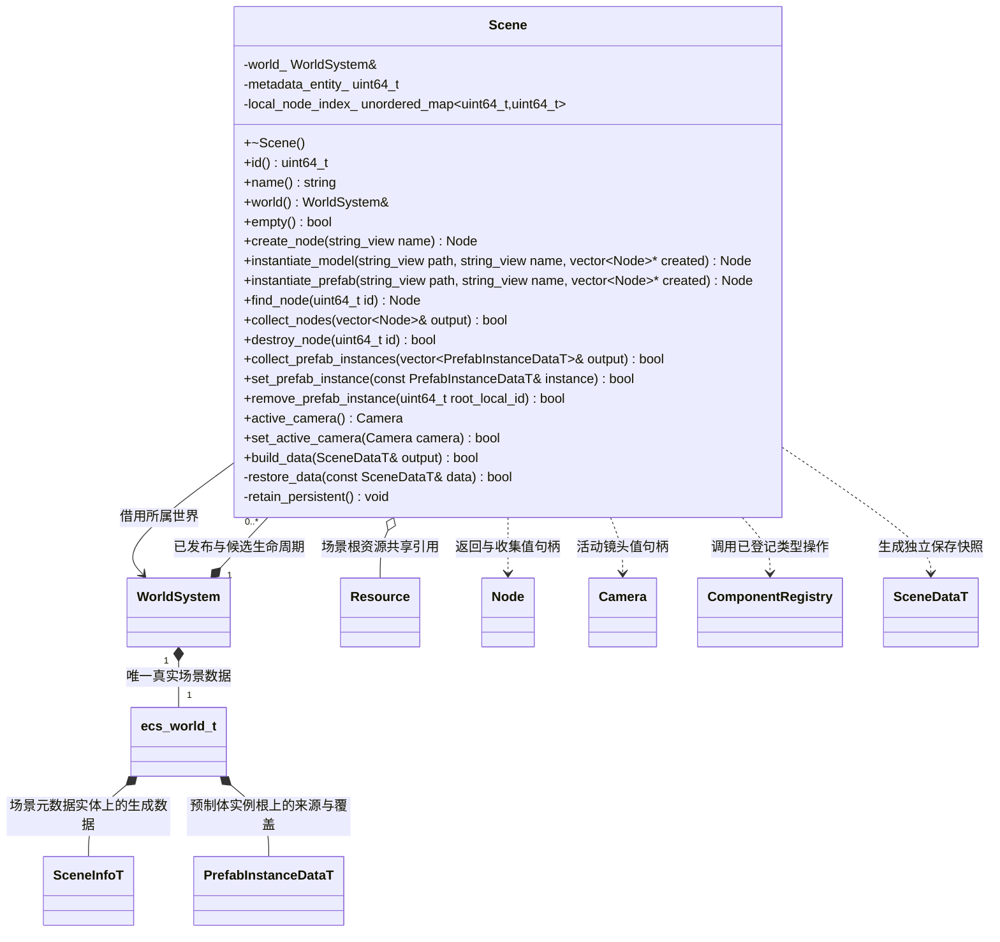

# 场景

[类图索引](../../class-diagrams/index.md) · [世界系统](world-system.md) · [节点](node.md) · [ECS 场景](ecs-scene.md)

Scene 组织场景加载、发布、卸载和资源引用；节点属性、层级、组件数据与预制体实例记录唯一存放在 WorldSystem 的 Flecs world。

- WorldSystem 最多有一个当前玩法 Scene，另可保留常驻场景及一个未发布候选。场景 ID 在世界重新初始化后不重用。
- `create_node()` 创建实体并自动添加 Transform。节点的完整 64 位实体 ID 含代次；局部 ID 另行分配并由 `local_node_index_` 索引。索引只保存身份映射，不复制节点状态或拥有 Node 对象。
- SceneInfoT 存放于内部场景实体，活动相机只以局部 ID 保存；`active_camera()` 按需返回 Camera 值句柄。`set_active_camera(Camera{})` 清空选择，过期非空或其他场景镜头失败。添加 Camera 不自动改变选择。
- `collect_nodes()` 按创建/恢复顺序生成独立值句柄数组；不暴露 ECS 内部地址或拥有容器。数组跨 ECS 移表仍可用于重新查找，但被删除实体的句柄立即失效。游戏系统以具体列和 Published 标记查询，不每帧调用该快照接口。
- `destroy_node()` 删除节点及全部 ChildOf 后代，先清理索引和活动镜头选择，再释放 ECS 列与运行资源；不存在返回 false。其他实体身份不变。
- 候选恢复使用源局部 ID，允许乱序、不连续及最大 uint64_t；后续自动 ID 在耗尽时失败。无效父链、组件或资源使候选完整回滚；发布前没有 Published 标记，原生系统查询不能看到半成品。
- `build_data()` 由 ECS 中的唯一生成数据组装独立 SceneDataT，失败清空输出。运行实体 ID、缓存、请求与后端句柄不落盘；FlatBuffers 与 TypeScript 使用同一 schema。

## 实例化、预制体与保存

`instantiate_model` 加载独立 Model 及必要依赖，展开普通节点、Transform 与 MeshRenderer；动画由调用方另加。`instantiate_prefab` 恢复节点树并在实例根登记来源、稳定映射与显式覆盖；非空 name 是根名称覆盖。两者可选 `created` 输出精确本次创建集合，默认 nullptr，失败输出为空并回滚候选；编辑器撤销不按全场景数组长度推算新节点。

`collect_prefab_instances()` 返回独立来源/覆盖快照，顺序由明确登记次序保持；解除再关联排到后面，不依赖 ECS 表行顺序。`set_prefab_instance()` 校验存在的节点及映射后替换元数据，不自动将运行时变化记录为覆盖。来源、修改与展开见[预制体](prefab.md)。

源场景/预制体由编辑器 TOML 编解码，运行时只消费 FlatBuffers。统一 Component 登记操作负责具体类型的保存/恢复与 GUID，Scene 不出现组件字段分支。生成的 NodeInfoT/ComponentDataT 只在保存、恢复、撤销边界组装。

瞬态节点的整棵子树及瞬态组件从保存排除；活动相机被排除时保存失败。MeshRenderer 保存所有材质槽 GUID，尚未导出的动态网格使保存失败，不伪造资源身份。

普通卸载释放非持久子树及场景根资源；常驻实体保留原 Scene 和局部身份，组件只持有实际依赖，空保留容器按世界生命周期回收。显式 destroy_scene 和世界关闭释放全部实体。句柄析构不触发释放，跨场景语义见[常驻节点](persistent-nodes.md)。
