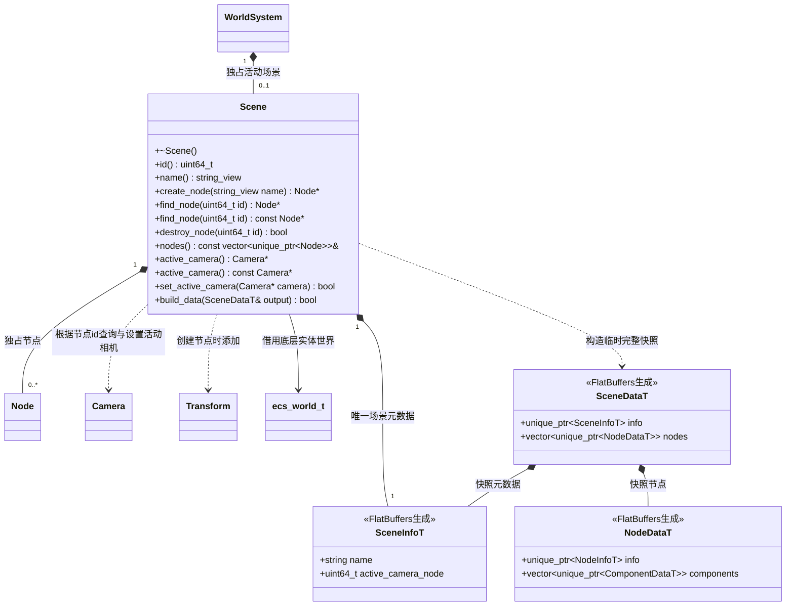

# 场景

[类图索引](../../class-diagrams/index.md) · [世界系统](world-system.md) · [节点](node.md)

场景中所有对象均为 Node 与 Component 的组合；跨语言数据及未来落盘格式由 FlatBuffers schema 定义。

- 只能由已初始化的 WorldSystem 创建，一个世界同时最多一个活动场景。场景生命周期 id 由 WorldSystem 递增，关闭再初始化也不重用。
- 节点身份使用 flecs 完整 64 位标识（含代次），删除后不会由新节点冒用。`create_node()` 自动添加 Transform，Node 本身不包含具体组件创建逻辑。
- Camera 添加后由调用方显式 `set_active_camera()`，没有添加组件隐式修改场景状态的行为。传空指针清除，拒绝其他场景的相机。
- `destroy_node()` 连同后代一起删除；如果活动相机属于该子树，清除记录的相机节点 id。不存在时返回 false。
- 返回节点和组件均为借用，删除所属节点或场景后失效。遍历 `nodes()` 期间不可增加或删除节点。
- `build_data()` 从生成类型组成的运行时状态创建独立的 `SceneDataT` 内存快照；失败输出为空。快照可由 FlatBuffers Pack、Verifier、UnPack，并保留层级、组件类型及参数。本轮验证内存往返，不实现磁盘写入或加载。
- `schemas/runtime/scene.fbs` 是共享字段定义；flatc 生成头只在构建目录产生。后续其他语言从同一 schema 生成类型，不另定义数据模型。
