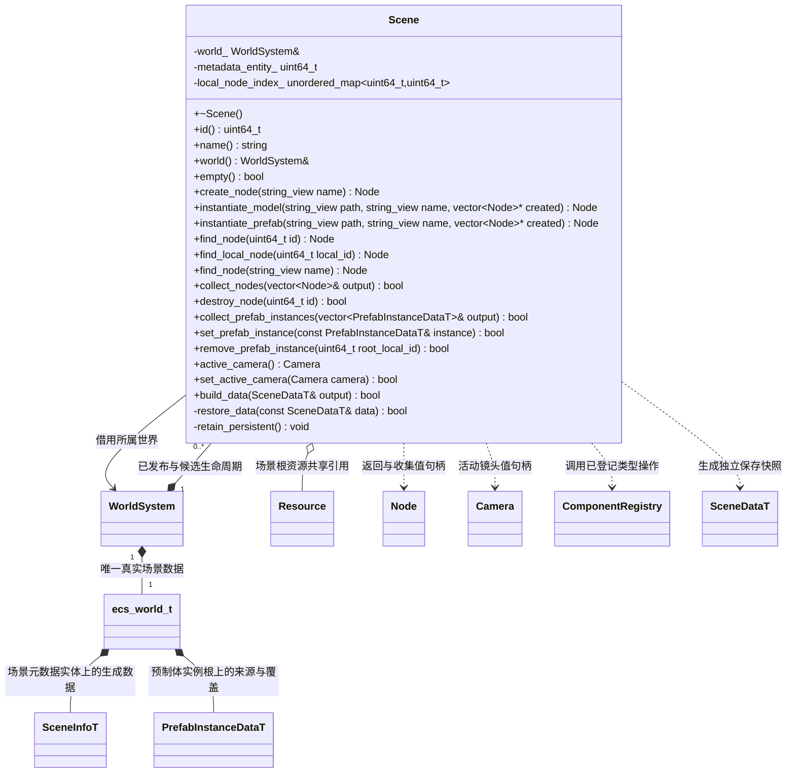

# 场景

[类图索引](../../class-diagrams/index.md) · [世界系统](world-system.md) · [节点](node.md) · [ECS 场景](ecs-scene.md)

Scene 组织场景加载、发布、卸载和资源引用；节点属性、层级、组件数据与预制体实例记录唯一存放在 WorldSystem 的 Flecs world。

- WorldSystem 最多有一个当前玩法 Scene，另可保留常驻场景及一个未发布候选。场景 ID 在世界重新初始化后不重用。
- `create_node()` 创建实体并自动添加 Transform。节点的完整 64 位实体 ID 含代次；局部 ID 另行分配并由 `local_node_index_` 索引。索引只保存身份映射，不复制节点状态或拥有 Node 对象。
- SceneInfoT 存放于内部场景实体，活动相机只以局部 ID 保存；`active_camera()` 按需返回 Camera 值句柄。`set_active_camera(Camera{})` 清空选择，过期非空或其他场景镜头失败。Camera 类型在登记时安装移除观察器，移除活动 Camera 即清空选择；同节点重新添加 Camera 不恢复旧选择。添加 Camera 不自动改变选择。
- `collect_nodes()` 按创建/恢复顺序生成独立值句柄数组；不暴露 ECS 内部地址或拥有容器。数组跨 ECS 移表仍可用于重新查找，但被删除实体的句柄立即失效。游戏系统以具体列和 Published 标记查询，不每帧调用该快照接口。
- `destroy_node()` 删除节点及全部 ChildOf 后代，先清理索引和活动镜头选择，再释放 ECS 列与运行资源；不存在返回 false。其他实体身份不变。
- 候选恢复使用源局部 ID，允许乱序、不连续及最大 uint64_t；后续自动 ID 在耗尽时失败。无效父链、组件或资源使候选完整回滚；发布前没有 Published 标记，原生系统查询不能看到半成品。
- `build_data()` 由 ECS 中的唯一生成数据组装独立 SceneDataT，失败清空输出。非零活动相机引用必须对应会保存的 Camera；相机节点或 Camera 组件为 transient 时失败，不能输出缺少所引用相机的快照。运行实体 ID、缓存、请求与后端句柄不落盘；FlatBuffers 与 TypeScript 使用同一 schema。

## 场景查询收敛契约

本节沿用已确认的最小公开契约。`find_local_node(uint64_t)` 将已有私有索引查询公开；`find_node(string_view)` 与[节点图](node.md)中的 `find_child(string_view)` 收敛原脚本绑定中的领域查询。既有 `find_node(uint64_t)` 的含义保持不变。不增加查询系统、管理器、通用注册框架或第二份节点状态。

| 接口 | 身份、范围与结果 |
| --- | --- |
| `Scene::find_node(uint64_t entity_id) const noexcept` | 既有接口；完整运行实体 ID，包含 Flecs 代次。重新校验实体属于本 Scene，禁止将局部 ID 当作实体 ID。 |
| `Scene::find_local_node(uint64_t local_id) const noexcept` | 复用本 Scene 的 `local_node_index_`；局部 ID 为 `NodePropertiesT.id`，0 无效。先查索引，再执行既有实体身份校验，不扫描世界或组装 `NodeInfoT`。 |
| `Scene::find_node(string_view name) const noexcept` | 本 Scene 内任意层级的完整名称精确匹配，大小写敏感；存在同名时返回最早创建/恢复的存活节点，与既有 `Scene.FindNode(name)` 顺序一致。空名称按普通名称匹配；`/`、`.`、`..` 不在此接口解释为路径。 |

上述方法均为 `[[nodiscard]]`，返回可空 Node 值句柄；不返回 ECS 行地址、内部索引或列表借用，不缓存裸运行列。不存在、身份过期或局部 ID 不属于本 Scene 时返回 `Node{}`。删除再建即使复用源局部 ID，也不会使旧 Node 句柄恢复有效；查询返回新实体的完整身份。

### 可见性与生命周期

- 查询只作用于调用方明确借用的这个 Scene，不遍历其他已发布、常驻或候选容器。常驻节点保留原 Scene/局部 ID，新关卡同名或同局部 ID 不与其合并。
- 与既有 `Scene::find_node(uint64_t)` 一致，显式 Scene 内查询不额外过滤 Published、enabled、visible、transient 或 persistent。恢复过程持有的候选 Scene 必须能解析自己已建立的节点；这不发布候选，也不使其被世界运行查询看到。
- `WorldSystem::find_node(entity_id)` 继续校验 Published；`WorldSystem::scenes()` 继续只列已发布容器，`scene()` 继续只返回活动场景。运行系统以 Published 实体作为查询起点，再在该实体所属 Scene 解析本地引用；不能借此访问其他场景或自动改用当前关卡。
- 脚本绑定继续负责参数转换和活动 Run/拥有场景校验。`Scene.FindNode` 仍只接受当前 Run 的活动 Scene；`Node.FindChild` 以 BindingContext 校验过的节点为起点，因此允许该 Run 保留的常驻节点子树。新增原生方法不扩大脚本可访问场景集合，不新增脚本局部 ID 门面。
- Scene 借用只在其拥有者 WorldSystem 保留该容器期间有效。节点查询每次重新校验世界与实体身份；调用方不得跨 Scene 销毁保留 Scene 裸借用。并发/结构稳定阶段遵守现有 ECS 契约。

### 调用归属与验收

| 位置 | 调整 |
| --- | --- |
| `plugins/runtime/character_controller/detail/character_scene.hpp` 及角色相机/控制器调用点 | 删除重复的全世界 ECS 本地 ID 扫描，使用起点所属 Scene 的索引查询；保留原生系统 Published 查询边界。 |
| `plugins/runtime/script/bindings/scene_binding.cpp`、`node_binding.cpp` | 分别委托名称/相对子路径查询；仅保留脚本参数、返回身份和 Run 生命周期检查。 |
| `editor/commands/prefab_commands.cpp` | 移除 `local_node()` 重复枚举，复用 Scene 局部索引；预制体事务与覆盖策略仍归现有命令。 |
| `editor/scene/scene_persistence.cpp` | 保存中的局部 ID 解析委托 Scene；已收集的节点集合仍承担选择、顺序与保存排除，不能用查询绕过这些条件。 |
| `editor/render/render_commands.cpp`、`plugins/editor/character_controller/*_commands.cpp` | 局部 ID 转运行身份不再枚举/复制全场景节点，继续用原所属 Scene 解析。 |

资源源数据和烘焙快照中的 `SceneDataT`/`NodeDataT` 搜索不属于实时 Scene 查询，不把尚未实例化的离线数据强行转成 Node；按组件遍历 Published ECS 列的领域查询也继续保留。

有意义的 Release 回归包括：实体 ID 与局部 ID 混用拒绝、不同 Scene 同局部 ID 隔离、删除/重建后的旧句柄失效、候选可内查但世界/脚本不可见、常驻子树与新场景隔离；名称重复的稳定首项与删除后回退、空名/含斜线名称；子路径非法段/歧义拒绝以及父子调整后的即时结果。角色组件本地引用与脚本旧 Run 拒绝需要覆盖迁移后的真实调用链。

## 实例化、预制体与保存

`instantiate_model` 加载独立 Model 及必要依赖，展开普通节点、Transform 与 MeshRenderer；动画由调用方另加。`instantiate_prefab` 恢复节点树并在实例根登记来源、稳定映射与显式覆盖；非空 name 是根名称覆盖。两者可选 `created` 输出精确本次创建集合，默认 nullptr，失败输出为空并回滚候选；编辑器撤销不按全场景数组长度推算新节点。

`collect_prefab_instances()` 返回独立来源/覆盖快照，顺序由明确登记次序保持；解除再关联排到后面，不依赖 ECS 表行顺序。`set_prefab_instance()` 校验存在的节点及映射后替换元数据，不自动将运行时变化记录为覆盖。来源、修改与展开见[预制体](prefab.md)。

源场景/预制体由编辑器 TOML 编解码，运行时只消费 FlatBuffers。统一 Component 登记操作负责具体类型的保存/恢复与 GUID，Scene 不出现组件字段分支。生成的 NodeInfoT/ComponentDataT 只在保存、恢复、撤销边界组装。

瞬态节点的整棵子树及瞬态组件从保存排除；活动相机被排除时保存失败。MeshRenderer 保存所有材质槽 GUID，尚未导出的动态网格使保存失败，不伪造资源身份。

普通卸载释放非持久子树及场景根资源；常驻实体保留原 Scene 和局部身份，组件只持有实际依赖，空保留容器按世界生命周期回收。显式 destroy_scene 和世界关闭释放全部实体。句柄析构不触发释放，跨场景语义见[常驻节点](persistent-nodes.md)。
