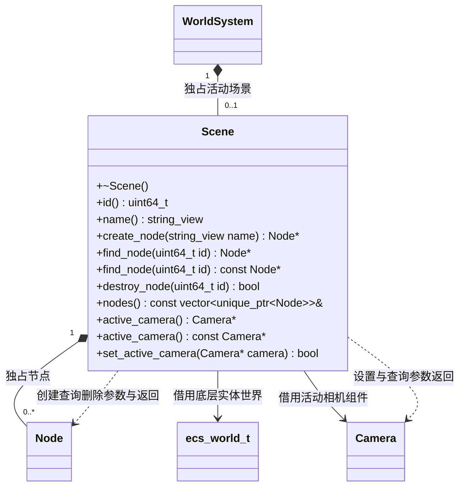

# 场景

[类图索引](../../class-diagrams/index.md) · [世界系统](world-system.md) · [节点](node.md)

本轮契约：场景中所有对象均为 Node 与 Component 的组合；相机和灯光没有场景外的特殊实例。

- 只能由已初始化的 WorldSystem 创建。一个世界同时最多一个活动场景，重复创建返回空指针。
- `id()` 是场景生命周期标识，同一 WorldSystem 每次创建均递增，关闭再初始化也不重用。
- 节点身份使用 flecs 实体完整 64 位标识（含实体代次）；删除后不会由新节点冒用。
- `destroy_node()` 连同后代一起删除；如果活动相机属于该子树，先清除活动相机。无此节点返回 false。
- 首个添加的 Camera 自动成为活动相机；也可明确切换，传空指针清除。拒绝其他场景的相机。
- 返回的节点、相机均为借用，删除所属节点或场景后失效。脚本仅保存场景 id 与节点 id，每次重新查找。
- `nodes()` 返回只读拥有集合，遍历期间不可增加或删除节点。相机以组件形式属于节点，Scene 不另持有一份相机状态。
