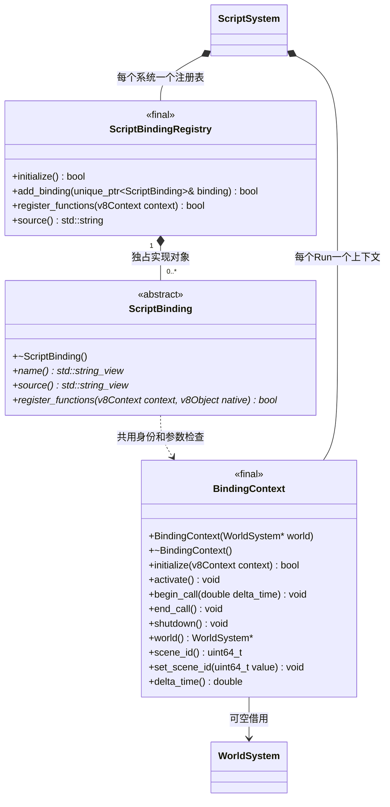
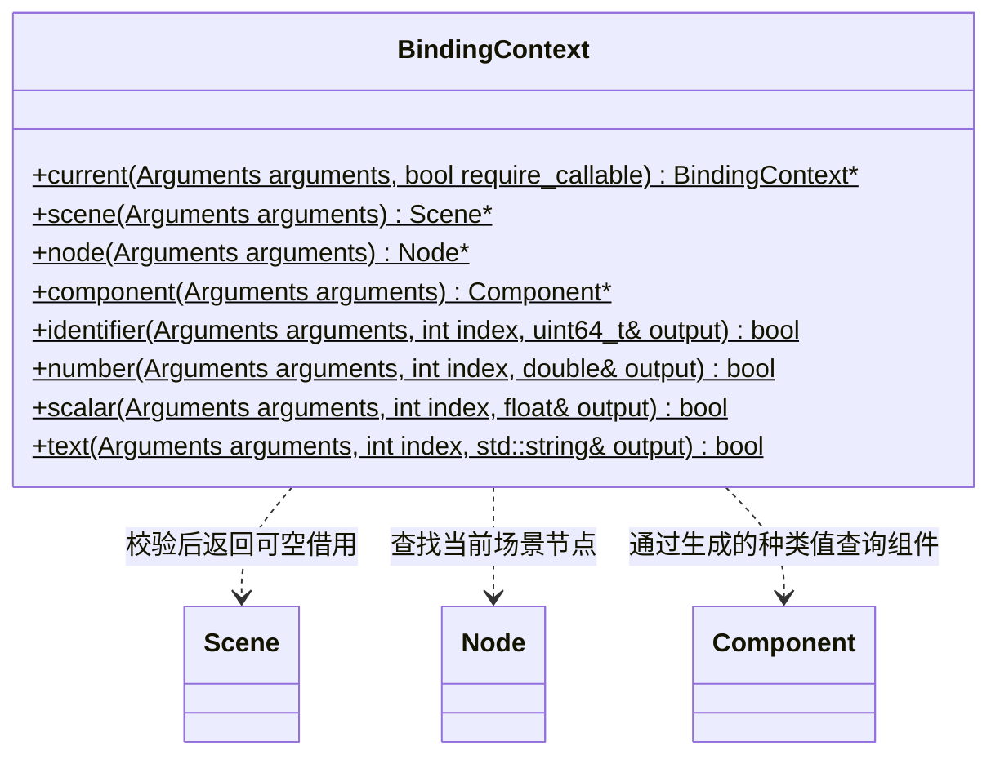
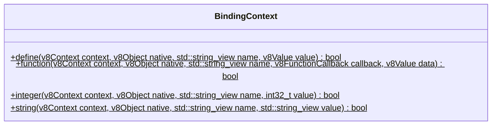
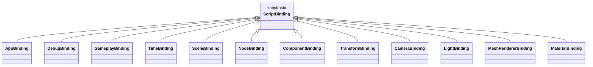

# 脚本绑定接口与实现

[脚本系统](script-system.md) · [渲染组件脚本接口](render-script-api.md) · [类图索引](../../class-diagrams/index.md)

以下类型为脚本模块内部实现，不在公开 C++ SDK 中引入 V8。

`ScriptBinding` 的三个查询/注册方法为纯虚 `const` 方法，其中 name 和 source 为 `noexcept`；析构为公共虚析构且 `noexcept`。`ScriptBindingRegistry::register_functions` 和 `source` 为 `const`；`BindingContext::world`、`scene_id`、`delta_time` 为 `const noexcept`，其中 world 返回可修改世界的可空借用。成员函数的 `const` 在此说明，不写入返回类型。

以下是同一个 `BindingContext` 的静态帮助入口；生命周期与借用方法仅在上图定义。`Arguments` 为 `const v8::FunctionCallbackInfo<v8::Value>&`；`v8Context`、`v8Object`、`v8Value` 分别为对应 `v8::Local` 句柄，`v8FunctionCallback` 为 V8 原生回调函数指针。

这两组全部为静态方法，返回值均不可忽略；数字和文本读取失败将输出重置为零值或空字符串。`current` 的 `require_callable` 默认 true；只有 Debug 日志使用 false，允许当前活动模块顶层记录日志，但仍拒绝旧 Context。`function` 的可选 `data` 默认为空 V8 句柄。所有 native 属性按只读、不可删除注册，已有名称直接失败。

实现均为 final，分别保存于 `src/engine/runtime/script/bindings/` 下的 `app_binding`、`debug_binding`、`gameplay_binding`、`time_binding`、`scene_binding`、`node_binding`、`component_binding`、`transform_binding`、`camera_binding`、`light_binding`、`mesh_renderer_binding`、`material_binding` 头文件与实现文件。接口、注册表和公共上下文同目录独立维护。

- `ScriptBinding` 定义名称、JS 门面和原生函数注册；具体实现不重复持有 Run 或世界。注册表独占绑定对象，拒绝空绑定和重复名称，失败不转移调用者所有权。原生属性注册拒绝已有名称，不能覆盖其他绑定函数。
- 每个组件绑定自行注册工厂和组件种类值；Node 的 AddComponent 根据注册表调用相应工厂，新增组件绑定无需修改 Node 或全局业务 switch。
- BindingContext 的共享静态帮助方法负责数值/字符串/64位标识校验、场景/节点查找和只读原生属性注册；所有失败返回状态或空借用。
- 绑定上下文借用 World，保存 Run 所属场景 ID 和本帧时间，不持有原生 Node/Component 指针。活动 isolate 指针、当前 V8 Context 和回调许可三者全部匹配后才允许访问；退出时清空 embedder 指针并仅清理自己的场景。
- `AppBinding` 读取 App 现有三种路径；`DebugBinding` 转发日志；`TimeBinding` 仅在有效生命周期回调内返回时间；GameplayBinding 只有 JS 基类。
- MaterialBinding 将 SetType/SetShader/SetTexture 的资源路径与 SetFloat/SetV2/SetV3/SetV4 交给材质接口校验。材质门面保存槽号，每次调用按场景与节点身份解析当前槽，失效槽不访问原生对象；GetTexture 返回已解析的路径。
- CameraBinding 提供透视与正交设置；LightBinding 提供方向、点和聚光设置；MeshRendererBinding 提供资源网格切换与材质槽访问。所有范围及资源匹配由对应原生组件负责。
- 构造和清理不抛 C++ 异常；V8 调用通过 Maybe/返回值报告错误。全部借用仅在引擎主线程有效。

SceneBinding 提供 Scene.Load 与 FindNode：Load 仅可替换当前 Run 拥有的场景，失败保留原场景；FindNode 按节点顺序查首个同名节点，缺失返回 null。场景字节来自已激活 ResourceCatalog，不直接访问可变项目缓存或 SQLite。
