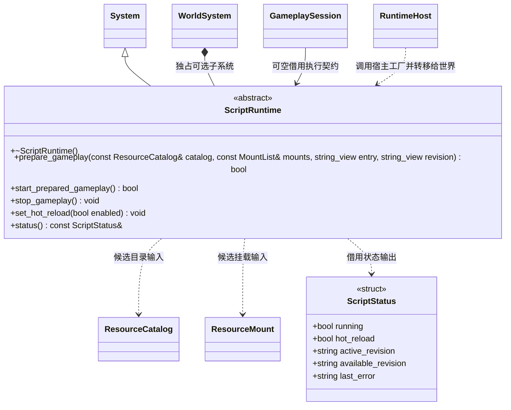

# 脚本运行契约

[类图索引](../../class-diagrams/index.md) · [玩法会话](gameplay-session.md) · [运行宿主](runtime-host.md)

核心只定义玩法执行所需的最小接口，具体语言、虚拟机及绑定由运行时插件实现。

- ScriptRuntime 继承 System，复用统一初始化、逐帧更新和反序关闭，不再创建另一套生命周期接口。运行宿主通过调用方提供的工厂取得独占实例，并移交给 WorldSystem 管理。
- `prepare_gameplay()` 只预检调用方明确提供的候选目录，不执行玩法、不切换当前资源；入口和修订默认空，由实现解析默认值。失败保留旧运行。
- `start_prepared_gameplay()` 执行已经预检且与活动目录匹配的玩法。`stop_gameplay()` 支持重复停止、部分初始化，保证 noexcept。
- `set_hot_reload()` 表达是否允许调用方应用新候选，不自行扫描编辑器或项目目录。`status()` 返回实现拥有的只读 ScriptStatus 引用，有效期受实例及后续操作约束。
- ScriptStatus 是普通状态结构，属于核心契约，不包含 V8 句柄。`running`、`hot_reload` 默认 false，其余字符串默认空。所有失败通过返回值与状态中的 last_error 表达。
- 核心不提供脚本系统伪实现；不选择插件时不创建此子系统。V8 依赖的独立编译、链接验证由测试目标负责。
