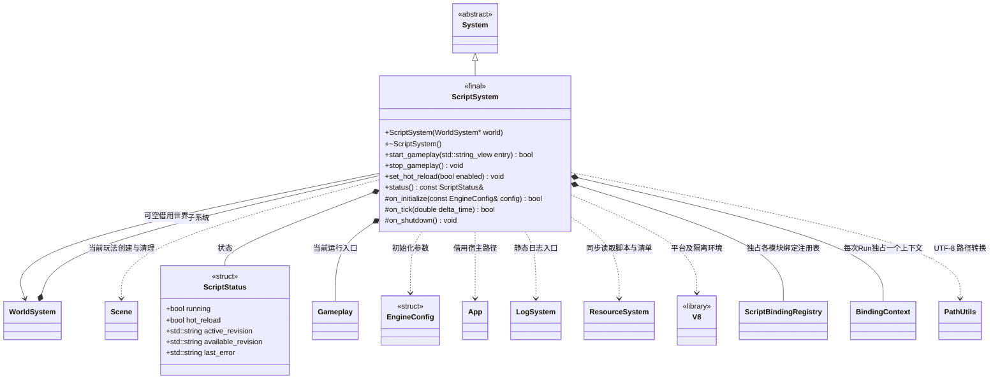

# 脚本系统

[类图索引](../../class-diagrams/index.md) · [引擎与系统](engine-system.md) · [玩法入口](gameplay.md)

状态：桌面与 Android 脚本运行已实现，本轮扩展桌面原生场景绑定。仅定义 `ScriptSystem` 与其状态；其他类的方法在各自类图维护。

- 构造参数 `world` 默认 nullptr；非空借用必须活到 ScriptSystem 关闭，Engine 传入其父 WorldSystem。空指针保留独立脚本能力，场景创建返回 null。
- `WorldSystem` 独占可选子系统。系统初始化只准备 V8 环境，所有系统就绪后宿主显式调用 `start_gameplay()`；空引擎无需项目或入口。
- 入口默认参数为空，采用同步清单 entry；无同步版本时 Android 采用打包清单 entry，桌面使用 `scripts/game.js`。非空参数固定显式入口，重载继续使用该路径。入口必须默认导出继承 `Gameplay` 的类。所有生命周期和脚本调用在引擎运行线程进行。
- V8 平台每进程只初始化一次、退出时释放；每个脚本系统独占 isolate，单次玩法运行持有独立 Context、模块缓存及一个入口实例。停止重载释放该次运行；系统重启可以重建 isolate。
- `ScriptStatus` 默认布尔值为 false、字符串为空；`status()` 返回借用，不能跨系统销毁或跨线程使用。内置运行的 `active_revision` 为 `builtin`。
- 每帧先读取控制和完整发布版本，在安全点切换，再调用 `Update()`。JavaScript 异常写日志及 `last_error`，不使 Engine 失败；Update 失败停止玩法并清空场景，回到编辑器待机，不会由后续热重载自动启动。`OnInitialize` 非布尔值或 false 均使此次启动失败。
- Node 的泛型 AddComponent/GetComponent 通过各组件绑定注册的工厂匹配类型；变换由 Transform 提供，材质通过字符串资源路径和参数名设置。原生 Node 仅管理组件列表。
- [脚本绑定](script-bindings.md)通过 `ScriptBinding` 通用接口拆成独立实现：每个类的 JS 门面、原生回调与注册在自己的源文件。增加绑定只增加实现类及一个集中注册项；ScriptSystem 只负责 V8、模块加载、生命周期与热重载，不维护业务分派 switch。
- 每个 Run 独占 BindingContext；isolate 保存活动上下文指针。回调先比较当前 Context、活动指针和生命周期许可再访问世界与场景。Run 销毁前清空 Context 中的 Run/BindingContext 指针；旧 Context 或预检 Context 不能解引用已销毁 Run。
- 场景包装仅保存 Scene generation 与 Node id；每次调用同时校验当前 Context 属于活动 Run、Scene 属于该 Run、Node 仍存在。失效对象返回 false/null，不保存原生 Node 或 Component 裸指针。
- 仅 Gameplay 生命周期回调允许修改场景；模块顶层、构造函数及预检期间禁止修改。`Time.deltaTime` 只在 Update 提供本帧秒数，初始化和退出为 0。
- 停止与重载先在旧场景仍有效时调用 OnShutdown，随后销毁该次运行的原生 Scene，再释放 Context；初始化失败清理部分场景。
- 预检候选 Context 编译、静态链接失败时，旧入口与快照继续运行；预检成功后先停止旧入口，再执行新模块及入口。执行失败明确报告并停止玩法，不承诺撤销已产生的副作用。
- 关闭热重载只禁止切换，仍报告可用版本，固定当前入口和模块快照；重新开启在下一帧处理最新完整版本。停止后不会自动重启。
- `persistent_data_path/assets/available.json` 清单包含 `revision`、`entry`、`files[{path,size,hash}]`、`deleted[]`。版本位于 `assets/versions/<revision>/`，哈希为小写 16 位 FNV-1a 64。全部文件的大小、哈希、路径验证通过后才接受版本。
- 入口和所有 import 统一按路径解析：清单 files 命中读取对应 cache；deleted 命中拒绝；其他路径回退 builtin。宿主保证 builtin 在会话内不变；不复制内置内容覆盖同步文件。绝对路径、越界路径和符号链接越界均拒绝。
- Android 的 builtin 为 `apk:/assets/project`：安全相对路径组合后交给 ResourceSystem 读取 APK，不对虚拟路径调用原生文件系统 canonical；持久版本仍执行 canonical、大小与哈希校验。
- Android 初始化要求 App 已就绪；验证 `apk:/assets/project-manifest.json` 的完整资源清单和包内文件后，只将清单原子导出为 `persistent_data_path/assets/builtin.json`，供首次设备同步计算删除项，不覆盖 `available.json` 或复制项目资源。当前运行固定打包项目；即使 App 自定义 builtin 根，也必须与该包清单对应，不提供任意项目切换。校验或导出失败使初始化返回 false。
- Android 的 ICU 从 `apk:/assets/v8/icudtl.dat` 读取到 `cache_path/v8/icudtl.dat`；内容相同复用，否则原子替换。桌面继续读取可执行程序旁的 ICU。准备或 V8 初始化失败通过返回值与日志报告。
- 本阶段支持静态 ES 模块和虚拟 `engine` 模块，不提供 Node.js API、动态导入或顶层 await。
- 源码、清单和控制文件统一通过 ResourceSystem 的 SDL3 同步读取入口访问；文件系统仅负责非异常路径校验和状态写入。
- 电脑工具在目标持久目录原子写 `script-control.json` 的 `hotReload`；脚本系统原子写 `script-status.json` 的 `running`、`hotReload`、`activeRevision`、`availableRevision`、`lastError`，不启动网络服务。Android 同步和控制复用此契约。
- `stop_gameplay()` 和清理支持重复调用。已进入初始化的入口会收到一次 `OnShutdown()`，包括部分启动失败。
- 真实运行由 `ENGINE_ENABLE_SCRIPT_RUNTIME` 控制；关闭时保留 V8 版本链接探针，启动玩法返回 false，不接入 App、日志或 JSON。Android 使用真实运行时后，包内与同步版本共用同一 Gameplay 生命周期和热重载实现。

C++ 限定符：构造、析构、`stop_gameplay()`、`status()` 和 `on_shutdown()` 为 `noexcept`；`status()` 为 const。返回状态或借用的方法标注 `[[nodiscard]]`，钩子和析构标注 override。V8 异常捕获只处理 JavaScript 异常，不使用 C++ 异常。

公共路径编码复用 [PathUtils](path-utils.md)；路径规范化和安全检查仍由本类负责。
