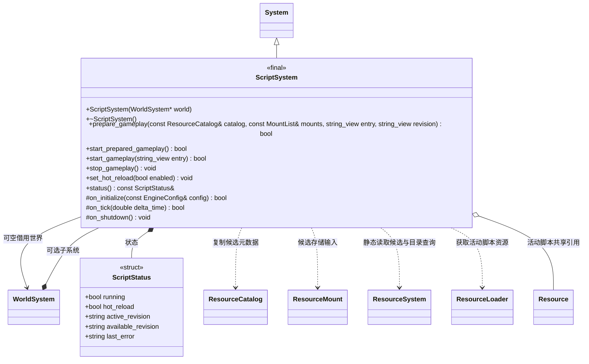
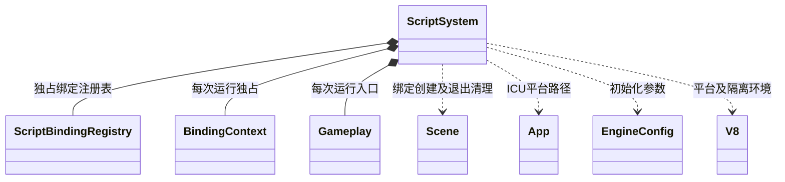

# 脚本系统

[类图索引](../../class-diagrams/index.md) · [玩法会话](gameplay-session.md) · [脚本绑定](script-bindings.md)

ScriptSystem 管理 V8、模块预检与执行、玩法回调和脚本运行资源；资源部署选择及清单切换由 GameplaySession 调用。

- `world` 默认空指针；非空世界必须比本系统存活更久。初始化只准备 V8 和绑定，不启动项目，也不读取资源部署文件。
- `prepare_gameplay()` 接收调用方提供的目录和挂载，入口默认 `scripts/game.js`，修订默认目录修订。只沿静态 import 图读取候选 JS、编译和链接，不执行模块或用户回调、不更新核心目录、不停止旧玩法。失败保留旧运行。
- 宿主预检成功后停止旧玩法及 GPU、更新资源目录，再调用 `start_prepared_gameplay()`。启动核对活动资源与预检脚本的内容及模块身份，取得共享引用，然后执行模块并创建入口。执行失败停止本次玩法，不承诺撤销外部副作用。
- `start_gameplay()` 是从已经提交的活动目录直接准备并启动的入口；目录未提交或模块缺失时返回失败，不回退物理脚本目录。
- 每个 Run 拥有 Context、模块缓存、Gameplay、BindingContext 以及实际加载脚本的 ResourcePtr；目录只复制元数据，脚本实体按 import 读取。只接受相对导入与虚拟 `engine` 模块，不支持 Node.js、动态 import 或顶层 await。
- 生命周期 `OnInitialize/Update/OnShutdown` 同步调用；初始化必须返回 true。Update 抛出 JavaScript 异常时记录错误并停止玩法，Engine 帧仍返回成功。C++ 不使用异常。
- 停止先在场景仍有效时调用 OnShutdown，再销毁属于此 Run 的场景，释放上下文和脚本引用。部分初始化、重复停止和关闭均安全；不清理其他运行者的场景。
- 原生包装通过 Context、Scene generation、Node id 和调用阶段检查有效性；模块顶层、构造及预检阶段不能修改场景。Time.deltaTime 仅在 Update 有效。
- `set_hot_reload()` 只修改脚本重载开关。调用方按该开关决定是否应用已发布候选；ScriptSystem 不轮询 available.json、控制文件或编辑器目录，也不自动激活资源。
- V8 平台每进程初始化一次，isolate 可随系统重建。Android ICU 从 APK 提取至 App 缓存目录，相同内容复用；桌面读取程序旁 ICU。V8 关闭前销毁所有 Context。
- `status()` 返回只读借用，下一次运行操作可更新内容。`entry` 默认空、`revision` 默认空；MountList 为标准容器别名。构造、析构、停止、查询及关闭为 noexcept，返回状态与重要查询标注 nodiscard，钩子标注 override。
