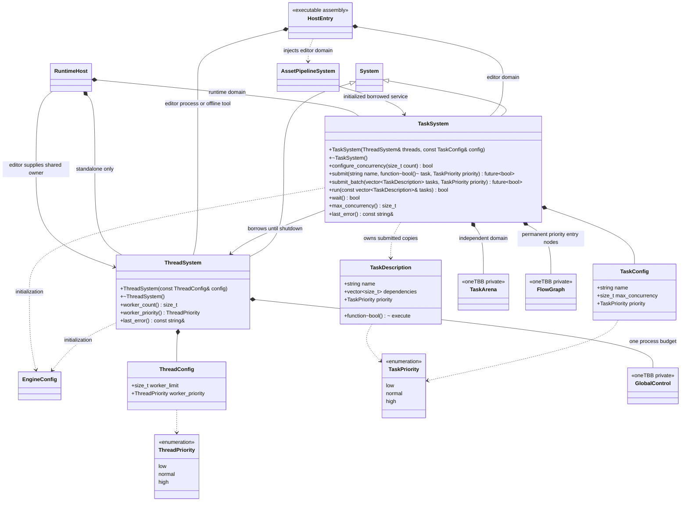

# 运行时线程与任务系统

[类图索引](../../class-diagrams/index.md) · [资源管线](../../editor/class-diagrams/asset-pipeline-system.md)

oneTBB 管理进程共享 worker，编辑器与运行时各有任务域。公开头仅依赖标准库和 System；旧 editor/task 实现下沉 runtime/task，不保留兼容别名。

## 所有权与生命周期

ThreadSystem 是唯一进程并行预算拥有者；第二个实例不能同时初始化。ThreadConfig.worker_limit 默认 0（按可用 CPU 留一主线程额度，至少 1、最多 64），显式值 1–64。global_control 使用 worker_limit + 1；这是引擎预算，不是独占或预创建的线程数，其他库更低的全局限制仍会生效。ThreadPriority 默认 normal。

TaskSystem 借用已初始化的 ThreadSystem，各自拥有 arena、入口图和关闭等待。TaskConfig 默认 name="Tasks"、max_concurrency=4、priority=normal；额度范围 1–64，实际执行同时受进程预算限制。两域不预留独占 worker，关闭一域只等待该域工作。所有域先关闭，ThreadSystem 最后关闭。

生命周期、提交、配置及 last_error 查询由所属协调线程调用。回调不得调用 System 生命周期、同步等待同池 future；依赖用批次表达。run/wait/configure_concurrency 在回调内拒绝。提交拥有函数和数据的副本；闭包借用由调用方保证活到 future 完成。关闭停止接收、等待已接收工作、释放图和 arena；不强制打断正在写文件的函数。支持重复关闭、部分初始化与重新初始化。

编辑器入口拥有 ThreadSystem 和低优先 TaskSystem，向 AssetPipelineSystem 注入已初始化 TaskSystem&；管线不再自建池。import_threads 默认 4，当前在空闲时配置编辑器域，有在途任务时不能改变额度。整批导入仍由协调线程同步组织，仅转换阶段在 worker 执行。

RuntimeHost 最后一个可空初始化参数借用已有 ThreadSystem；独立运行时自行创建。宿主拥有高优先运行时 TaskSystem，tasks() 返回初始化期间的可空借用；先关闭任务域，再释放场景、资源与自有线程预算。

## 提交、依赖与优先级

- submit(name, task, priority=normal) / submit_batch(tasks, priority=normal) 返回 std::future<bool>。未初始化、空函数、非法枚举、无效/重复依赖或环，返回无效 future 并设置 last_error；接收后的结果表示整项成功/失败。空批次返回已完成 true。
- last_error 仅报告协调线程上的提交、配置和同步 run 错误；worker 不并发改写它。异步回调失败或 OS 优先级设置/恢复失败，通过 future 返回 false，任务身份可在 Tracy 追踪。
- 一个长期 flow graph 的三档 function_node 负责单任务与批次入口，优先度使用原生 node_priority_t。每个入口的活跃请求上限为域并发额度，由原生队列暂存其余请求；三档合计最多 3 倍额度的活跃请求体，避免协作等待无限嵌套，实际执行线程数仍受 arena 限制。TaskConfig.priority 映射 arena 优先度，控制域间调度倾向。
- 批次在 worker 内建立临时 flow graph；continue_node 使用 TaskDescription.priority，边由 oneTBB 调度。失败的下游跳过，独立分支仍完成。graph.wait_for_all 使用 oneTBB 协作执行，不能替换成 worker 阻塞等 std::future；图彻底结束才销毁节点。
- 批次优先度控制入口，各节点优先度控制该图内就绪工作；不承诺跨所有图严格排序。优先度均非抢占，不能打断长函数或越过依赖。
- run 为同步导入提供便利；wait/关闭先等待本域完成计数，再收尾原生图，调用线程不执行用户函数。异步消费者通常 wait_for(0) 后按主线程预算应用结果。

## OS 优先度与 Tracy

ThreadPriority 独立于 TaskPriority。worker_priority=normal 保持 worker 基线；low/high 仅执行引擎函数期间临时设置并恢复，不能永久给共享 worker 贴域标签。Apple 使用 QoS，Windows 使用线程优先度，Linux/Android 使用可恢复的调度策略/nice。设置失败不执行回调，恢复失败返回失败；无权限提升不能报告成功。UI/输入仍属于主线程关键路径。

复用 ENGINE_ENABLE_TRACY；记录任务名、域、优先度、入队到执行等待、批次与关闭等待。排队纳秒与域、任务名和优先级合成一条单行注释，避免官方 TSV 导出的多行问题；批次节点的排队时间包含依赖等待，不代表依赖就绪后的纯排队延迟。不伪造跨线程 zone。关闭开关不链接客户端。

## 边界

本轮实现底座、编辑器转换迁移和运行时域装配；物理、导航、文件读取、动画等消费者后续分别接入。活动 Scene/Node/Component、VM、GPU 提交保持原线程契约。资源代际校验、主线程应用预算归具体模块，不放进通用任务系统。

依赖使用现有固定 oneTBB 版本和补丁；平台声明与实际测试分开记录于 README。Mac 动态库通过不代表 Android/iOS 或静态链接已验证。
