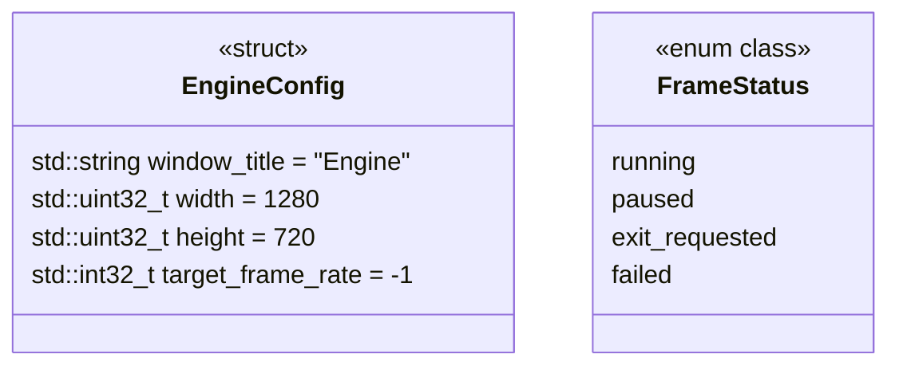

# 配置与状态

[类图索引](../../class-diagrams/index.md) · [完整引用关系](../../class-diagrams/references.md)

本图维护公共配置结构体和帧状态枚举，不增加行为类。

- 运行宿主使用默认配置即可启动，不要求项目。编辑器项目路径由宿主传给 `ProjectSystem` 构造函数，不属于运行时配置。
- 窗口标题不得为空，窗口尺寸不得为零或超出平台整数范围；实际像素尺寸还需通过渲染系统检查。
- 系统按需复制配置，不保存指向调用者配置的悬空引用。
- `target_frame_rate` 由 Engine 校验并应用：`-1` 不限帧，正整数为帧率上限，`0` 和其他负数使初始化失败。编辑器宿主从项目编辑器配置提交默认 `60`，运行包沿用核心默认值，项目脚本可在启动后调整。
- `FrameStatus` 由 `RuntimeHost::tick()` 返回；具体语义见[运行宿主](runtime-host.md)。Engine 的框架更新通过 bool 表达成功或失败。
