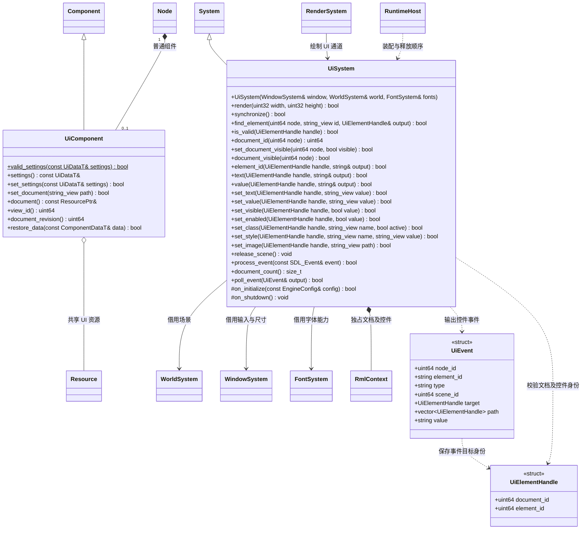

# 场景界面

[类图索引](../../class-diagrams/index.md) · [字体系统](font-system.md)

普通 Node 持有 UiComponent，组件引用导入后的 UI 资源。RmlUi 文档中的控件不成为场景节点。
系统负责文档呈现与事件输出，项目业务通过调用方接入。

- 核心 UI 系统只加载明确挂载的文档，更新布局、转发输入并输出事件，不选择项目场景。
- 文档保存多个字体绑定（族别名、字体 GUID、Shader 路径）和多个纹理 GUID；每个绑定独立选择内置或项目 Shader。字体通过核心 FontSystem 测量与生成字形，UI 和 3D 文字共享资源。
- UI 图片当前只接受二维 LDR `rgba8` / `basis` 资源；立方体贴图及半浮点 HDR KTX 在依赖校验和文档激活时明确拒绝并记录路径，不能按 Basis 解码或静默压成 LDR。HDR 显示与色调映射不属于当前 UI 图片契约。
- RmlUi 的渲染与字体接口在 UI 模块内部实现；提交顺序、预乘透明度、裁剪和变换保留在 UI 绘制阶段。
- 文档先销毁，再释放字体和 GPU 对象，最后关闭渲染设备。反复启停及平台 Surface 重建使用同样顺序。
- C++ 返回失败状态；公开接口不暴露 RmlUi 类型。SDL 事件借用仅在调用期间有效。
- synchronize 准备当前场景文档，不提交绘制；允许玩法初始化中查询和修改 View。文档身份跨重建不复用，控件使用内部弱观察引用校验存活；UiComponent 的 view_id 区分同节点上先移除再添加的组件。
- 文档按节点独立同步，其他文档的增加或移除不会清空未变更的 View。失效事件不返回给调用方。
- document_revision 在成功替换文档时递增；同一次调用中 A → B → A 也使旧 View 失效，不依赖共享缓存是否复用了相同资源地址。
- 控件事件保存从最近有 ID 的目标到有 ID 祖先的身份路径；脚本可按冒泡顺序分发，不能在分发时按名字重新查找新控件。
- UI 内部图片与字体纹理定位包含文档资源代际；独立文档更新不会复用同路径旧版本纹理，释放按仍存活的文档集合进行。
- MVC 的 Model 和 Controller 位于项目/脚本层，见 [UI 脚本类图](../../plugins/runtime/class-diagrams/ui-script-api.md)。
