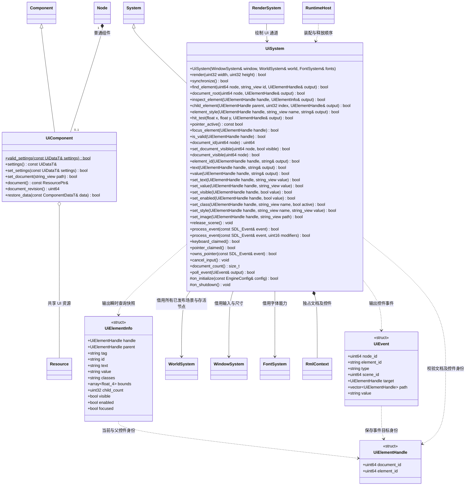

# 场景界面

[类图索引](../../class-diagrams/index.md) · [字体系统](font-system.md)

普通 Node 持有 UiComponent，组件引用导入后的 UI 资源。RmlUi 文档中的控件不成为场景节点。
系统负责文档呈现与事件输出，项目业务通过调用方接入。

- 核心 UI 系统只加载明确挂载的文档，更新布局、转发输入并输出事件，不选择项目场景。
- 文档保存多个字体绑定（族别名、字体 GUID、Shader 路径）和多个纹理 GUID；每个绑定独立选择内置或项目 Shader。字体通过核心 FontSystem 测量与生成字形，UI 和 3D 文字共享资源。
- UI 图片当前只接受二维 LDR `rgba8` / `basis` 资源；立方体贴图及半浮点 HDR KTX 在依赖校验和文档激活时明确拒绝并记录路径，不能按 Basis 解码或静默压成 LDR。HDR 显示与色调映射不属于当前 UI 图片契约。
- RmlUi 的渲染与字体接口在 UI 模块内部实现；提交顺序、预乘透明度、裁剪和变换保留在 UI 绘制阶段。
- 文档先销毁，再释放字体和 GPU 对象，最后关闭渲染设备。反复启停及平台 Surface 重建使用同样顺序。
- C++ 返回失败状态；公开接口不暴露 RmlUi 类型。SDL 事件借用仅在调用期间有效。
- synchronize 准备所有已发布场景中的存活文档，不提交绘制；允许玩法初始化中查询和修改 View。常驻节点在场景卸载后保留原 Rml Context、文档与控件身份，没有活动玩法场景时仍可更新、绘制和输入。文档身份跨重建不复用；UiComponent 继承的 instance_id 区分同节点上先移除再添加的组件。
- 文档按节点独立同步，其他文档的增加或移除不会清空未变更的 View。失效事件不返回给调用方。
- 普通常驻标记通过 Node 生效，文档中的控件仍不成为节点。常驻文档在普通关卡文档之后绘制、优先命中输入；同组保留场景和节点顺序。UiEvent.scene_id 记录目标文档的实际所属场景，不用活动关卡 ID 替代。
- release_scene 是整个会话的完整清理入口，停止与重载时释放全部文档；普通场景切换依靠同步裁剪已删除节点，不调用全量释放。
- document_revision 在成功替换文档时递增；同一次调用中 A → B → A 也使旧 View 失效，不依赖共享缓存是否复用了相同资源地址。
- 控件事件保存从最近有 ID 的目标到有 ID 祖先的身份路径；脚本可按冒泡顺序分发，不能在分发时按名字重新查找新控件。
- UI 内部图片与字体纹理定位包含文档资源代际；独立文档更新不会复用同路径旧版本纹理，释放按仍存活的文档集合进行。
- MVC 的 Model 和 Controller 位于项目/脚本层，见 [UI 脚本类图](../../plugins/runtime/class-diagrams/ui-script-api.md)。

## 输入路由

配合[输入设计](../input.md)，UI 向宿主提供命中、持续占用和精确指针归属；InputSystem 不依赖 RmlUi 或 DOM。`keyboard_claimed`、`pointer_claimed` 和 `owns_pointer` 是 `const noexcept` 查询，`cancel_input` 为 `noexcept`。键盘持续占用来自有效文本 / 表单焦点或可见模态文档；指针持续占用只表示可见模态文档，普通鼠标或触摸 capture 不会占用其他游戏手指。宿主每帧同步文档后提交占用状态，事件泵中按已有 capture、UI 命中、游戏区域的顺序路由。

原生触摸桥使用窗口逻辑坐标，以一个已认领触点驱动普通 UI，不重新注入 SDL。其他命中 UI 的手指只保留阻挡身份，不驱动第二个 RmlUi 鼠标；未命中 UI 的手指仍可并行操作游戏控件。可见背景 body / div 不默认占用全屏；标准交互控件、可滚动区域及显式 `data-input-capture` 区域参与命中，自定义可点容器应声明该属性。合成鼠标 / 触摸来源忽略，防止重复触发。

触点取消、失焦、后台、窗口尺寸变化、文档隐藏 / 移除与 `cancel_input` 清理 capture；先移除 RmlUi hover 再释放鼠标按键，不产生普通 click。停止与关闭清理同一状态。控件运动与虚拟触摸识别不通过高频 TS 事件执行。

- [UI 编辑器插件](../../plugins/editor/class-diagrams/ui-editor.md) 复用最小查询与输入增量。UiElementInfo 只读快照，bounds 为窗口逻辑坐标，密码值掩码；实际遮挡仍由 RmlUi 命中测试决定。句柄失效保持失败，不查找同名替代。
- 显式 modifiers 重载仅影响本次输入，不改 SDL 全局修饰键状态。取消先清理指针捕获，再失焦并释放已记录按键，抑制取消引起的激活但不删除已排队合法事件。

隐藏或停用节点/UiComponent 保留 Rml 文档与控件身份。隐藏清除输入捕获及排队事件，停用还暂停 Context 更新；恢复后使用同一文档。`set_document_visible` 只写组件本地 visible，`document_visible` 返回有效激活及可见结果，不另存可写文档状态。删除组件、替换文档或卸载所属场景才释放文档。
