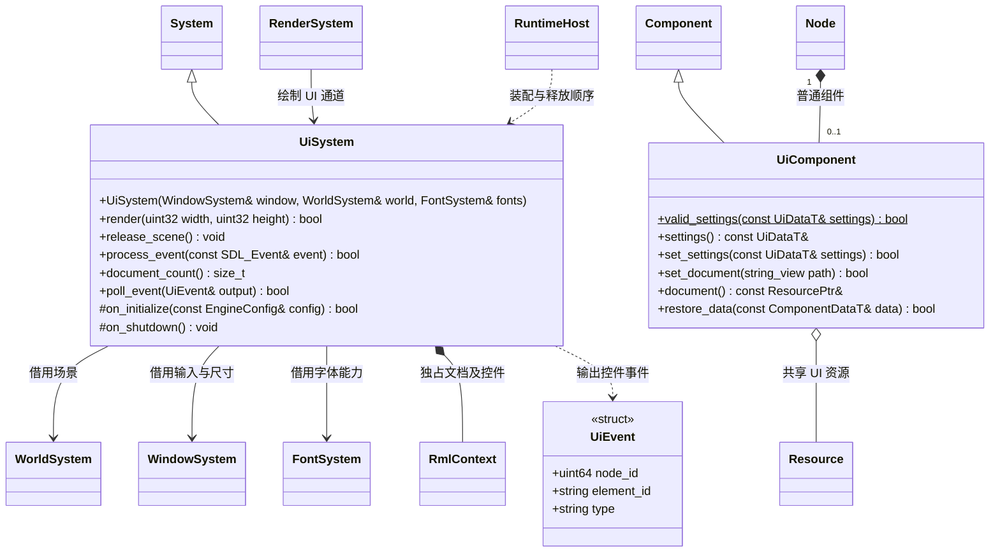

# 场景界面

[类图索引](../../class-diagrams/index.md) · [字体系统](font-system.md)

普通 Node 持有 UiComponent，组件引用导入后的 UI 资源。RmlUi 文档中的控件不成为场景节点。
系统负责文档呈现与事件输出，项目业务通过调用方接入。

- 核心 UI 系统只加载明确挂载的文档，更新布局、转发输入并输出事件，不选择项目场景。
- 文档保存多个字体绑定（族别名、字体 GUID、Shader 路径）和多个纹理 GUID；每个绑定独立选择内置或项目 Shader。字体通过核心 FontSystem 测量与生成字形，UI 和 3D 文字共享资源。
- RmlUi 的渲染与字体接口在 UI 模块内部实现；提交顺序、预乘透明度、裁剪和变换保留在 UI 绘制阶段。
- 文档先销毁，再释放字体和 GPU 对象，最后关闭渲染设备。反复启停及平台 Surface 重建使用同样顺序。
- C++ 返回失败状态；公开接口不暴露 RmlUi 类型。SDL 事件借用仅在调用期间有效。
