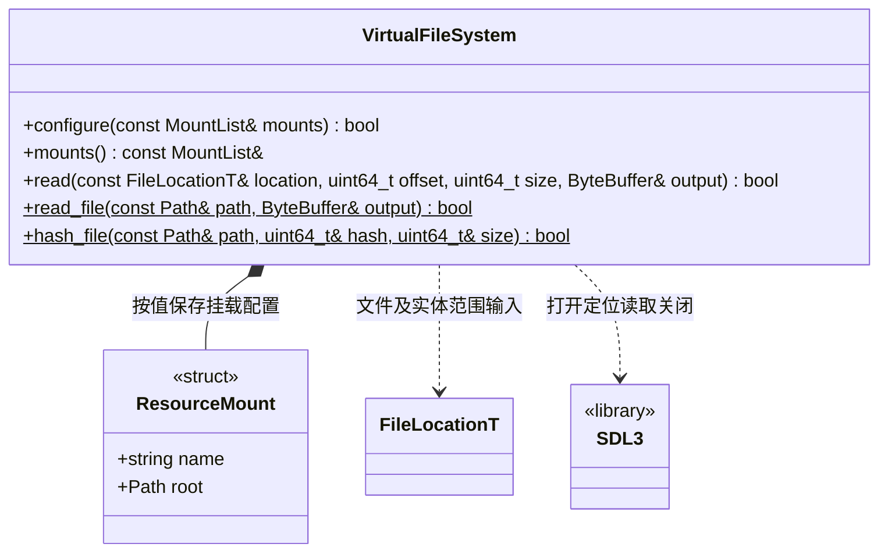
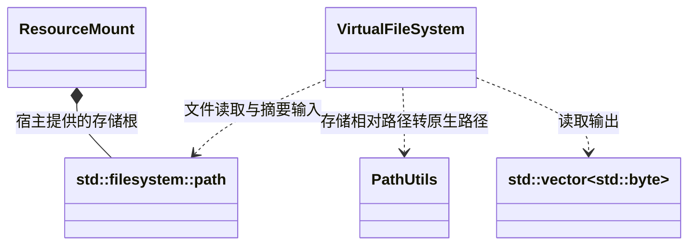

# 虚拟文件访问

[类图索引](../../class-diagrams/index.md) · [资源系统](resource-system.md) · [目录](resource-catalog.md)

VirtualFileSystem 是资源模块内部的同步存储对象，不继承 System、不独立参与引擎生命周期。

MountList 是 `std::vector<ResourceMount>`。挂载是运行配置，清单只保存挂载名称，不能包含构建电脑的绝对路径。

- configure 校验并整体保存配置，失败保持旧值。ResourceSystem 按完整目录换代提交挂载；旧已加载数据独立存活，新读取仅按新目录，业务不得绕过它改写文件访问对象。
- read 的 offset 相对于实体起点，size 是本次字节数。检查无符号溢出、实体范围和文件边界后同步读；成功输出由调用者拥有，失败清空。方法为 const，状态返回标注 nodiscard。
- 散文件是一个文件范围，合并包成员是包文件的一个范围；读取实体不读整包。第一版用未压缩条目，不引入压缩选择或后台解压调度。
- read_file 保留现有工具所需的整文件同步能力，不要求 System/App 初始化；平台环境由宿主建立。资源加载用有边界的 read，整包不交给整文件接口。
- hash_file 使用固定 64 KiB 缓冲计算整个文件的 FNV-1a 64 位摘要与字节数，不将包整体载入内存，也不受 read_file 的 64 MiB 上限限制。打开方式与 APK 来源检查复用同一实现；读取、长度或关闭失败时返回 false，hash 和 size 均清零。
- 每次读取拥有局部 SDL_IOStream 并成对关闭；没有异步任务或外借长寿命流，不新增独立包对象和包句柄框架。
- Android 包内根由现有 App 提供，继续核验实际 AAsset 来源，避免同名私有文件遮挡。物理路径以 UTF-8 传给 SDL，保留非法路径、符号链接与越界检查。
- 不认识 GUID、资源类型、依赖或项目设置；不判断编辑器/真机，不自行选择持久版本或回退内置内容。来源由提交的挂载和目录明确决定。
