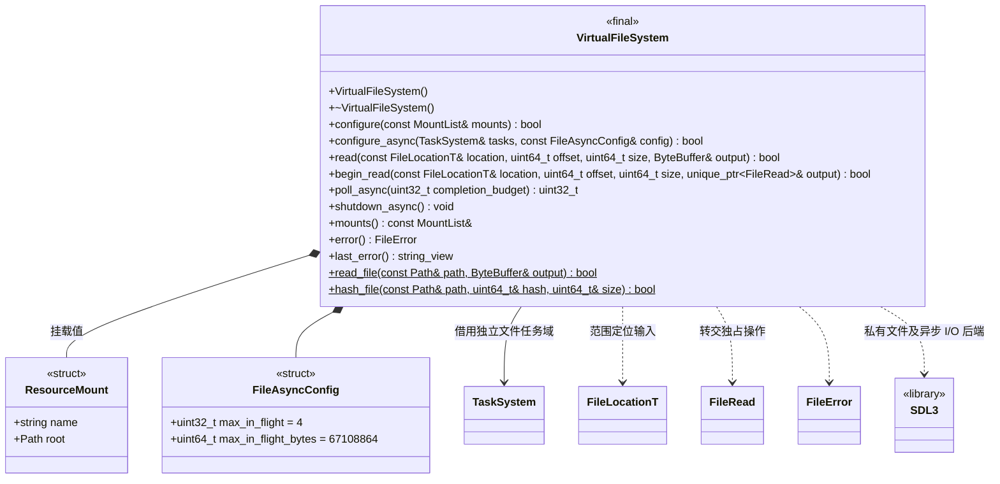
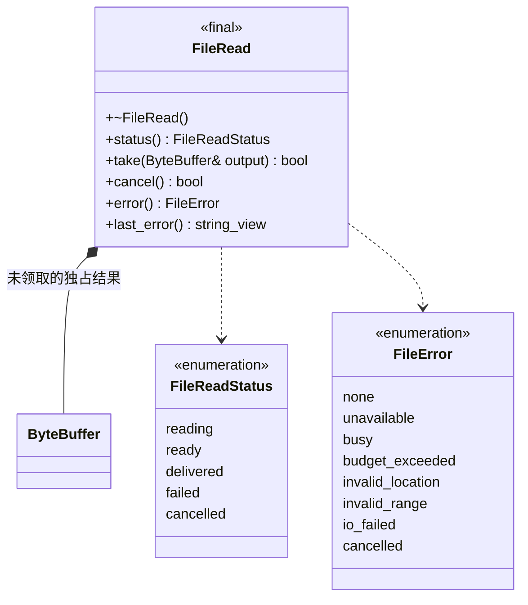

# 核心文件类

[类图索引](../../class-diagrams/index.md) · [统一生命周期](resource-lifecycle.md) · [资源读取](resource-system.md) · [目录](resource-catalog.md)

VirtualFileSystem 提供同步读取、独立异步操作及取消；文件层不包含资源计数、GUID、资源解析或依赖图。

## 文件读取与任务

MountList 为 vector<ResourceMount>，Path 为 filesystem::path，ByteBuffer 为 vector<byte>，不是新框架类。FileLocationT 沿用 schema 生成模型。

- 普通类，不继承 System；拥有者 ResourceSystem 统一初始化、轮询及关闭。构造/析构 noexcept，不允许复制；存在异步操作时不能移动对象。
- configure 校验并原子更新挂载，失败保留旧值，不扫描/打开文件。已受理操作持有自己的挂载快照，更新后不改变其来源；资源目录换代取消由上一层决定。
- read 的 offset 相对实体起点，size 是字节数；校验加法溢出、实体范围、实际文件边界和平台 size_t 容量。成功输出独占缓冲，失败清空；精确范围未读满视为失败。零长度合法范围成功返回空缓冲。
- read_file 是工具所需的整文件同步能力，不要求 ResourceSystem 初始化；资源包成员统一用范围 read。hash_file 保持固定 64 KiB 缓冲的 FNV-1a 64 位整文件摘要，失败 hash/size 清零，不整包载入内存。
- begin_read 只受理请求，要求操作输出为空，非空则拒绝并保留原值；合法输入失败时输出空且不会产生晚到结果。未配置返回 unavailable，暂时满额返回 busy，单项超过字节上限返回 budget_exceeded。命令错误通过 error/last_error 获取。
- configure_async 借用已初始化 TaskSystem，在活动请求清空后才可重配。TaskSystem 负责打开和路径校验等短任务，实际传输使用 SDL 异步 I/O；不新建线程池，不让 CPU worker 主动等待传输。
- poll_async 非阻塞收集最多 completion_budget 项完成结果，仅由所属系统推进；业务查询 FileRead 不会推动工作。宿主统一派发 TaskSystem 完成委托。
- 普通取消不等待底层；若后端无法中断，则标记撤销并忽略晚到结果，I/O 完成前保留缓冲和句柄。只有 shutdown_async/析构等待收尾，关闭可重复；将仍未交付的 reading/ready 操作取消并回收结果，停止后不能发布新的完成结果。
- read/error/last_error 和异步提交在协调线程使用；mounts/error/last_error 为 const noexcept。read 更新最近命令错误，因此不声明 const；状态返回标注 nodiscard。
- SDL 类型、队列与平台路径实现私有；散文件和未压缩包内范围共用契约。Android 使用 APK assets 的真实 AAsset 来源，不能被同名私有文件遮挡；UTF-8 转换复用 PathUtils，保留越界、权限与符号链接检查。
- 文件层不选择持久版本、不回退旧包、不解码资源、不处理业务卸载。

## 单次异步操作

FileRead 只能由 VFS 创建，调用方用 unique_ptr 独占；对象禁止复制/移动。查询 const noexcept，析构 noexcept，可能失败的返回 nodiscard。

reading → ready/failed/cancelled；ready → delivered（take）或 cancelled。take 只能成功一次，转移字节缓冲，不复制；失败输出空且保留原终态错误。cancel 对 reading/ready 生效，重复取消成功，对 delivered/failed 返回 false。销毁未领取操作即放弃；独立状态可以晚于 VFS 销毁，关闭后查询/取消/析构不解引用 VFS。

本设计用 FileRead 替代公开 function 回调式 read_async，便于上层按请求取消和接管所有权，不建立通用 Future、JobManager 或额外线程系统。
