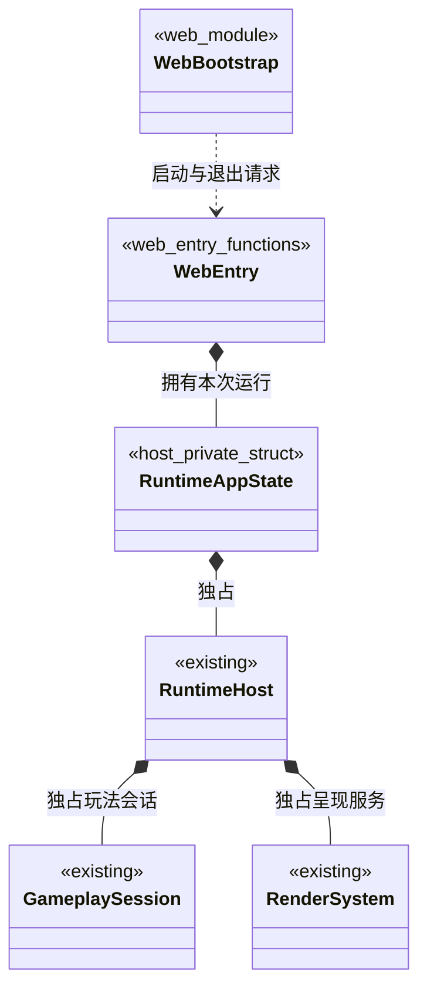
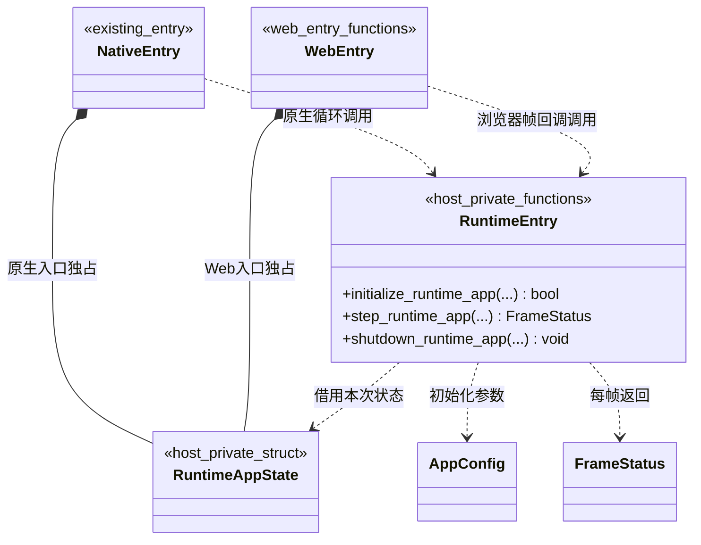
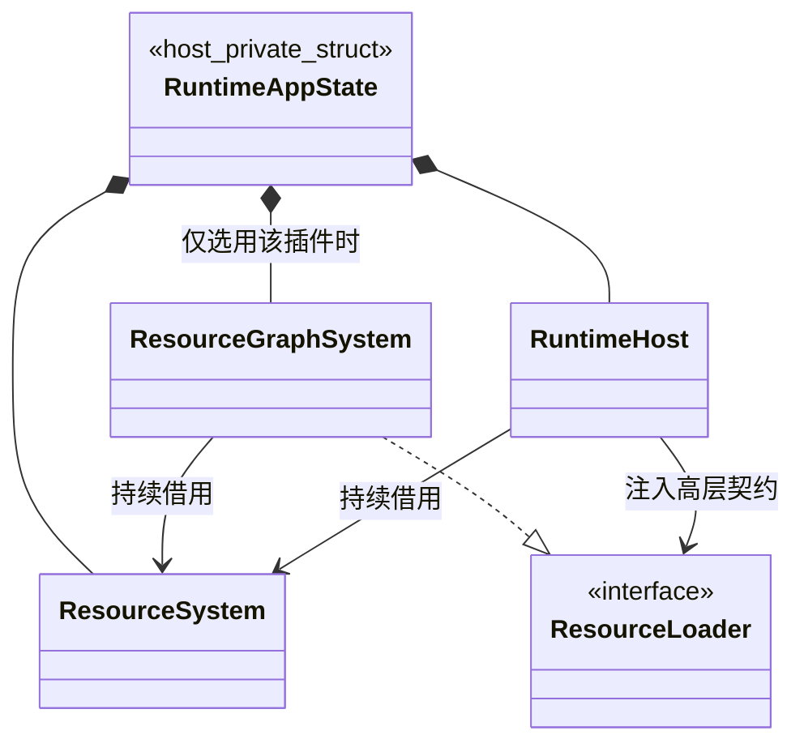
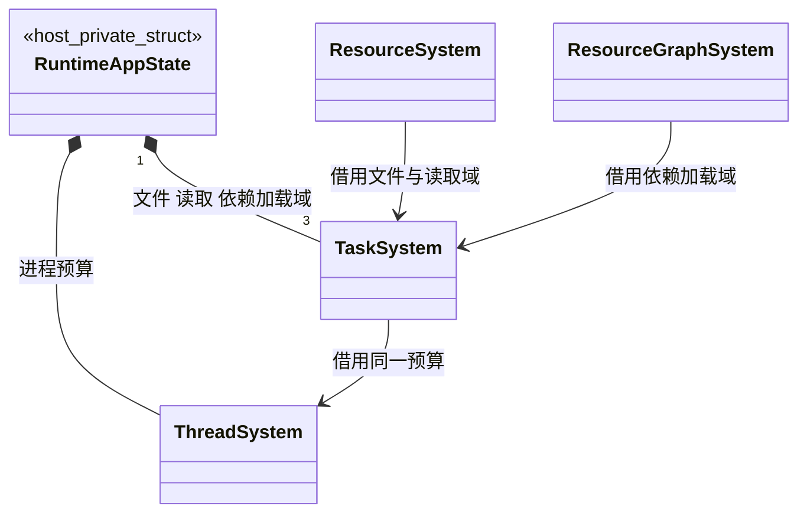
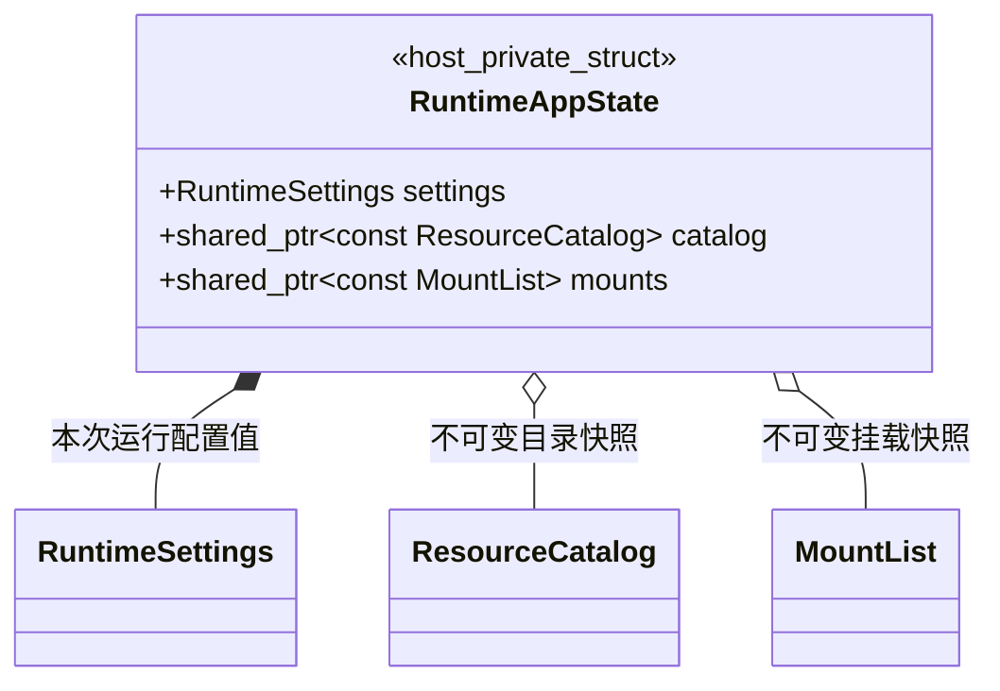
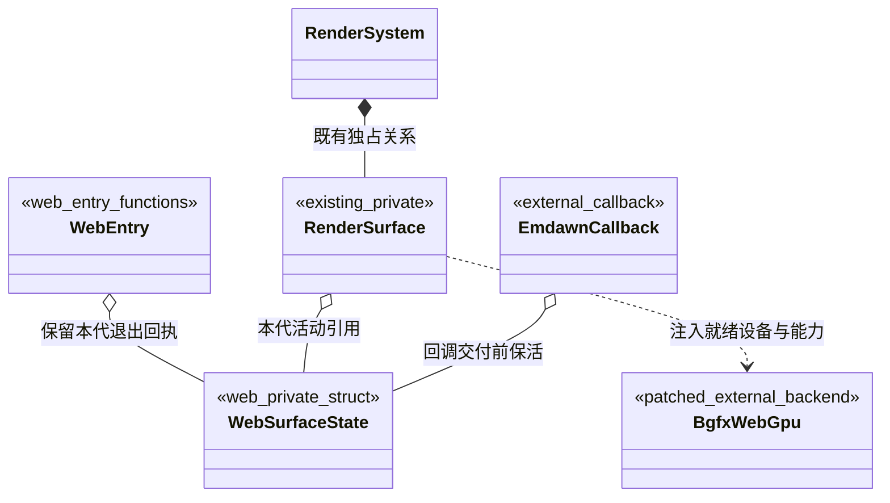
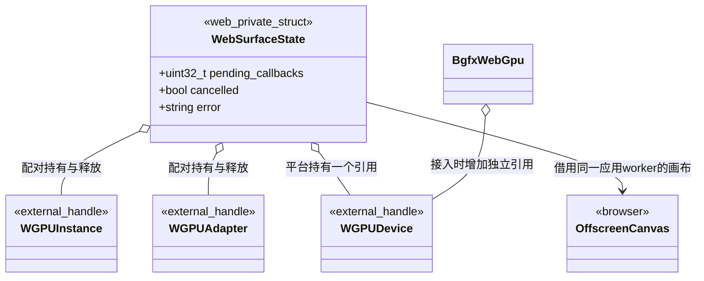
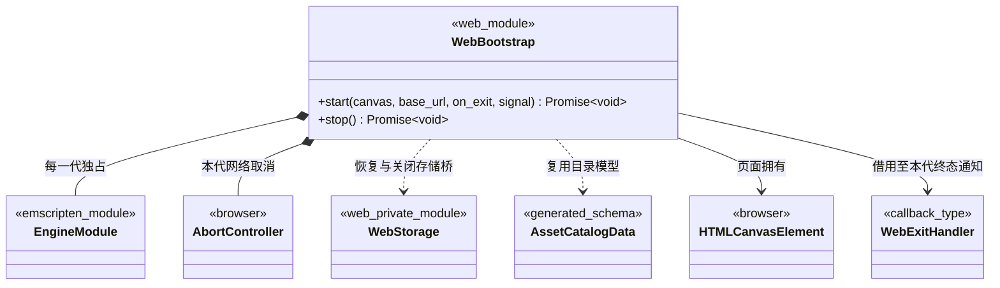
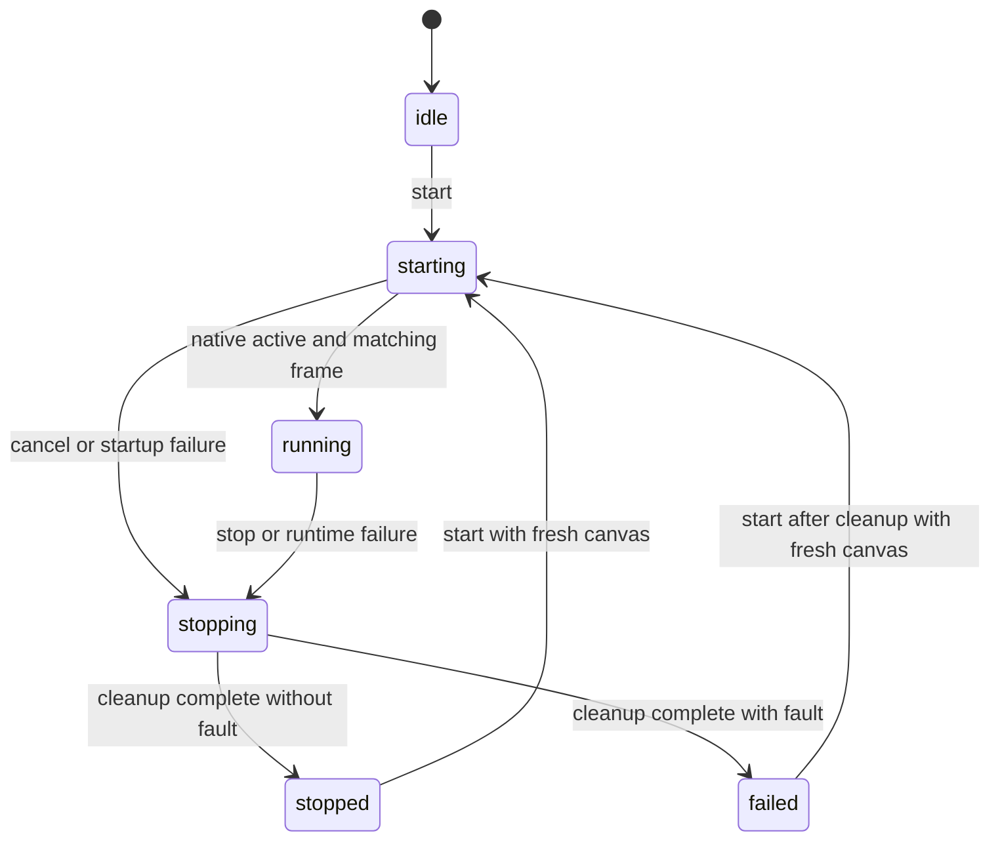

# Web 运行宿主与 WebGPU

只支持导出的游戏运行产物；桌面编辑器继续使用原生后端。已在 macOS Chrome 验证 WebGPU 首帧、公开 PBR／室内场景、停止与重新启动；其他浏览器、设备及复杂功能的覆盖范围见[测试文档](../../testing.md#webgpu-导出)。

[类图索引](../../class-diagrams/index.md) · [Web 导出](../../editor/class-diagrams/web-export.md) · [运行宿主](runtime-host.md) · [渲染系统](render-system.md)

## 最小改动与目录

Web 适配不新增核心公开类、System 或项目脚本接口；既有平台参数增加 `web` 取值。新增两个 C++ 私有数据结构：`RuntimeAppState` 保存当前游戏入口已有的跨帧状态，`WebSurfaceState` 保活异步设备申请。存储增加一个私有文件发布函数；浏览器入口、存储桥和导出器使用模块函数。浏览器启动状态只记录页面装载与关闭，不复制 Gameplay、Scene、资源或任务状态。

| 位置 | 职责 |
| --- | --- |
| `platforms/web/main.cpp` | Web 入口及 Emscripten 帧回调 |
| `platforms/web/bootstrap.mjs` | 浏览器启动、资源预载、存储挂载和正常退出 |
| `platforms/web/render/render_surface.cpp` | 既有 RenderSurface 的 Web 实现及私有 WebSurfaceState |
| `platforms/web/app.cpp`、`platforms/web/task/` | App 路径与必要线程平台适配 |
| `platforms/web/storage/storage_file.cpp`、`platforms/web/storage/storage.mjs` | 持久文件发布、IndexedDB 完成回执及私有线程代理 |
| `platforms/web/export.py`、`platforms/web/templates/` | Web 专用打包与网页模板 |
| `cmake/platforms/` | 选择和装配 Web 目标，不放网页模板或浏览器业务 |
| `third_party/overlay-ports/bgfx/`、`third_party/emscripten/` | 固定来源的外部设备接入及 IDBFS 原子完成补丁 |
| `src/runtime_entry.hpp`、`src/runtime_entry.cpp` | 原生及 Web 入口共用的宿主私有状态和函数 |

以上路径对应当前实现。RuntimeAppState 位于宿主私有命名空间 `engine::host_detail`；WebSurfaceState 位于 `engine::render_detail`。其他现有类的方法只在其所属图定义。

## 宿主总体关系



图中的 WebBootstrap 和 WebEntry 是模块，不是新增 C++ 系统类。WebBootstrap 不跨线程读写 RuntimeHost；请求由平台桥接送到游戏协调线程，核心接口仍仅在所属线程调用。

## 共用游戏入口



把 `src/main.cpp` 中现有的配置读取、资源服务装配、片头、启动目录选择、Gameplay 启动推进和收尾提取为宿主函数。原生入口保留原生循环，Web 入口改为 Emscripten 帧回调；二者调用同一实现。不是在 RuntimeHost 外再建一套公共运行门面。

图中省略号对应以下完整签名，声明仅在宿主私有头文件，不进入 `include/engine/`：

```cpp
[[nodiscard]] bool initialize_runtime_app(
    RuntimeAppState& state,
    const AppConfig& app_config,
    int argc,
    char** argv);

[[nodiscard]] FrameStatus step_runtime_app(
    RuntimeAppState& state,
    double delta_time);

void shutdown_runtime_app(
    RuntimeAppState& state) noexcept;
```

- 两种入口互斥：每个进程／Wasm 模块只由自己的入口独占一个 RuntimeAppState；图中的两个拥有关系不是同时拥有同一对象。
- 初始化失败返回 false 并清理已成功部分；逐帧返回现有 FrameStatus，关闭可重复且支持部分初始化。状态结构本身不增加另一份 Gameplay 或 Scene 状态。
- 每帧沿用现有 ResourceSystem、资源图和 RuntimeHost 的推进顺序；启动仍使用 begin_gameplay、step_gameplay 和 activate_gameplay，场景首帧及终态仍来自原生请求。
- Web 使用 `emscripten_set_main_loop_arg` 一类逐帧回调，继续让 WindowSystem 处理 SDL 事件，不另设一个消费相同事件的输入回路。暂停时返回调度器，恢复后丢弃暂停期间的时间。
- 首版选择 pthread 运行包，游戏协调线程放在 Emscripten 应用 worker；它同时是本包的 SDL 调用线程和 GPU API 线程。Web 目标显式关闭 bgfx 自有后台渲染线程（`BGFX_CONFIG_MULTITHREADED=0`）。oneTBB 继续执行 CPU 任务，不持有浏览器 GPU 对象；预算仍由 ThreadSystem 统一配置。
- 页面拥有 HTMLCanvasElement；启动器在取得任何图形 context 前，将其 OffscreenCanvas 转交本代应用 worker。设备申请、Canvas 的 WebGPU context、bgfx 初始化／提交／回读／关闭全部在这个 worker。浏览器 UI 线程负责 DOM、输入代理及存储代理，不跨 worker 传递 GPU JS 对象指针。
- Web 目标的 `PROXY_TO_PTHREAD`、OffscreenCanvas 转交、pthread 预建预算和 SDL 选择器由平台构建／启动器配套配置，必须通过同一真实浏览器闭环验证。SDL 继续把事件交给 WindowSystem，线程代理不重复消费输入。

### 服务所有权



RuntimeAppState 只是当前入口局部拥有者的持久化整理。所选资源图实现由宿主装配；RuntimeHost 和业务只借用 ResourceLoader。替换插件仍遵守[资源加载契约](resource-loader.md)，不让核心依赖默认插件。



文件、单项读取、依赖加载三个域由入口拥有；RuntimeHost 内部的玩法、渲染、物理等任务域继续由其自身管理。Emscripten 的 pthread worker 是平台执行机制，ThreadSystem 仍是唯一引擎并行预算拥有者。



RuntimeSettings、ResourceCatalog、MountList 均为现有类型。目录及挂载为不可变共享快照，生命周期覆盖 startup 与 Gameplay 借用。窗口、影片、日志、领域系统及插件登记沿用当前入口的拥有关系，不把它们重新装配进 WebBootstrap。

关闭先撤销本代接受新请求的权限，随后按 RuntimeHost → 资源图 → ResourceSystem → 三个入口任务域 → ThreadSystem → 日志和 App 收尾。Gameplay 的 OnShutdown 仍可显式 Save，存储桥必须继续存活。原生对象关闭后应用 worker 暂留事件循环，交付在途 GPU 回调并排空代理；WebStorage 完成最后同步并关闭后才终止 worker、释放 Wasm 模块。仅保活 C++ 状态不足以保活其执行环境，不能提前释放回调函数表或代理队列。

## GPU 接入前提

当前固定的 bgfx `1.167.9605-606` 会自行申请 WebGPU 设备，没有下面类图使用的外部设备接入路径。此缺口是实现前置工作，不能用平台侧填入一个指针代替。

采用保留当前基线、回移所需上游接入改动的路线：补丁放在 `third_party/overlay-ports/bgfx/webgpu-external-device.patch`，来源固定到 [bgfx f5ce45e39d6381093e577e80adb1abb2c611302c 的 WebGPU 实现](https://github.com/bkaradzic/bgfx/blob/f5ce45e39d6381093e577e80adb1abb2c611302c/src/renderer_webgpu.cpp)。该版本包含 `g_platformData.context` 外部设备分支及设备 AddRef；回移同时核对相应头文件、能力读取和释放路径，保留来源与许可。原生其他后端继续使用当前路线。

1. 平台异步申请 adapter／device，申请所选渲染能力需要且 adapter 支持的 features／limits；bgfx 按设备实际启用的能力报告 caps，不能将未启用功能报告为可用。
2. bgfx 外部设备路径不得再次同步 requestAdapter／requestDevice。平台持有一个引用，bgfx 增加独立引用；先关闭 bgfx，再释放平台引用。
3. Emscripten、Emdawnwebgpu、bgfx 补丁及桌面 shaderc／Tint 形成一组固定工具链。回读、编译完成等 API 仍须核对 Asyncify／JSPI 或非阻塞适配需求。实现第一步固定版本及必要选项，通过浏览器绘制／回读／退出门槛后再接入完整运行产物。
4. RenderSystem 同时补齐[通用暂缓传播](render-system.md#异步表面准备)：prepare_frame() 改用私有 FramePrepareStatus（ready／deferred／failed），准备就绪不等于已提交帧。影片呈现的返回值从 bool 收敛到既有 RenderSubmitStatus，场景、影片和空闲路径统一传播暂缓与故障，更新全部调用方；不新增 Web 参数，不通过修改窗口可见性掩盖等待。

固定版本和补丁参与实际 Wasm 构建与浏览器验证；当前覆盖及限制统一见[测试文档](../../testing.md#webgpu-导出)。

## 异步 WebGPU 表面



复用 RenderSurface 现有的 `prepare(bgfx::Init&, bool& available)`、poll、release 和 shutdown。语义如下：

| 情况 | 结果 |
| --- | --- |
| Canvas 或设备申请尚未就绪 | prepare 成功且 available=false；沿通用呈现链返回 deferred |
| 设备与 Canvas 就绪 | 填入 WebGPU 后端、平台句柄及已就绪设备，再初始化已适配的 bgfx |
| Canvas 像素尺寸改变 | 通过 SurfaceChange reset；DOM 替换或 worker 转交不作为普通 resize |
| 申请失败、验证错误或实际设备丢失 | 返回 failed，宿主锁存原生故障并结束在途请求 |

暂缓不产生成功帧，也不丢弃候选或活动场景。首次设备申请期间，已受理的[范围准备](render-readiness.md)保持 working／queued，不创建 GPU 对象；实际申请失败才锁存领域错误。设备丢失在首版视为本次运行失败，完成清理后由页面显式重启，不自动降级后端或循环申请。



- 三种 WGPU 句柄各自持有需要配对释放的原生引用，不是新增包装类，也不进入场景 Schema。
- RenderSurface 保留活动状态；已登记回调各自保活 userdata，只交付结果，不访问 Scene、Node、VM 或已销毁的 RenderSurface。结果在同一应用 worker 的安全点应用。
- WebEntry 的平台私有记录保留本运行代的活动／退役 WebSurfaceState 引用及完成回执。RenderSurface 关闭后，退出桥仍能等待这些记录的 pending_callbacks 归零并解除事件回调；随后释放记录。该退出桥不读取已关闭的 RenderSystem，也不把 Web 类型加入 RuntimeAppState 或核心接口。
- 关闭或重建先把本代状态标记为 cancelled，禁止新申请；晚到结果只释放本代引用，不影响新代。pending_callbacks 记录未交付回调，每个回调只完成一次。设备事件回调需随设备销毁解除，不能形成“状态持有设备、设备回调永久保活状态”的环。
- 正常关闭按撤销请求 → 关闭 bgfx → 释放平台设备／adapter／instance → 交付取消或晚到回调 → 释放状态执行。引擎对象可先关闭，Emdawn 所在 worker、Wasm 和回调队列必须存活到收尾完成。
- 页面拥有 DOM Canvas，本代应用 worker 独占转交后的 OffscreenCanvas；WebSurfaceState 仅借用。重启使用新的、尚未转交的 Canvas，不能假定已转交画布可再次转交。

## Web 持久存储

`KeyValueStore::save()` 保留 bool 返回值，通过[私有文件发布函数](key-value-store.md#平台文件发布)连接平台持久化。Web 实现仅在 IndexedDB 事务确认完成后返回 true；失败恢复上一份文件视图，退出同步不得再次提交失败的候选。

模块、线程、原子失败和关闭契约唯一维护在 [Web 持久存储类图](web-storage.md)。恢复先于 App 初始化；OnShutdown 中的显式 Save 及已受理保存先收尾，最后才关闭存储桥。WebBootstrap 不解释 KV 内容，核心存储不依赖浏览器启动模块。

## 浏览器启动模块



完整浏览器侧签名如下；不是项目 engine 脚本 SDK 的接口：

```ts
type WebExitHandler = (reason: "stopped" | "failed", error: string) => void;

start(
    canvas: HTMLCanvasElement,
    base_url: URL,
    on_exit: WebExitHandler,
    signal?: AbortSignal,
): Promise<void>;

stop(): Promise<void>;
```

on_exit 必须提供，借用至本代完全收尾后的唯一终态通知；正常停止时 error 为空，故障时为英文诊断。start 已成功后发生的设备丢失或脚本故障仍通过此回调通知页面。它只报告原生故障和装载结果，不复制场景状态；页面模板负责展示故障和显式重启。

### 启动资源与就绪

- 每代只创建一个 EngineModule。按同一 FlatBuffers Schema 生成的访问器读取 catalog，枚举载体位置；预载校验长度和请求状态，实体解析、依赖加载及运行时校验仍由原生资源链执行。
- 完整预载所选包的 catalog、packs／gen 和 runtime.json，并完成存储恢复后才启动原生入口。失败或取消不启动半成品，不从另一版本补文件；网络取消复用 AbortController。
- `/assets` 为预载只读根，`/settings/runtime.json` 为运行设置，`/persistent/<application_name>` 为恢复后的持久根，`/cache/<application_name>` 可丢失，应用名与原生产物取自同一导出配置。AppConfig 只提交路径，资源名、GUID、VFS 和运行设置格式不变；运行包不读取项目 TOML。
- start 仅在本代原生启动请求 active 且目标范围有对应的真实场景／UI 提交帧后 resolve。下载、模块实例化和片头画面均不能替代该结果。导出入口须产生此就绪事实，无有效玩法入口的包明确失败。
- 音频解锁、指针锁定、全屏及页面可见性按浏览器／SDL 实际能力处理；代理不得把尚未生效的请求报告为成功。

### 启动、停止与失败终态

状态只属于启动模块的私有装载生命周期。每代 generation、在途启动结果、停止结果及故障原因由模块保存，不新增 C++ System 或公共轮询服务。



| 调用或事件 | 契约 |
| --- | --- |
| idle／已清理的 stopped／failed 调用 start | 建立新 generation，要求提供尚未转交的新 Canvas |
| starting／running／stopping 再次 start | 拒绝 InvalidStateError，原运行和 Promise 不变 |
| start 收到已取消 signal | 拒绝 AbortError，不创建模块、不转交 Canvas，不产生本代退出通知 |
| starting 收到 stop 或取消 | 停止预载或向原生提交退出；同一清理链完成后 start 拒绝 AbortError，stop 正常完成 |
| running 收到 stop、取消或正常原生退出 | 进入 stopping；已 resolve 的 start 不改变，收尾后通知 stopped |
| 启动失败、运行故障或清理失败 | 锁存故障并自动收尾；尚未完成的 start 拒绝故障，stop 拒绝故障，最终仅通知一次 failed |
| stopping 重复 stop | 返回同一份在途停止 Promise，不重复退出或同步 |
| idle／stopped 调用 stop | 返回已完成结果；failed 时返回已缓存的失败结果，不重复清理或通知 |

- stop／取消一经启动模块受理，后续 ready 通知失效；start 已先 resolve 时走正常停止规则。实际故障优先于主动取消，不把失败降为 stopped。
- signal 作用于本代整个运行，监听器在终态移除；网络、代理和原生通知均校验本代运行身份，GPU 回调持有本代独立状态并检查 cancelled。旧回调不能结算新代 Promise。
- 所有正常出口共用清理链：撤销网络及新请求 → 原生安全点退出及 OnShutdown → 在途 GPU／存储回执收尾 → 关闭存储桥 → 释放 worker／模块 → 发布 stopped 或 failed。start、stop、on_exit 各只结算一次。
- 运行后故障通过 on_exit 通知，不尝试再次 reject 已 resolve 的 start。终态及引用释放先完成，再调用页面回调；回调异常不能阻断清理。参数非法且尚未建立运行代时，只拒绝该次调用。
- 清理期间保持 stopping，不接受重启，不以强制终止仍有回调的 worker 冒充完成。强制关页不承诺完成在途操作；已确认成功的 Save 不依赖正常 stop 才提交。

完整预载为首版边界：场景切换、依赖加载与 GPU 准备仍异步，不包含游玩期间 HTTP Range 下载、Service Worker 更新或 Web 编辑器。网络按需读取另按 VFS 契约评审。

## 验证边界

1. 完成固定来源的 bgfx 外部设备适配，固定配套工具链；在同一应用 worker 验证真实 WebGPU 绘制、回读、缩放和退出，确认无重复设备申请、引用平衡及回读等待可运行，不以原生 Dawn 或 WebGL 代替。
2. 一个现有公开范例按 web 目标导出后，使用同一玩法／资源／世界链进入 PBR 场景、显示纹理与 UI，切场景并按原生帧身份截图。
3. 覆盖预载／设备申请／首帧前取消、重复 start／stop、停止期间重启拒绝、首帧与取消竞态、运行后故障及旧代回调；Promise、on_exit 和资源释放均满足唯一终态。
4. 蒙皮、阴影、HDR、AO、物理、脚本与 UI 的功能按当前选用能力逐项验证。ASSAO 使用的部分存储纹理格式需要可选 WebGPU 能力或所属通道的适配，不能靠设备创建成功宣称效果已支持。

首个范例须明确声明所启用的组件效果；不在 Web 平台静默跳过已开启但不受支持的效果来使验收通过。采样、存储格式或截图回读不满足要求时，报告所属能力缺口，再评审必要调整。

存储还需覆盖 Save 成功后直接刷新、同毫秒连续保存、事务失败／配额不足保留旧值，以及停止期间完成已受理保存，见 [Web 存储验收](web-storage.md#验收边界)。

首版构建只装配核心与实际选择的运行时插件，QuickJS 仍为默认脚本后端；编辑器、导入器与正式运行包的 MCP／临时脚本入口不进入 Wasm。测试只适配普通状态与截图接口，不在此建立浏览器专用场景执行器。

## 研究来源

- [bgfx 后端说明](https://bkaradzic.github.io/bgfx/overview.html)：WebGPU 当前标注 Dawn Native only。
- [Emdawnwebgpu](https://dawn.googlesource.com/dawn/+/refs/heads/main/src/emdawnwebgpu/pkg/README.md)：浏览器 WebGPU 的 Emscripten 接入。
- [SDL 的 Emscripten 入口约定](https://wiki.libsdl.org/SDL3/README-emscripten)：帧循环和浏览器音频限制。
- [Emscripten pthreads](https://emscripten.org/docs/porting/pthreads.html)：线程代理与 COOP／COEP 部署前提。
- [WebGPU 纹理格式能力](https://www.w3.org/TR/webgpu/#texture-format-caps)：可选存储纹理格式边界。
