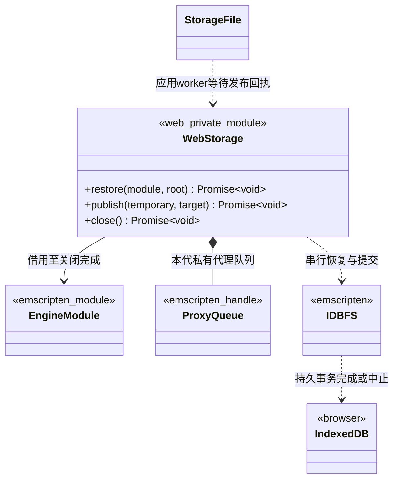

# Web 持久文件发布

本页定义 Web 平台对既有持久存储语义的适配。C++ 和 TS 的 Save 仍同步返回 bool；成功表示本次内容已被浏览器持久存储确认，退出时同步不是 Save 的替代品。

[类图索引](../../class-diagrams/index.md) · [通用文件发布契约](key-value-store.md#平台文件发布) · [Web 宿主](web-host.md#web-持久存储)

## 模块和线程

StorageFile 是存储模块私有函数的图示名称，完整 C++ 签名仅在 [KeyValueStore](key-value-store.md#平台文件发布) 定义。WebStorage 是 `platforms/web/storage/storage.mjs` 模块，不是新增 C++ 类或系统。图中 module 为 Emscripten 模块借用，root／temporary／target 为复制的路径字符串；所有方法失败均拒绝 Promise，只有平台桥将结果转成 C++ bool 和英文 error。

- restore(module, root) 在本代启动时调用一次，建立 IDBFS 挂载并等待恢复完成；失败不得初始化 App 或 Gameplay。根使用 `/persistent/<application_name>`，应用名取同一导出配置中的既有 ENGINE_PROJECT_APPLICATION_NAME，按 App 规则校验；不以构建版本命名，避免更新后丢失存档，不让同源的不同项目共用固定数据库名。
- WebStorage 持有本代专用 Emscripten proxy queue，借用 EngineModule。队列是平台通信句柄，不是任务调度器；不增加线程池，不修改 ThreadSystem。
- publish(temporary, target) 仅由 `platforms/web/storage/storage_file.cpp` 调用。游戏协调 worker 使用 `emscripten_proxy_sync_with_ctx` 把操作交给浏览器 UI 线程；UI 发起异步事务后立即返回事件循环，结束时写入结果并调用 `emscripten_proxy_finish`。仅应用 worker 等待，浏览器 UI 不等待 worker，也不能由事务回调反向调用玩法或 VM。
- 路径和候选内容在异步操作受理时保留到回执交付；不得借用会提前失效的临时字符串或 Wasm 堆视图。同步等待只覆盖低频显式保存，不暂停浏览器事件循环。
- restore、publish、close 串行，IDBFS autoPersist 关闭；所有主动同步经这一模块执行，防止退出同步越过失败回滚。close() 禁止新操作，等待已受理操作、同步剩余有效文件并释放代理队列；重复关闭共用同一结果。

上述代理模式使用 [Emscripten proxying API](https://emscripten.org/docs/api_reference/proxying.h.html)，复用其异步工作与完成通知，不把整个脚本 VM 改造成异步存档接口。

## 发布和失败语义

KeyValueStore 仍负责编码、限制、路径检查以及临时文件的完整写入和关闭。Web 平台发布只负责以下文件事务：

1. 在改动当前文件视图之前，保留旧目标的内容、存在性和必要元数据；准备失败返回失败，目标不变。
2. 将完整临时文件替换为目标的内存文件视图，并标记本次变化。连续两次 Save 即使发生在同一毫秒，也必须被 IDBFS 识别；不能只依赖可能相等的时间戳跳过发布。
3. 将本次文件变化提交到 IDBFS 的 IndexedDB 事务；以 transaction complete 确认为成功，以 transaction abort 确认为失败，不以请求入队、单个 put 成功或错误回调首次触发作为最终回执。
4. 失败时恢复旧内容／元数据或原先的“不存在”状态，清除候选临时文件后才唤醒应用 worker。旧持久事务保持有效；KeyValueStore 内的未保存修改可供用户显式重试，不能被 close() 隐式提交。
5. 成功后才返回 true。若页面在事务完成后、回执交付前被强制关闭，下一次可能读到新值，但不得伪造已向旧调用方返回成功；不承诺浏览器被强杀或设备断电时的在途操作结果。

不引入另一份 KV Schema、专有存档数据库或项目 key 解释；仍用现有 UTF-8 文件和 Emscripten IDBFS。IDBFS 的默认同步是异步的，见[官方文件系统说明](https://emscripten.org/docs/api_reference/Filesystem-API.html#idbfs)。

### 上游事务前提

所选 Emscripten 版本必须保证：同步发生读取／写入错误时中止整个事务，回执在事务完成或中止后且仅发一次。当前检查的上游 `src/lib/libidbfs.js` 存在先报告操作错误、没有显式中止事务的路径，不能直接据此承诺上述回滚。

因此交付工具链纳入 `third_party/emscripten/idbfs-atomic-sync.patch`：固定 SDK 版本与原文件校验值，明确中止失败事务并在其终态发回执，保留来源和许可。该补丁仅处理所需原子完成语义，不另写一套 IDBFS。应用前核对版本，禁止修改不匹配的安装；构建在 build/ 中暂存匹配版本并应用补丁，不改写已安装 SDK；真实事务中止与业务 Save 的验证入口见[测试文档](../../testing.md#webgpu-导出)。

## 退出和资源生命期

WebBootstrap 先让原生运行安全退出；Gameplay 的 OnShutdown 可以显式 Save，此时 WebStorage、浏览器 UI 和代理队列仍有效。原生调用全部结束后才调用 close()。已受理的 Save 不能被 stop 直接取消成失败；等待事务真实结果，再继续停止。底层存储故障通过 Save 的 last_error 与关闭结果报告，不降为内存保存成功。

close() 的最后同步只处理仍有效的文件视图；不保存 KeyValueStore 纯内存中的未保存修改。完成后解绑模块引用，再由 WebBootstrap 终止应用 worker／释放 Wasm。禁止在事务或代理回调仍引用队列时销毁队列。

## 验收边界

复用现有 KV 用例和 Web 公开范例，补充浏览器适配的真实契约验证：

- Save 返回成功后直接刷新，读取到本次值；无需先调用 stop。
- 连续同毫秒保存不同内容均生效，首次保存和覆盖保存一致。
- 注入事务中止、配额不足及操作错误后，内存文件和重新加载结果均保留旧值；正常退出不会补写失败候选。
- stop 与在途 Save 交错时，事务只提交一次、结果只交付一次，UI 事件循环可继续处理。
- 不同 application_name 的同源产物互不覆盖；同一应用更新继续读取原存档。沿用现有接口不承诺多实例同时写入的边界。
