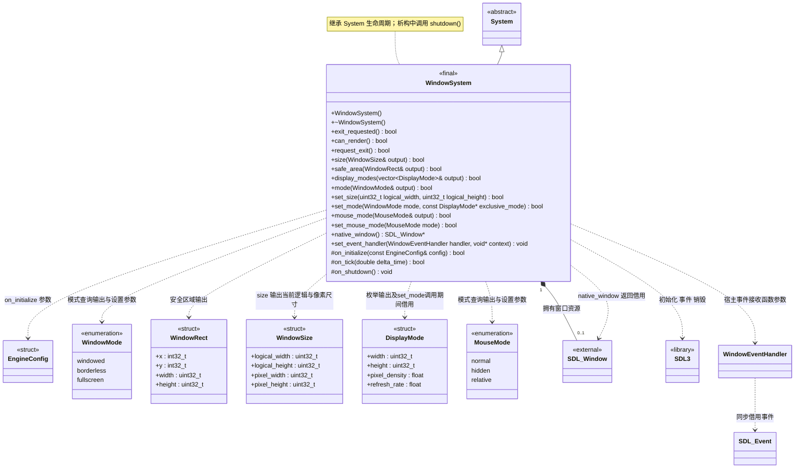

# 窗口系统

[类图索引](../../class-diagrams/index.md) · [引擎与系统](engine-system.md) · [完整引用关系](../../class-diagrams/references.md)

本图定义 `WindowSystem` 的方法及其窗口数据，其他节点为跨图引用或第三方类型。

> **已实现**：经评审，在既有类中追加显示模式、窗口尺寸、鼠标模式和退出请求接口。原有生命周期、事件泵及借用关系保持不变；尺寸及显示模式设置成功表示请求被接受，实际结果由后续事件和查询确认。

- 负责 SDL3、主窗口和事件处理，`on_tick()` 更新退出与可绘制状态。
- `can_render()` 在未初始化、暂停或窗口表面不可用时返回 `false`。
- `native_window()` 返回借用指针，未创建时为 `nullptr`；借用仅在`SDL_main` 所在线程（见[线程约定](engine-system.md)）及窗口生命周期内有效，调用者不能销毁窗口，也不能跨窗口重建长期缓存该指针。
- Android 的可绘制性还检查宿主暂停标志；关闭 SDL 自带后台阻塞，使失焦 / 后台期间的主线程暂停回调仍可处理；允许同一进程内 Activity 重建，正常退出后可再次初始化。Surface 销毁前的同步协议见 [Android 宿主](android-host.md)。
- 初始化、事件更新和关闭均由 `SDL_main` 所在线程（见[线程约定](engine-system.md)）调用；后台事件标志使用原子变量不代表公共接口具备线程安全性。
- Android 原生 Surface 是否可用不等同于 SDL 窗口指针是否非空；恢复后继续使用同一引擎，表面重建与渲染系统协作处理。
- 从[配置](types.md)读取所需窗口参数，不保存指向调用者配置的悬空引用。复制、移动限制和初始化失败清理遵守[系统约定](engine-system.md)。

- 平台窗口选项配合已确定的图形后端：macOS / iOS 为 Metal，Windows 为 Direct3D12，Android / Linux 为 Vulkan。平台差异集中在窗口和渲染实现。

C++ 限定符：构造、析构、状态及窗口访问器为 `noexcept`；访问器为 `const`。受保护钩子和析构标注 `override`，`on_shutdown()` 为 `noexcept`，状态返回值标注 `[[nodiscard]]`。

## 输入职责

窗口只保留唯一 SDL 事件泵和窗口生命周期；`WindowEventHandler = void (*)(void*, const SDL_Event&)` 同步把每个事件交给宿主，不保存或消费输入。原六键 / 三按钮接口已删除，角色和预览直接升级为[统一输入](../input.md)调用方，没有兼容层。设备与输入状态见[输入系统类图](input-system.md)。

## 已实现：显示与尺寸

新增类型仍位于 `engine` 命名空间，是普通枚举或数据 `struct`，不增加窗口包装类或管理器。`WindowSize` 和 `DisplayMode` 的数值成员默认清零；`MouseMode` 默认 `normal`。实现直接使用既有 SDL3 的查询和设置能力，只增加引擎状态校验、数据转换与薄脚本绑定，不新增依赖、不重新实现窗口或输入算法。

- `size(WindowSize& output) const noexcept` 同时查询 SDL 当前窗口的逻辑宽高和物理像素宽高。逻辑尺寸对应 UI 布局坐标；像素尺寸对应窗口表面，不能在 Retina 上假定二者相等，也不能固定假设倍率为 2。窗口不存在、查询失败或尺寸无效时返回 `false`，输出清零。它不等待渲染器；最近已应用的绘制目标尺寸继续通过 `RenderSystem::viewport_size()` 查询。
- `set_size(logical_width, logical_height)` 接收窗口**逻辑尺寸**，仅用于 `windowed`。参数必须非零且可安全转换为 SDL 的整数尺寸；其他模式、未初始化或平台拒绝时返回 `false`，不静默转为其他模式。成功只表示 SDL 接受尺寸请求；窗口系统可能异步调整或限制尺寸，调用方继续泵事件并通过 `size()` 确认实际值，不使用阻塞式窗口同步。
- `display_modes(vector<DisplayMode>& output) const` 枚举当前窗口所在显示器支持的独占全屏模式。字段镜像 SDL 模式的 `w`、`h`、`pixel_density` 与 `refresh_rate`：`width`、`height` 是 **SDL 模式尺寸**，物理输出为尺寸乘 `pixel_density`，不能直接把 `w/h` 当作像素。像素密度必须有限且大于零；刷新率单位为 Hz，保留 SDL 的零值表示未指定。数据来自有效 SDL 模式，不自行合成固定分辨率。显示器有效但没有可用模式时可成功返回空列表；查询失败时返回 `false` 并清空输出。列表是值拷贝，不公开 SDL 指针；窗口移到另一显示器后调用方重新查询，不缓存为永久身份。
- `mode(WindowMode& output) const noexcept` 查询 SDL 当前窗口模式；失败返回 `false` 并将输出置为 `windowed`。`windowed` 为普通可调整窗口；`borderless` 为使用桌面原生显示模式的无边框全屏；`fullscreen` 为按枚举模式设置的独占全屏。
- `set_mode(WindowMode mode, const DisplayMode* exclusive_mode = nullptr)` 在主线程请求切换模式。`fullscreen` 必须传入在当前显示器枚举结果中仍能匹配的模式尺寸、像素密度和刷新率，内部使用匹配的原始 SDL 模式，不重造其平台私有数据；指针仅在调用期间借用，不保留。`windowed` / `borderless` 必须传空。无效参数、当前显示器不支持该模式或 SDL 拒绝时返回 `false`；不能把独占全屏失败当作无边框成功。返回 `true` 表示请求被接受，实际模式和尺寸仍通过事件泵及查询确认。
- 分辨率选项属于项目配置。现有游戏的五档分辨率按物理像素解释：窗口模式下，项目通过 `WindowSize` 的实际 `pixel/logical` 比分别换算逻辑宽高，再调用 `set_size()` 并显示实际结果；独占全屏按 `DisplayMode` 尺寸乘密度后的物理结果筛选档位，并保留原模式的尺寸、密度和刷新率用于匹配。无边框全屏直接显示 `DESKTOP` 并禁用分辨率选择，不把它伪装为渲染比例设置。未提供独立的内部渲染分辨率或缩放接口。

窗口模式切换涉及多个 SDL 操作，不在接口中承诺跨操作的通用事务。失败后调用方可以查询实际模式和尺寸，不把未执行的请求显示为已生效；渲染器仍通过现有表面变更流程处理像素尺寸和图形设备，不在 `WindowSystem` 中调用 bgfx。

## 已实现：鼠标与退出

- `mouse_mode(MouseMode& output) const noexcept` 查询 SDL 当前鼠标模式。相对模式启用时返回 `relative`；否则按光标可见性返回 `normal` 或 `hidden`。失败时返回 `false`，输出为 `normal`。光标可见性由 SDL 在应用内管理，主窗口及其焦点策略由宿主协调。
- `set_mouse_mode(MouseMode mode)` 直接组合 SDL 已有操作：`normal` 关闭相对模式并显示光标；`hidden` 关闭相对模式并隐藏光标，不主动约束鼠标；`relative` 调用 SDL 的相对鼠标模式，复用其在窗口有焦点时自动隐藏、约束和持续报告相对位移的成熟行为。当前项目不需要独立 grab 接口，不自造捕获算法或多布尔组合。未初始化、非法枚举、平台不支持或 SDL 操作失败时返回 `false`；多次 SDL 调用中途失败后允许查询实际模式，不新增通用事务框架、不伪造成功状态。
- 本接口只操作窗口与鼠标模式，不创建输入通道、不读取动作、不决定玩法暂停。现有 `InputSystem` 已按 SDL 当前相对模式发布 `mouse_relative` 或 `mouse_delta`，调用方应相应提交映射。进入菜单、停止项目、退出和失焦后的释放及再次捕获策略由调用方组织。
- `request_exit() noexcept` 只在窗口系统已初始化且窗口有效时设置退出请求并返回 `true`；重复请求可成功返回。未初始化返回 `false`。它不直接销毁窗口、不调用进程退出，也不重入事件泵。宿主继续通过现有 `exit_requested()` 和帧状态结束循环，按既有逆序生命周期清理。
- TS 的显示及鼠标入口由独立 `Window` 静态门面对应这些能力，`App` 继续负责路径；`App.RequestQuit()` 复用窗口退出请求，额外参数被拒绝。脚本绑定只借用由宿主显式注入的可空 `WindowSystem*`，缺少借用或不处于活动回调时失败，不把 `RuntimeHost` 或 SDL 类型暴露给脚本。

新增操作及查询都在 `SDL_main` 所在线程调用；返回状态标注 `[[nodiscard]]`，只读查询为 `const`，上文标明的无异常操作为 `noexcept`。核心不判断运行宿主或编辑器身份；宿主决定是否允许当前项目修改共享窗口，以及停止项目时恢复哪些设置。编辑器与独立运行复用相同底层接口，项目切换不得遗留相对鼠标捕获。

## 成熟上游接口对应

- 尺寸查询与设置直接使用 [SDL_GetWindowSize](https://wiki.libsdl.org/SDL3/SDL_GetWindowSize)、[SDL_GetWindowSizeInPixels](https://wiki.libsdl.org/SDL3/SDL_GetWindowSizeInPixels) 和 [SDL_SetWindowSize](https://wiki.libsdl.org/SDL3/SDL_SetWindowSize)，保留上游的逻辑尺寸与像素语义。
- 模式枚举和切换直接使用 [SDL_GetFullscreenDisplayModes](https://wiki.libsdl.org/SDL3/SDL_GetFullscreenDisplayModes)、[SDL_SetWindowFullscreenMode](https://wiki.libsdl.org/SDL3/SDL_SetWindowFullscreenMode) 与 [SDL_SetWindowFullscreen](https://wiki.libsdl.org/SDL3/SDL_SetWindowFullscreen)。密度换算遵循 [SDL_DisplayMode](https://wiki.libsdl.org/SDL3/SDL_DisplayMode) 的正式字段，不另建模式算法。
- 鼠标模式使用 [SDL_SetWindowRelativeMouseMode](https://wiki.libsdl.org/SDL3/SDL_SetWindowRelativeMouseMode)、[SDL_ShowCursor](https://wiki.libsdl.org/SDL3/SDL_ShowCursor) 和 [SDL_HideCursor](https://wiki.libsdl.org/SDL3/SDL_HideCursor)，查询复用对应 SDL 状态。职责沿用 [SDL3 鼠标接口](https://wiki.libsdl.org/SDL3/CategoryMouse)。

## 安全区域查询

- Android、iOS 共用此窗口服务契约；数据取自当前平台，不维护机型尺寸表。引擎保持完整窗口渲染，安全矩形只供项目查询；项目决定哪些 UI 需要避让，不由核心自动添加边距或裁剪场景。
- `[[nodiscard]] bool safe_area(WindowRect& output) const noexcept`。仅在 SDL 主线程、窗口有效期间可调用；通过现有 SDL_GetWindowSafeArea 查询，失败时 output 全部清零。
- 矩形相对窗口客户区左上角，单位为与 size().logical_width / logical_height 一致的逻辑坐标；x、y 为 int32_t，width、height 为 uint32_t。不返回平台对象或内部指针。
- 查询成功必须是当前窗口范围内的有效矩形；没有遮挡限制时返回完整客户区。窗口尚无有效尺寸时返回失败，不能拿旧方向或旧设备的缓存冒充当前值。
- 旋转、窗口布局或安全区域事件后重新查询，不在此接口保存场景设置，也不自动缩小相机视口或 3D 渲染分辨率。
- 脚本同步增加 `WindowRect` 只读值接口和 `Window.GetSafeArea(): WindowRect | null`，遵守现有 Window 绑定的活动 Run / 生命周期校验；失败返回 null。声明与绑定同步维护于 engine.d.ts。
- 类型属于 engine 窗口模块，WindowSystem 仍继承 System 并独占 SDL_Window；完整既有继承和窗口所有权见本页主图。iOS 适配见 [iOS 宿主](ios-host.md)。
