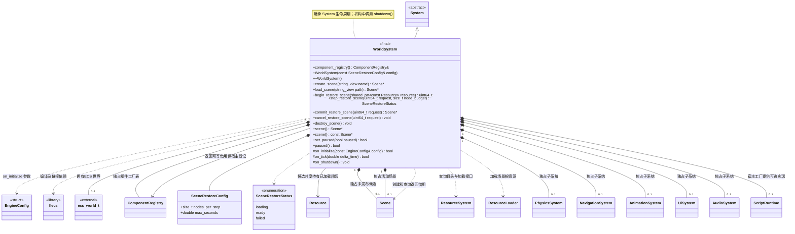

# 世界系统

[类图索引](../../class-diagrams/index.md) · [引擎与系统](engine-system.md) · [完整引用关系](../../class-diagrams/references.md)

本图仅定义 `WorldSystem` 的方法；其他节点为跨图引用或第三方类型。

> **世界暂停已实现。** `set_paused()` / `paused()` 及下述暂停约定已按批准契约实现，并通过本轮 Debug / Release 定向测试。行为与限制见[世界暂停](../world-pause.md)。`Engine` / `System` 的通用调度契约保持不变。

- 由 `Engine` 拥有的根系统；持有一个 flecs 世界，初始化与销毁调用成对。
- `on_tick()` 推进 ECS 世界；之后由 `System` 按加入顺序更新子系统。暂停时世界自身略过 ECS 推进；子系统仍获得调度，由实际模拟系统读取 `paused()` 决定是否推进。场景节点使用 flecs 实体标识，节点变换与组件只有一份 C++ 状态。
- `RuntimeHost` 通过 `add_subsystem()` 将子系统所有权移交世界系统；当前顺序为字体、界面、导航底层、可选脚本、`before_physics` 插件、物理、动画、`after_physics` 插件、音频，详见[运行宿主](runtime-host.md)。关闭子系统后再销毁 ECS 世界。
- 只有已初始化的世界可创建一个活动场景，已有场景时返回空指针。`destroy_scene()` 可重复调用；关闭时在释放 ECS 世界前销毁场景。每次成功创建分配递增的场景标识，关闭再初始化不重用，供脚本与渲染器拒绝旧引用。
- `scene()` 返回可空借用，`destroy_scene()` 或世界关闭后失效；只读重载为 `const`，查询与销毁为 `noexcept`。初始化失败和清理遵守[系统约定](engine-system.md)。

C++ 限定符：构造、析构及 `on_shutdown()` 为 `noexcept`；析构和受保护钩子标注 `override`，返回状态的钩子标注 `[[nodiscard]]`。

`load_scene(string_view path)` 从当前 ResourceCatalog 读取场景，建立候选 Scene 并校验全部节点/组件/父子和资源引用；成功替换活动场景，失败保留当前场景。

`begin_restore_scene` 只接受已加载的场景资源并返回非零请求身份；每个世界最多一个候选。`step_restore_scene` 在主线程按节点数和时间预算创建节点/组件、恢复父子，预算默认每步最多 64 项、1 ms；单个组件恢复不可抢占。资源读取和解码已在前一阶段完成，候选不作为活动场景更新。ready 后由调用方显式 commit；失败/取消保持旧场景。代际、请求身份和世界生命周期均在提交时重新校验。新场景创建/切换及世界关闭取消候选，过期请求不能取消新请求。同步 load_scene 保留原语义。脚本既有 BeginLoadScene/StepSceneLoad/CommitSceneLoad 共用此链路，玩法无需管理线程。

宿主在加载场景前通过 `component_registry()` 登记插件组件；WorldSystem 拥有登记表，Scene 在恢复时借用，不引用具体插件。登记函数地址须保持有效直到世界关闭。

## 世界暂停契约

- `set_paused(bool paused)` 为 `[[nodiscard]]`、`noexcept`，仅在世界已初始化且存在活动场景时成功；重复设置幂等。拒绝时保留原状态。`paused()` 为 `[[nodiscard]]`、`const`、`noexcept`，无活动场景或世界未初始化时返回 `false`。
- 暂停是 WorldSystem 持有的一个临时 `bool`，不进入场景 schema、资源、存档或 EngineConfig，不增加系统类型枚举、暂停驱动器或通用调度阶段。世界只记录调用方的明确请求，不判断菜单、项目、编辑器或窗口状态。
- 暂停期间不推进 ECS 与各原生世界模拟；字体、UI、输入、渲染和活动 `Gameplay.Update()` 继续执行。项目在 Gameplay 中处理菜单，再根据自身的暂停/页面状态决定是否调用自己的玩法更新；现有脚本插件没有独立逐组件 `Update()` 调度，暂停功能不增加该框架。
- 已完成的本帧工作不回滚；设置后尚未执行的模拟系统在本次调度读取最新状态，已经执行的系统从下一帧起暂停。恢复时只消费正常新帧时长，不累积暂停时长、不补算历史帧；不能用传入 `0` 秒代替暂停。
- 成功创建或替换活动场景、销毁场景及世界关闭时恢复 `false`；加载失败保留旧场景及其暂停状态。仅预检而未激活的候选 Run 不能设置或复位活动世界的暂停状态。Run 停止时由现有会话/绑定的场景释放链清理其拥有的场景，不能借候选 Run 析构清理另一 Run 的状态。
- 脚本通过现有 `SceneBinding` 提供实例 `SetPaused(bool): boolean` 与 `GetPaused(): boolean | null`；只允许活动回调通过当前 Run 所拥有的活动 Scene 身份访问 WorldSystem。旧句柄/不活动回调设置失败、查询为空；不新增原生 `Scene` 持久字段或引擎项目策略。
- 各模拟系统继续只依赖核心 `WorldSystem` 查询；WorldSystem 不反向 include、链接或扫描具体插件。音频仍由 RuntimeHost 合并窗口不可绘制与世界暂停两项原因，复用已有 `AudioSystem::set_paused()`，不把项目菜单逻辑加入音频或世界核心。
