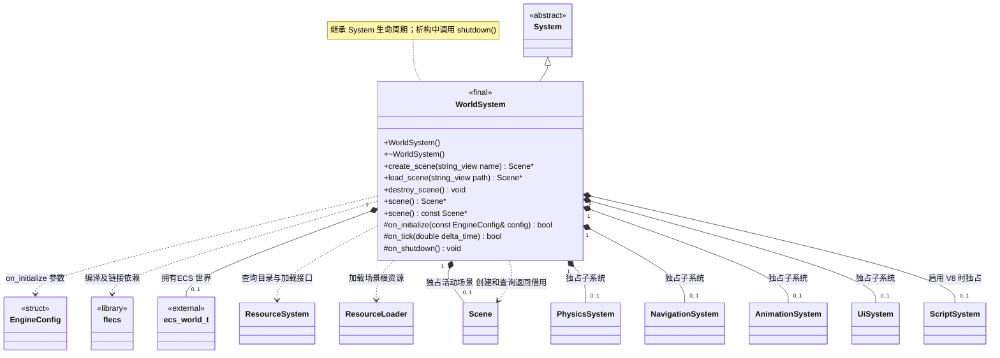

# 世界系统

[类图索引](../../class-diagrams/index.md) · [引擎与系统](engine-system.md) · [完整引用关系](../../class-diagrams/references.md)

本图仅定义 `WorldSystem` 的方法；其他节点为跨图引用或第三方类型。

- 由 `Engine` 拥有的根系统；持有一个 flecs 世界，初始化与销毁调用成对。
- `on_tick()` 推进 ECS 世界；之后由 `System` 按加入顺序更新子系统。场景节点使用 flecs 实体标识，节点变换与组件只有一份 C++ 状态。
- `RuntimeHost` 装配物理、导航、动画、界面及可选脚本子系统，通过 `add_subsystem()` 将所有权移交世界系统。关闭子系统后再销毁 ECS 世界。
- 只有已初始化的世界可创建一个活动场景，已有场景时返回空指针。`destroy_scene()` 可重复调用；关闭时在释放 ECS 世界前销毁场景。每次成功创建分配递增的场景标识，关闭再初始化不重用，供脚本与渲染器拒绝旧引用。
- `scene()` 返回可空借用，`destroy_scene()` 或世界关闭后失效；只读重载为 `const`，查询与销毁为 `noexcept`。初始化失败和清理遵守[系统约定](engine-system.md)。

C++ 限定符：构造、析构及 `on_shutdown()` 为 `noexcept`；析构和受保护钩子标注 `override`，返回状态的钩子标注 `[[nodiscard]]`。

`load_scene(string_view path)` 从当前 ResourceCatalog 读取场景，建立候选 Scene 并校验全部节点/组件/父子和资源引用；成功替换活动场景，失败保留当前场景。
