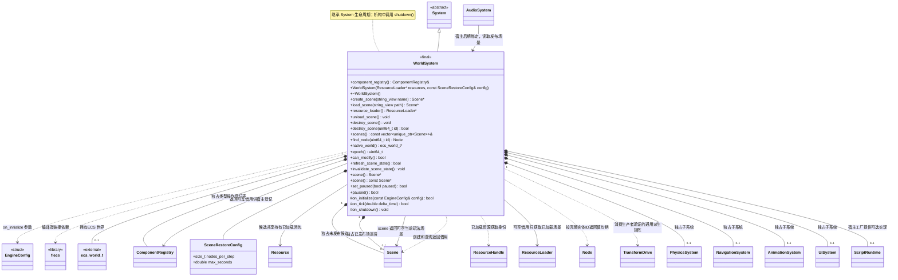

# 世界系统

候选与追加批次的唯一公开方法定义见[场景范围契约](scene-loading.md#worldsystem-的候选和批次边界)。

[类图索引](../../class-diagrams/index.md) · [引擎与系统](engine-system.md) · [完整引用关系](../../class-diagrams/references.md)

本图仅定义 `WorldSystem` 的方法；其他节点为跨图引用或第三方类型。

`set_paused()` / `paused()` 的行为与限制见[世界暂停](../world-pause.md)，实际验证范围统一见[测试文档](../../testing.md)。`Engine` / `System` 的通用调度契约保持不变。

- 由 `Engine` 拥有的根系统；持有一个 flecs 世界，初始化与销毁调用成对。
- `on_tick()` 校验帧时长、回收空常驻场景并刷新派生场景状态；之后由 `System` 按加入顺序更新子系统，不另启 Flecs 调度器。暂停时仍刷新可见性与层级，实际模拟系统读取 `paused()` 决定是否推进。场景节点属性、层级、具体组件生成数据及领域运行列唯一存入 Flecs；Node/Component 只是身份值句柄，系统以有类型查询消费 Published 实体。
- `RuntimeHost` 通过 `add_subsystem()` 将子系统所有权移交世界系统；当前顺序为字体、界面、导航底层、可选脚本、`before_physics` 插件、物理、动画、`after_physics` 插件；音频由宿主独占并在世界之后单独更新，详见[运行宿主](runtime-host.md)。关闭子系统后再销毁 ECS 世界。
- 只有已初始化的世界可创建一个活动场景，已有场景时返回空指针。`destroy_scene()` 可重复调用；关闭时在释放 ECS 世界前销毁场景。每次成功创建分配递增的场景标识，关闭再初始化不重用，供脚本与渲染器拒绝旧引用。
- `scene()` 返回可空借用，`destroy_scene()` 或世界关闭后失效；只读重载为 `const`，查询与销毁为 `noexcept`。初始化失败和清理遵守[系统约定](engine-system.md)。

C++ 限定符：构造、析构及 `on_shutdown()` 为 `noexcept`；析构和受保护钩子标注 `override`，返回状态的钩子标注 `[[nodiscard]]`。

`load_scene(string_view path)` 通过 acquire_loaded 获取当前目录中已加载的场景，建立候选 Scene 并校验全部节点/组件/父子和资源引用；成功替换活动场景并保留旧场景常驻子树，失败保留当前场景。

异步恢复、封存、发布及模拟激活使用 SceneScopeId，状态和预算见[场景范围契约](scene-loading.md)。普通查询只返回已发布节点；领域准备通过明确 scope 访问同一世界中的候选。

宿主在加载场景前通过 `component_registry()` 登记插件组件；WorldSystem 拥有登记表，Scene 在恢复时借用，不引用具体插件。登记函数地址须保持有效直到世界关闭。

## 世界暂停契约

- `set_paused(bool paused)` 为 `[[nodiscard]]`、`noexcept`，仅在世界已初始化且存在活动场景时成功；重复设置幂等。拒绝时保留原状态。`paused()` 为 `[[nodiscard]]`、`const`、`noexcept`，无活动场景或世界未初始化时返回 `false`。
- 暂停是 WorldSystem 持有的一个临时 `bool`，不进入场景 schema、资源、存档或 EngineConfig，不增加系统类型枚举、暂停驱动器或通用调度阶段。世界只记录调用方的明确请求，不判断菜单、项目、编辑器或窗口状态。
- 暂停期间不推进各原生世界模拟，ECS 派生状态仍可刷新；字体、UI、输入、渲染和活动 `Gameplay.Update()` 继续执行。项目在 Gameplay 中处理菜单，再根据自身的暂停/页面状态决定是否调用自己的玩法更新；现有脚本插件没有独立逐组件 `Update()` 调度，暂停功能不增加该框架。
- 已完成的本帧工作不回滚；设置后尚未执行的模拟系统在本次调度读取最新状态，已经执行的系统从下一帧起暂停。恢复时只消费正常新帧时长，不累积暂停时长、不补算历史帧；不能用传入 `0` 秒代替暂停。
- 成功创建或替换活动场景、销毁场景及世界关闭时恢复 `false`；加载失败保留旧场景及其暂停状态。仅预检而未激活的候选 Run 不能设置或复位活动世界的暂停状态。Run 停止时由现有会话/绑定的场景释放链清理其拥有的场景，不能借候选 Run 析构清理另一 Run 的状态。
- 脚本通过现有 `SceneBinding` 提供实例 `SetPaused(bool): boolean` 与 `GetPaused(): boolean | null`；只允许活动回调通过当前 Run 所拥有的活动 Scene 身份访问 WorldSystem。旧句柄/不活动回调设置失败、查询为空；不新增原生 `Scene` 持久字段或引擎项目策略。
- 各模拟系统继续只依赖核心 `WorldSystem` 查询；WorldSystem 不反向 include、链接或扫描具体插件。RuntimeHost 仅因窗口不可绘制暂停音频设备；AudioSystem 自行读取世界暂停值以暂停场景声部，独立影片不随世界暂停。不把项目菜单逻辑加入音频或世界核心。

## 常驻节点与精确清理

- `unload_scene()` 取消恢复候选、复位暂停并卸载普通节点；保留常驻根及其子树的原 Scene 容器，释放旧场景根资源，`scene()` 为空。切换场景采用相同保留规则，只在候选完成后发布新场景。
- `scenes()` 返回全部已发布容器的只读拥有者列表借用，不包含恢复候选；只有 `scene()` 指向当前玩法场景。各系统按存活节点增量同步，迭代器不能跨场景变更持有。
- `find_node(id)` 校验完整实体 ID、世界代次及 Published 标记，返回 Node 值句柄；未发布恢复候选不对运行查询可见。
- 无参 `destroy_scene()` 完整清理活动、常驻及恢复候选，保留停止/关闭语义。带 ID 重载无条件释放指定的已发布容器及其节点，不存在返回 false；仅删除当前场景时复位暂停，不取消其他恢复候选。脚本用后者精确清理所属场景，宿主结束整个会话用前者。
- 上述查询及清理均为 `noexcept`，返回值标记 `[[nodiscard]]`；列表查询为 `const`。详见[常驻节点与场景切换](persistent-nodes.md)。

`native_world()` 返回初始化期有效的 Flecs 借用，未初始化为 nullptr；核心通用框架不包含第三方类型定义。`refresh_scene_state()` 在无在途列借用的协调安全点按 ChildOf 层级更新有效标记和世界矩阵，无修改快速返回；调用失败不继续消费旧状态。`can_modify()` 检查当前 ECS 写入阶段，`invalidate_scene_state()` 标记派生缓存需刷新。epoch 在世界重新初始化时变化，旧句柄不能复活；对象借用寿命见 [ECS 场景](ecs-scene.md)。

World 只消费 `TransformDrive` 的矩阵和生产者提供的只读有效性函数，不解释 BoneAttachment、Animator、骨架或播放状态。函数指针借用的代码须覆盖 drive 的存活期，签名为 `bool(Node owner, uint64_t owner_instance_id) noexcept`；必须先检查所属组件实例仍有效，失效时返回 false，不解引用旧运行列。该函数不得修改 ECS、刷新世界缓存或重入 `refresh_scene_state()`。节点及 Transform 的启用检查仍由通用层级刷新负责；生产者负责本领域来源校验、发布/撤销，以及相关状态变化时使派生缓存失效。
