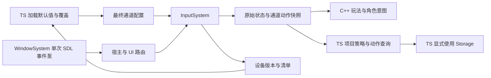
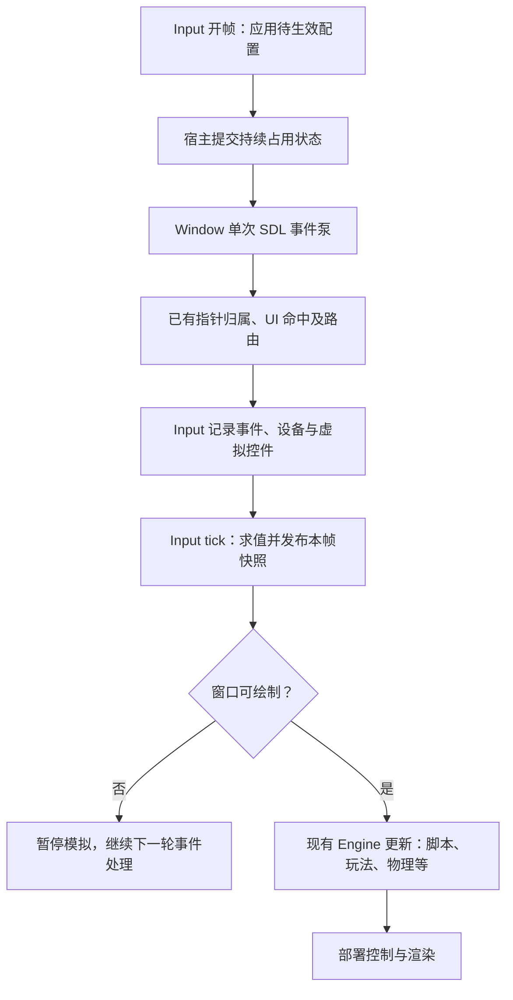

# 输入模块

输入由核心 InputSystem 统一采集和求值，WindowSystem 只保留窗口与单次事件泵。原生接口、生成数据和脚本 SDK 共用下述契约；平台构建见[构建指南](../building.md)，运行验证范围见[测试与范例](../testing.md)。

[原生类图](class-diagrams/input-system.md) · [数据契约](class-diagrams/input-data.md) · [脚本接口](../plugins/runtime/class-diagrams/input-script-api.md)

## 确定的职责边界

**TS 负责加载、覆盖、保存和决定绑定；C++ 负责设备事实与执行调用方明确提交的规则。**

| 范围 | 负责方 |
| --- | --- |
| 动作命名、默认配置来源、玩家覆盖、合并与迁移、绑定冲突如何处理 | 项目 TS |
| 哪个手柄属于哪个玩家、是否共用设备、断开后暂停与否、重连后如何恢复 | 项目 TS |
| 何时启用游戏 / 菜单 / 编辑器输入、重绑定期间阻止哪些动作 | TS 或对应宿主调用方 |
| SDL 设备枚举、状态、热插拔、按键边沿、轴处理、触摸识别、映射校验与求值 | 原生 InputSystem |
| UI 命中、文本输入焦点、模态遮挡、UI 指针路由和可见控件表现 | UiSystem 与宿主；业务由 TS 编排 |
| JSON / KV 的读取和保存时机 | 项目 TS 显式调用已有 Storage |

InputSystem 不读取项目 settings、资源文件、JSON、Storage 或平台偏好设置，不合并默认值与覆盖，不自动保存、选择第一个手柄、选择玩家或恢复配对。原生可以提供校验和捕获结果，但何时采用哪份配置由调用方决定。

默认配置放在项目 TS 模块，通过普通 import 随脚本编译、打包。TS 解析自己的覆盖数据并提交最终结构；不新增 `.input` 资源、AssetKind、资源解码器或配置加载器。showcase 的 [character_controls.ts](../../projects/showcase/assets/scripts/character_controls.ts) 演示配置、Storage 覆盖和显式配对，属于项目策略。

## 最小组成

- 原生行为类只有 `InputSystem`，继承 System。它统一拥有设备句柄、状态、通道、绑定运行数据、触摸占用及重绑定捕获状态。
- 动作、绑定、通道配置、区域、设备描述、状态和句柄均为普通生成数据，由 `include/schemas/runtime/input.fbs` 生成 C++ / TS 模型；不另建 Action、Context、DeviceManager、PlayerInputManager 等所有者层次。
- 脚本插件通过 `InputBinding` 做逐类绑定、数据转换、有效回调检查和本 Run 创建句柄的清理；`Input` 是脚本静态门面。
- RuntimeHost 独占 InputSystem，借用关系遵循窗口先创建、最后关闭。输入不属于 Scene / World，不因切场景重建设备。

## 通道与最终绑定

动作通过 `(channel, action_name)` 查询。通道只是独立作用域，不认识玩家、场景或游戏模式。TS 可以创建两个玩家通道，也可以创建菜单、编辑器或重绑定用途的通道；这些名字和用途没有原生特判。

最终通道配置包含动作定义、具体连接设备与控件、绑定处理参数、虚拟触摸控件，以及显式优先级和消费选项。一个动作允许多个来源；同一设备能否服务多个通道由 TS 提交结果决定。

| 动作类型 / 值模式 | 含义与合成规则 |
| --- | --- |
| Button | 各来源独立记录再合成；任意有效来源保持即 held，只有聚合状态变化产生 pressed / released |
| Axis1D / state | 持续标量，如扳机、左右方向合成；按配置处理死区、反转和比例 |
| Axis2D / state | 持续向量，如 WASD 或摇杆；数字方向可归一化，模拟杆保留有效幅度 |
| Axis1D / delta、Axis2D / delta | 本帧累计增量，如滚轮、鼠标移动、拖动；每输入帧清零，可超过单位范围 |

持续轴和增量不能隐式混合。项目可以使用 `look_rate` 与 `look_delta` 两个动作，由原生玩法或轻量角色输入组织代码分别处理；鼠标位移不乘 deltaTime，摇杆转动速率在控制器按时间积分。InputSystem 不猜测角度、摄像机灵敏度单位或游戏时间倍率。

| 来源 | 原生输出范围与单位 |
| --- | --- |
| 按钮、键、数字方向分量 | 0 / 1；方向由绑定权重形成 -1 / 0 / 1 |
| 标准摇杆 | 各分量归一化到 [-1, 1]，径向死区及单位圆限幅按配置处理 |
| 标准扳机 | [0, 1]，不把未按下解释成 -1 |
| 原始 Joystick 轴 / hat | 轴归一化到 [-1, 1]，hat 方向分量为 -1 / 0 / 1；不猜测非标准轴用途 |
| 鼠标位置 / 普通移动 | 位置为窗口逻辑坐标，普通指针位移为该坐标的差；相对模式另保留 SDL 相对移动单位，不冒充 drawable 像素 |
| 滚轮 | SDL 浮点滚动量，保留小数并统一方向，不当作像素距离 |
| 虚拟摇杆 / 拖动 | 摇杆为单位圆内向量；拖动为窗口逻辑坐标增量 |
| 原始触点 | 设备归一化坐标原样保留，可能越出 [0, 1]；另提供转换后的窗口逻辑坐标 |

state / delta 相同也不代表单位相同。首版同一个 delta 动作只合成单位相同的来源，混合滚轮、逻辑位移及相对模式鼠标单位的配置拒绝提交；项目使用独立动作与灵敏度在调用方转换，不在原生建立通用量纲框架。

持续轴提供明确的合成选择：取最大幅度，或相加后限幅。数字二维移动默认建议单位圆限幅，避免斜向加速；扳机转 Button 使用独立按下 / 松开阈值，避免阈值附近反复触发。修饰键、按键组合、正负方向和多来源均为数据，不给业务动作增加专用 C++ 分支。

`configure_channel` 整份校验并提交，类型冲突、重复动作定义、非法数值或失效句柄返回失败，保留旧配置和上一份成功待生效配置。可暂时不可用的设备来源保持中性，不转绑其他设备；TS 持久配置中的逻辑设备槽必须先解析为会话连接身份再提交。

成功提交在下一次输入开帧原子生效。完整配置和启停按调用顺序修改同一份待生效状态：完整配置替换全部字段，启停只改 enabled / activation，失败不改变待生效状态。Update 内提交不会改变本帧已发布状态，OnInitialize 提交在首个输入帧生效。销毁立即使句柄失效；安全取消立即移除工作缓冲中的贡献，结果在玩法更新前发布。

重新启用 / 替换映射时，调用方明确选择 `wait_for_neutral` 或 `use_current_state`：前者等待被保持的键、轴或触点回中 / 结束，后者以当前保持值建立基线；两者都不因配置变化伪造 pressed，也不复用旧增量。

## 设备覆盖与多手柄

设备能力以当前固定 SDL 3.4.20 实际可报告的输入为准：

- 键盘覆盖有效 scancode，修饰键可以参与组合；文字与输入法使用独立 TEXT_INPUT / TEXT_EDITING 链路。按键位置标识和展示名称分开，不从按键事件拼中文。
- 鼠标支持设备上报的按钮、侧键、双向滚轮、窗口逻辑坐标和相对位移。可区分来源的平台保留设备身份，无法区分的键鼠明确呈现为聚合来源。
- 标准 Gamepad 支持其按钮、摇杆和扳机；原始 Joystick 提供非标准按钮、轴及方向帽。已识别 Gamepad 使用标准通路，不将同设备的 Joystick 事件重复计算为第二份动作。
- 多手柄分别枚举、打开、保存状态和关闭，不在引擎中写死单手柄或四个玩家。通道绑定指向明确的连接身份，动作不会因设备相邻或同型号而混到一起。
- 触摸保留设备和 contact 身份、归一化原始坐标、逻辑坐标及可用压力；手柄触摸板按设备能力单独描述，不冒充屏幕触摸。

`device_revision` 在初始枚举及连接、断开、映射 / 能力变化时递增。`devices()` 返回最近发布的清单，是该快照的连接事实；清单和版本一起发布，事件泵中不暴露半份变化。TS 发现版本变化后重新枚举，对比自己的配对表；不依赖只存在一帧的连接事件，不为此新增事件总线。

| 情况 | 原生行为 | TS 策略 |
| --- | --- | --- |
| 启动时已连接多个手柄 | 枚举全部设备并发布清单 | 决定是否等待按键加入，或采用项目规则配对 |
| 某手柄断开 | 关闭对应句柄，立即移除其贡献、清零轴和触摸占用，更新设备版本 | 保留玩家逻辑槽与持久映射，决定暂停、提示或切换输入 |
| 手柄重新接入 | 建立新的连接身份并发布清单，不复活旧绑定引用 | 选择待恢复槽，按设备信息或确认输入配对，再提交新绑定 |
| 同型号多个手柄 | 各自保留连接身份 | 型号 GUID / 名称只是提示，不能当作唯一玩家身份 |
| 后台拔插后返回 | 输入仍在后台处理设备变化，恢复后清单反映当前连接 | 根据设备版本重新核对，不依赖收到每个中间事件 |

连接 ID 不写入长期覆盖数据。持久配置保存项目逻辑设备槽与稳定控件标识；TS 解析连接身份。断开一个来源不会取消同一动作仍由另一有效来源维持的状态；最后一个来源被断开时标为 canceled，不当作正常 released 触发松手技能。

## 状态、UI 与触摸路由

InputSystem 同时记录设备事实和路由资格。UI 消费事件不会阻止原始状态更新，尤其释放、取消、失焦、后台和设备移除必须处理。UI 占用的按下保持归属直到释放，即使 UI 中途关闭，也不会突然变成新的玩法按下。

宿主在开帧后、事件泵前通过 `set_routing_state` 提交键盘 / 指针持续占用，即使没有 SDL 事件也要提交；UI 在泵内改变占用时再次提交。`process_event` 单独接收本事件已被认领的 bool。外部取得占用时，原生取消工作缓冲中相应已有贡献，并对仍保持的输入等待回中；InputSystem 不认识 RmlUi、文本框或菜单。通道优先级与消费同样按 TS 提交参数执行，不从动作名推断优先级。

每个输入帧发布稳定、非消费式快照，带 frame_id。初始化先发布 frame_id 为 0 的设备和原始状态基线；事件泵中普通查询仍读取上一份完整快照，tick 才发布新的设备、控件及动作结果。宿主 `owns_pointer` 为即时路由读取工作缓冲的 capture，是明确例外。任意消费者重复查询结果一致，不能由第一个读取者取走 pressed。同帧按下再松开同时保留 pressed 和 released；键盘 repeat 不重复生成玩法 pressed，文本编辑重复事件保留。物理子步复用持续值，跳跃边沿和视角增量由调用方每个输入帧只提交一次，不在 InputSystem 重建物理固定步队列。

触摸的原生处理规则：

1. 已有 capture 优先交原拥有者；新的 down 先经宿主的活动 UI / 模态命中，再命中 InputSystem 的虚拟区域。背景 HUD 不应仅因可见就阻止全部触摸。
2. `button`、`stick`、`drag` 虚拟控件分别输出按钮、持续二维轴和累计位移，作为普通绑定来源。区域、大小、锚点、浮动 / 固定中心、死区和优先级均可配置；不写死左右半屏。`enabled=false` 或 `visible=false` 均不参与虚拟命中和值输出；实际绘制由项目 UI 负责，InputSystem 不绘制控件。
3. capture 以设备和 contact 身份跟踪，直到 up 或 cancel；移出区域不转交其他控件。多根手指可同时控制移动、视角和开火；取消一个触点不影响另一个触点或其他设备来源。
4. 使用窗口逻辑坐标统一鼠标、触摸和 UI；安全区和显示区域由调用方明确提交，不能混用 drawable 像素尺寸。窗口旋转、布局替换、控件移除 / 禁用、外部模态接管及失焦执行取消，等待新 down。
5. 控件运动、占指、限幅和虚拟控件求值在 C++ 完成，TS 不逐 motion 处理。基础配置直接给原生布局，InputSystem 不读取 DOM；本模块未提供自动从 RmlUi 控件计算区域的绑定，也没有 tap / pinch / longpress 等独立手势 API。
6. 原生 UI 桥接收认领的触摸并生成 UI 指针语义，不重新注入 SDL 队列。首版 RmlUi 普通 UI 使用一个被认领的触摸指针，多指游戏控件仍独立并行；不承诺同一文档多个手指独立拖拽。
7. SDL touch→mouse、mouse→touch 合成统一关闭并过滤合成来源；同步补 UI 触摸桥，保留 Android 普通按钮能力，避免一次操作重复触发。

UI 业务事件仍为 click / change / input。普通 RmlUi 文档由单个触摸指针桥接，虚拟摇杆与多指游戏区域由 InputSystem 独立跟踪；不通过高频脚本指针事件补齐。

文本输入与 SDL 硬件映射同样保持独立：文字 / 输入法组合由 UI 文本链路处理；SDL 的 Gamepad mapping 负责将硬件布局转成标准按键位置，项目 TS 的动作绑定负责将这些控件映射到 move / fire 等业务动作，两者不能共用一份配置或相互覆盖。

## 重绑定流程

TS 决定进入重绑定，停用或调整相关通道后请求原生捕获。捕获只返回候选控件或组合，不自动修改映射、处理冲突、保存或决定其他通道是否停用。

捕获限定设备 / 控件类型，受理后在下次开帧开始；当前泵中的启动操作即使尚未交给 InputSystem，也不能成为候选。开帧时已保持的键 / 按钮先等待松开，轴先经过中性区再越过有效阈值。每通道最多一个活动捕获；状态为 waiting / completed / canceled。捕获、通道均有带代次句柄，旧 token 不能取消新捕获。已完成或取消的结果保留到该通道下一次成功捕获请求或通道销毁，候选是连接会话信息，TS 转换为自己的持久标识。

TS 检查当前上下文中的冲突，再决定替换、交换、允许共用或取消，合并为完整最终配置并重新提交；之后显式调用 Storage 保存覆盖。原生提交失败保留旧有效配置，TS 自行决定如何展示和恢复输入。

## 宿主时序与生命周期

RuntimeHost 初始化 WindowSystem 后创建并初始化 InputSystem；输入在窗口暂停判断之前持续更新，不登记进 World，也不再次调用 SDL_PollEvent。设备版本保证后台变化可在 TS 恢复后核对。失焦 / 后台等安全取消递增 cancel_revision，恢复后调用方在物理前核对该版本并清除已提交给 Motor 的待执行意图；InputSystem 不反向依赖角色插件。

脚本工厂与 BindingContext 增加 InputSystem 借用，生命周期覆盖 Run。绑定只在活动回调使用；候选预检与模块顶层不创建通道、捕获或修改设备。Run 只可修改自己创建的通道与捕获；停止时先执行 OnShutdown，再由绑定清理其句柄、触摸占用和待提交修改，旧 Run 不能操作新 Run。设备本身继续由宿主持有，TS 重启后重新加载配置和配对。

关闭顺序为玩法与绑定清理 → 世界及 UI / 角色消费者 → InputSystem → WindowSystem。输入初始化失败按已有状态回滚；没有手柄只是清单中无该设备，不等同初始化失败。

## 预算、调用方与限制

配置预算和失败原子性以[输入系统类图](class-diagrams/input-system.md#捕获和错误)为唯一说明；脚本对象桥的输入限制见[脚本接口](../plugins/runtime/class-diagrams/input-script-api.md)。数据字段沿用 schema 的 snake_case，uint64 在 TS 使用 bigint。桥接转换不读取或保存 JSON 文件。

- WindowSystem 删除六键枚举、三按钮状态与相关查询，保留窗口、生命周期、退出状态和单次事件泵；已有项目和编辑器调用方直接升级，不保留旧输入兼容层。
- CharacterControllerSystem 删除 Window 借用和固定 WASD / Space / Tab fallback，保留调用方明确提交 CharacterInput 的路线。多通道与角色的关联由玩法决定，输入模块不选择场景节点；完整多角色控制属于角色插件的独立契约。
- RuntimeHost 调整输入所有权、事件串联及脚本工厂参数；UiSystem 增加原生触摸桥和明确捕获信息，不把 UI 策略塞入 InputSystem。
- InputBinding 提供同一原生能力，TS 只做配置与少量动作查询。编辑器也作为普通调用方提交自己的通道，不在核心加入编辑器模式。
- 验收围绕全键与组合、多来源边沿、同帧短按、摇杆死区、多个手柄独立输入、断开 / 重连、前后台变化、多指操作、UI 阻止穿透、配置失败保留旧映射和 Run 清理；不以能显示输入数值代替完整链路。

输入通道支持多个逻辑玩家，角色控制器仍是当前选中角色的输入 / 相机策略，未实现一份 CharacterControllerSystem 同时驱动多个玩家。设备震动、传感器与独立手势识别也不属于当前输入 SDK。本文说明当前代码契约，实际平台验证以[测试与范例](../testing.md)的记录为准。

## 参考与取舍

当前依赖固定 SDL 3.4.20；设备与事件接口对应上游 [SDL_events.h](https://github.com/libsdl-org/SDL/blob/release-3.4.20/include/SDL3/SDL_events.h)、[SDL_gamepad.h](https://github.com/libsdl-org/SDL/blob/release-3.4.20/include/SDL3/SDL_gamepad.h) 和 [SDL_mouse.h](https://github.com/libsdl-org/SDL/blob/release-3.4.20/include/SDL3/SDL_mouse.h)。最初输入设计采用 3.2.24 的接口子集；升级库不自动向引擎 SDK 暴露新的设备能力，仍以已实现绑定及实际验证为准。

本地 `references/The-Forge-master` 的 `InputCommon.h`、`TouchInput.h` 支持采用统一动作来源和原生虚拟触摸的方向；本设计另行处理多来源边沿、独立通道及热插拔，不继承其固定容量、直接求和或固定半屏区域。Ant 的原生输入 / 脚本业务分工可作为参考，但本项目将逐事件映射和触摸运动留在 C++，避免高频脚本转发。
